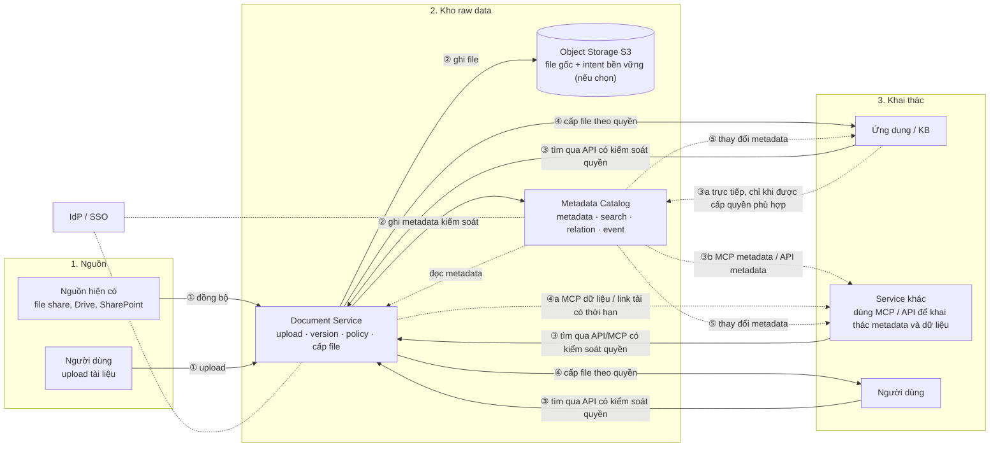

# ĐỀ XUẤT XÂY DỰNG KHO LƯU TRỮ VÀ QUẢN LÝ TÀI LIỆU DÙNG CHUNG

> **Trạng thái:** Bản dự thảo đã rà soát kiến trúc; các khả năng phụ thuộc sản phẩm phải được kiểm chứng qua thử nghiệm (PoC – Proof of Concept) trước khi phê duyệt triển khai.  
> **Định hướng:** Kho quản lý **raw data** (dữ liệu gốc) và metadata (thông tin mô tả dữ liệu) dùng chung; cung cấp dữ liệu nguồn cho hệ thống tri thức (Knowledge Base – KB) và những ứng dụng khác.  
> **Hướng công nghệ:** Kho lưu file gốc (Object Storage tương thích S3) + hệ thống quản lý metadata (Metadata Catalog, với OpenMetadata là ứng viên ưu tiên và DataHub đối chứng) + dịch vụ quản lý tài liệu (Document Service). Quyết định cuối cùng dựa trên kết quả thử nghiệm ở mục III và VI.  
> **Use case minh họa:** Quản lý văn bản, tài liệu trong dự án phát triển phần mềm.  
> **Giới hạn phạm vi:** Giai đoạn này tiếp nhận và lưu giữ dữ liệu đúng định dạng gốc (PDF, DOCX, XLSX, PPTX, ...), quản lý metadata, phiên bản và truy xuất. Chuẩn hóa nội dung về một định dạng thống nhất như Markdown (.md) thuộc giai đoạn sau (xem mục 2.1).  
> **Lưu ý:** Các vấn đề nêu ra là giả thuyết cần kiểm chứng. Kiến trúc ba lớp là định hướng, chưa mặc định catalog đáp ứng đủ tìm kiếm theo custom metadata, liên kết hai chiều hoặc ràng buộc phiên bản. Sản phẩm, giải pháp lưu trạng thái xử lý, hạ tầng và chi phí chốt sau PoC. Giá trị ghi **(đề xuất)** hoặc **[cần xác định]** cần xác nhận trước khi phê duyệt triển khai.

## MỤC LỤC

- [TÓM TẮT ĐỀ XUẤT (EXECUTIVE SUMMARY)](#tom-tat-de-xuat)
- [I. TỔNG QUAN (WHY — Sự cần thiết)](#chuong-i)
  - [1.1. Bối cảnh](#muc-1-1)
  - [1.2. Các vấn đề cần giải quyết](#muc-1-2)
  - [1.3. Mục tiêu xây dựng](#muc-1-3)
  - [1.4. Nguyên tắc thiết kế](#muc-1-4)
- [II. PHẠM VI VÀ YÊU CẦU HỆ THỐNG (WHAT — Cần xây dựng gì)](#chuong-ii)
  - [2.1. Phạm vi dữ liệu](#muc-2-1)
  - [2.2. Yêu cầu chức năng](#muc-2-2)
  - [2.3. Yêu cầu quản lý metadata](#muc-2-3)
  - [2.4. Yêu cầu quản lý phiên bản, trạng thái và liên kết](#muc-2-4)
  - [2.5. Yêu cầu truy xuất và tích hợp](#muc-2-5)
  - [2.6. Yêu cầu phân quyền đầu-cuối](#muc-2-6)
  - [2.7. Yêu cầu phi chức năng](#muc-2-7)
  - [2.8. Use case minh họa — Quản lý văn bản cho dự án phần mềm](#muc-2-8)
- [III. KIẾN TRÚC VÀ GIẢI PHÁP CÔNG NGHỆ (HOW — Phương án thực hiện)](#chuong-iii)
  - [3.1. Phương án lựa chọn](#muc-3-1)
  - [3.2. Vì sao không ưu tiên hệ quản lý tài liệu chuyên dụng](#muc-3-2)
    - [3.2.1. So sánh các nền tảng wiki (Nimbalyst, Wiki.js, BookStack, Outline, Confluence)](#muc-3-2-1)
  - [3.3. Kiến trúc tổng thể](#muc-3-3)
  - [3.4. Thành phần và công nghệ đảm nhận](#muc-3-4)
  - [3.5. Vì sao cần Document Service](#muc-3-5)
  - [3.6. Ánh xạ mô hình dữ liệu vào catalog](#muc-3-6)
  - [3.7. Vì sao ưu tiên OpenMetadata, DataHub là đối chứng](#muc-3-7)
  - [3.8. Lựa chọn Object Storage](#muc-3-8)
  - [3.9. Luồng quản lý và khai thác tài liệu](#muc-3-9)
  - [3.10. Quyết định kiến trúc còn mở](#muc-3-10)
- [IV. TIÊU CHÍ ĐÁNH GIÁ VÀ NGHIỆM THU (HOW WELL — Mức độ đáp ứng)](#chuong-iv)
  - [4.1. Chất lượng quản lý tài liệu](#muc-4-1)
  - [4.2. Tìm kiếm, tích hợp và vận hành](#muc-4-2)
  - [4.3. Kiểm chứng use case dự án phần mềm](#muc-4-3)
  - [4.4. Điều kiện nghiệm thu](#muc-4-4)
- [V. PHÂN TÍCH NHU CẦU TÀI NGUYÊN (HOW MUCH — Nguồn lực cần thiết)](#chuong-v)
  - [5.1. Thông số cần khảo sát](#muc-5-1)
  - [5.2. Nhóm tài nguyên](#muc-5-2)
  - [5.3. Nhân lực và chi phí](#muc-5-3)
- [VI. KẾ HOẠCH TRIỂN KHAI (WHEN — Lộ trình)](#chuong-vi)
  - [6.1. Các giai đoạn](#muc-6-1)
  - [6.2. Kế hoạch thử nghiệm (PoC)](#muc-6-2)
  - [6.3. Migrate và mô hình vận hành](#muc-6-3)
  - [6.4. Rủi ro chính](#muc-6-4)
  - [6.5. Kế hoạch nghiệm thu](#muc-6-5)
- [VII. KẾT LUẬN VÀ KIẾN NGHỊ (RECOMMENDATION — Đề xuất quyết định)](#chuong-vii)
  - [7.1. Kết luận](#muc-7-1)
  - [7.2. Kiến nghị](#muc-7-2)
- [PHỤ LỤC A. DANH SÁCH THÔNG TIN CẦN KHẢO SÁT](#phu-luc-a)
- [PHỤ LỤC B. BỘ KIỂM CHỨNG THỬ NGHIỆM (PoC)](#phu-luc-b)
- [PHỤ LỤC C. NGUỒN KHẢO SÁT CÔNG NGHỆ](#phu-luc-c)

---

<a id="tom-tat-de-xuat"></a>
## TÓM TẮT ĐỀ XUẤT (EXECUTIVE SUMMARY)

- **Đề xuất:** Xây dựng kho quản lý **raw data** dùng chung, lưu nguyên bản file nguồn và quản lý metadata, phiên bản, phân quyền, tra cứu.
- **Mục tiêu:** Tài liệu được lưu trữ, quản lý và khai thác thống nhất; giảm việc mỗi ứng dụng tự tổ chức một kho dữ liệu riêng.
- **Phạm vi ứng dụng:** Tài liệu nghiệp vụ, vận hành và kỹ thuật. KB chỉ là một hệ thống sử dụng dữ liệu nguồn từ kho.
- **Ngoài phạm vi:** Chuyển đổi/chuẩn hóa nội dung, tìm kiếm toàn văn, workflow phê duyệt nhiều bước.
- **Hướng công nghệ:** Object Storage tương thích S3 lưu file gốc; Catalog quản lý metadata và cung cấp chức năng tìm kiếm/quan hệ/sự kiện trong phạm vi đã kiểm chứng; Document Service kiểm soát upload, phiên bản, trạng thái, quyền và truy xuất file. OpenMetadata là ứng viên ưu tiên; DataHub là đối chứng.
- **Vì sao:** Kho phục vụ các ứng dụng qua giao diện lập trình (API), không ưu tiên soạn thảo. Hệ thống quản lý metadata có thể sử dụng tiếp cho quy trình chuẩn hóa dữ liệu ở giai đoạn sau. Đã đối chiếu với **hệ quản lý tài liệu** và các **nền tảng wiki** (Nimbalyst, Wiki.js, BookStack, Outline, Confluence). Các nền tảng wiki phù hợp hơn với việc biên soạn và đọc tài liệu, chưa được chọn làm nơi quản lý dữ liệu gốc và **quan hệ nguồn gốc theo từng phiên bản (lineage)**. Cần tính cả công tự phát triển và vận hành.
- **Use case minh họa:** Tập hợp URD (tài liệu yêu cầu người dùng), SRS (đặc tả yêu cầu phần mềm), SAD (tài liệu kiến trúc phần mềm) và các tài liệu khác theo dự án; liên kết tài liệu và truy vết phiên bản.
- **Quyết định cần xin:** Phê duyệt khảo sát và thử nghiệm trong **2–4 tuần (đề xuất)**; quyết định **tiếp tục hay dừng triển khai** dựa trên mức đáp ứng chức năng, giới hạn sản phẩm và chi phí tự phát triển (mục 6.2).

---

<a id="chuong-i"></a>
## I. TỔNG QUAN (WHY — Sự cần thiết)

<a id="muc-1-1"></a>
### 1.1. Bối cảnh

- Tài liệu có thể phát sinh từ nhiều bộ phận, dự án và nguồn lưu trữ khác nhau.
- Nhu cầu khai thác không chỉ là tải file, mà còn tìm đúng tài liệu, phiên bản và ngữ cảnh liên quan.
- Các hệ thống như KB, tìm kiếm nội bộ hoặc AI Agents có thể cần sử dụng chung nguồn tài liệu.

<a id="muc-1-2"></a>
### 1.2. Các vấn đề cần giải quyết

Các vấn đề dưới đây là giả thuyết. Bước khảo sát phải đo chỉ số tương ứng để xác nhận hoặc loại bỏ từng vấn đề trước khi đầu tư.

| Vấn đề cần khảo sát | Ảnh hưởng | Chỉ số hiện trạng cần đo |
|---|---|---|
| Tài liệu lưu tại nhiều nguồn | Khó tổng hợp và quản lý tập trung | Số nguồn lưu trữ; tỷ lệ tài liệu trùng giữa các nguồn |
| Thiếu quy tắc mô tả tài liệu | Khó phân loại, tìm kiếm và lọc dữ liệu | Tỷ lệ tài liệu có loại, owner, trạng thái xác định được |
| Thiếu quản lý phiên bản | Dễ sử dụng nhầm tài liệu cũ hoặc chưa phê duyệt | Số sự cố dùng nhầm bản; tỷ lệ tài liệu xác định được bản hiện hành |
| Thiếu liên kết giữa tài liệu | Khó xác định bối cảnh và tài liệu liên quan | Thời gian truy vết từ SRS về URD trên một dự án mẫu |
| Quyền truy cập chưa thống nhất | Khó kiểm soát chia sẻ và truy xuất | Số cơ chế phân quyền đang dùng; số link chia sẻ công khai |
| Mỗi ứng dụng tự kết nối nguồn | Tăng khối lượng tích hợp và đối soát | Số ứng dụng đang tự kết nối; số connector trùng chức năng |

<a id="muc-1-3"></a>
### 1.3. Mục tiêu xây dựng

- Tạo **một đầu mối quản lý tài liệu** với định danh và metadata thống nhất.
- Lưu giữ **nguyên bản raw data**, định dạng gốc và lịch sử phiên bản theo chính sách.
- Hỗ trợ phân loại, tìm kiếm theo metadata, liên kết, phân quyền và truy xuất.
- Cung cấp API hoặc cơ chế đồng bộ cho những hệ thống khai thác về sau.
- Cho phép mở rộng metadata theo từng loại tài liệu và bài toán nghiệp vụ.

<a id="muc-1-4"></a>
### 1.4. Nguyên tắc thiết kế

- Phân biệt **nơi lưu file** với **nơi quản lý thông tin mô tả file**.
- Quản lý tài liệu bằng ID ổn định, không phụ thuộc tên file hoặc đường dẫn.
- Dữ liệu, metadata và quyền truy cập phải được đối soát và có cơ chế xử lý bất nhất; khi dữ liệu đã được cấp cho ứng dụng khác, phải có quy tắc đồng bộ/thu hồi rõ ràng.
- Kho raw data không phụ thuộc vào một ứng dụng khai thác hoặc định dạng đầu ra cụ thể.
- Tách **lưu trữ và quản lý nguồn gốc dữ liệu** khỏi **chuyển đổi/chuẩn hóa nội dung** ở các giai đoạn sau.
- Ưu tiên tính năng có sẵn của catalog và storage; chỉ tự phát triển phần chúng không đảm nhận.

---

<a id="chuong-ii"></a>
## II. PHẠM VI VÀ YÊU CẦU HỆ THỐNG (WHAT — Cần xây dựng gì)

<a id="muc-2-1"></a>
### 2.1. Phạm vi dữ liệu

- **Giai đoạn hiện tại:** Tiếp nhận và quản lý raw data ở định dạng nguồn: PDF, DOCX, XLSX, PPTX, Markdown, TXT và các file tài liệu thông dụng.
- **Đối tượng quản lý:** Tài liệu nghiệp vụ, tài liệu kỹ thuật, tài liệu dự án, biểu mẫu và hồ sơ liên quan.
- **Nguồn tiếp nhận:** Upload, API, đồng bộ từ hệ thống/kho hiện có.
- **Ngoài phạm vi triển khai và nghiệm thu:**
  - Chuẩn hóa/chuyển đổi nội dung về định dạng thống nhất như Markdown (.md).
  - OCR, parsing nội dung; **tìm kiếm toàn văn bên trong tài liệu**.
  - Chunking, embedding, vector indexing, RAG hoặc suy luận bằng AI.
  - Workflow phê duyệt nhiều bước (kho chỉ ghi nhận trạng thái, xem mục 2.4).
- **Định hướng giai đoạn sau:** Xây dựng pipeline chuyển đổi và chuẩn hóa raw data trong một đề xuất riêng; vẫn giữ bản gốc và liên kết được kết quả chuyển đổi với file/phiên bản nguồn.

<a id="muc-2-2"></a>
### 2.2. Yêu cầu chức năng

| Nhóm chức năng | Yêu cầu chính | Mức |
|---|---|---|
| Lưu trữ raw data | Tiếp nhận, giữ nguyên định dạng file gốc, tải, khôi phục và quản lý vòng đời file | Bắt buộc |
| Tổ chức tài liệu | Phân nhóm theo bộ phận, dự án, loại tài liệu hoặc cấu trúc tùy chỉnh | Bắt buộc |
| Metadata | Quản lý thuộc tính chuẩn và thuộc tính mở rộng, kiểm tra hợp lệ | Bắt buộc |
| Phiên bản và trạng thái | Lưu bản cũ, xác định bản hiện hành, ghi nhận và kiểm soát chuyển trạng thái | Bắt buộc |
| Liên kết | Quan hệ giữa các phiên bản tài liệu với ba kiểu `references`, `derived_from`, `supersedes` | Bắt buộc ở mức tối thiểu; kiểu khác là mở rộng |
| Tìm kiếm | Tìm theo tên, nhóm; lọc kết hợp theo loại, trạng thái, phân loại bảo mật và phiên bản qua API. Khả năng tương đương trên giao diện người dùng (UI) phải được thử nghiệm | API bắt buộc; giao diện đánh giá theo đối tượng sử dụng |
| Phân quyền | Kiểm soát xem metadata, tìm kiếm, tải, sửa, chuyển trạng thái và chia sẻ | Bắt buộc |
| Tích hợp | API/connector, sự kiện hoặc lịch đồng bộ cho hệ thống bên ngoài | Bắt buộc |
| Audit | Theo dõi các thao tác và thay đổi quan trọng | Bắt buộc |

**Lưu ý về tìm kiếm:** Có thể lưu custom properties không có nghĩa là mọi trường đều lọc được qua Search API hoặc có sẵn dưới dạng filter trên UI. Phải đo riêng khả năng lưu, truy vấn chính xác, lọc kết hợp, phân trang và kiểm soát quyền với từng ứng viên catalog (POC-02, POC-19).

<a id="muc-2-3"></a>
### 2.3. Yêu cầu quản lý metadata

| Nhóm metadata | Ví dụ | Gắn với |
|---|---|---|
| Technical | `file_name`, `format`, `size`, `checksum`, `storage_uri` | Document Version |
| Descriptive | `title`, `description`, `document_type`, `tags`, `language` | Document |
| Organizational | `owner`, `department`, `collection_id` | Document |
| Lifecycle | `version_label`, `status`, `created_at`, `approved_at`, `approved_by` | Document Version |
| Governance | `classification`, `access_policy`, `retention_policy` | Document |
| Relationship | `relation_type`, `source_version_id`, `target_version_id` | Document Version |

Yêu cầu quản lý:

- Xác định bộ metadata **bắt buộc** và **tùy chọn** theo loại tài liệu; bộ bắt buộc giữ ở mức tối thiểu để giảm công nhập liệu.
- Hỗ trợ custom properties cho từng đơn vị/domain; trường dùng để lọc bắt buộc phải có đường truy vấn đã kiểm chứng, không chỉ có khả năng lưu giá trị.
- Phân biệt metadata nhập thủ công, đồng bộ từ nguồn và tự động trích xuất. Tự động trích xuất trong giai đoạn này **chỉ gồm metadata kỹ thuật** (định dạng, kích thước, checksum, thuộc tính có sẵn của file), không đọc nội dung tài liệu.
- Có kiểm tra tính hợp lệ, nguồn gốc và lịch sử cập nhật metadata quan trọng; phân loại trường **mô tả có thể cập nhật trực tiếp** và trường **kiểm soát phải đi qua Document Service** (mục 3.5).

<a id="muc-2-4"></a>
### 2.4. Yêu cầu quản lý phiên bản, trạng thái và liên kết

**Định danh và phiên bản**

- Mỗi tài liệu có `document_id` cố định; mỗi phiên bản nội dung có `document_version_id` bất biến, không phụ thuộc `version_label`, tên file, collection hay đường dẫn.
- Nội dung phiên bản cũ không được ghi đè khi phát hành bản mới, theo chính sách lưu giữ.
- Phân biệt **phiên bản nội dung** với **lịch sử cập nhật metadata** do catalog quản lý.
- Upload lại cùng nội dung vào **cùng một tài liệu** không tự tạo phiên bản nội dung mới; việc cập nhật metadata vẫn được phép và phải có audit. Hai tài liệu khác nhau có thể cùng checksum nhưng vẫn giữ `document_id` riêng.
- `version_label` phải duy nhất trong một tài liệu; khi đồng bộ nguồn hoặc tạo phiên bản đồng thời phải kiểm tra trùng ID/label.

**Trạng thái**

- Trạng thái gắn với **Document Version**: `Draft`, `Approved`, `Obsolete`.
- Một tài liệu có **tối đa một** phiên bản `Approved` hiện hành. Nếu chưa có bản nào được duyệt thì không có bản hiện hành.
- Khi duyệt phiên bản mới, hệ thống chuyển phiên bản `Approved` trước đó sang `Obsolete` trong một thao tác logic có kiểm soát đồng thời. Phiên bản `Obsolete` vẫn truy xuất lịch sử được nếu chưa hết retention và người dùng có quyền.
- Kho ghi nhận ai chuyển trạng thái, khi nào và từ trạng thái nào sang trạng thái nào. Workflow xét duyệt diễn ra ngoài kho; việc ghi trạng thái bắt buộc đi qua Document Service.

**Liên kết**

- Hỗ trợ ba kiểu `references`, `derived_from`, `supersedes`, lưu rõ `source_version_id`, `target_version_id` và loại quan hệ.
- Liên kết gắn đúng phiên bản ở cả hai đầu, không tự chuyển sang phiên bản mới.
- Truy vấn được hai chiều theo **loại quan hệ**, không chỉ đọc danh sách ID chiều đi. Khả năng hỗ trợ native của từng catalog cần kiểm chứng; không mặc định custom property dạng tham chiếu là một graph edge có thể truy vấn ngược.

<a id="muc-2-5"></a>
### 2.5. Yêu cầu truy xuất và tích hợp

- Người dùng tìm và tải tài liệu thông qua giao diện hoặc API theo quyền được cấp.
- Ứng dụng bên ngoài lọc tài liệu theo metadata, trạng thái, phiên bản và nhóm quản lý.
- Có tham chiếu ổn định đến file và phiên bản đã được sử dụng.
- Phát sự kiện (hoặc cho phép truy vấn thay đổi) khi có tài liệu mới, phiên bản mới, chuyển trạng thái, thay đổi quyền, thu hồi hoặc xóa.

<a id="muc-2-6"></a>
### 2.6. Yêu cầu phân quyền đầu-cuối

- **Định danh:** Sử dụng hệ thống định danh và đăng nhập tập trung (IdP/SSO) của tổ chức; không tạo hệ tài khoản nghiệp vụ riêng. **[cần xác định hệ thống hiện có]**
- **Quyền từ nguồn:** Phải có quy tắc ánh xạ quyền từ nguồn sang kho. Tài liệu chưa xác định được quyền thì ở chế độ hạn chế, chỉ owner và quản trị viên được ủy quyền truy cập; không tự động công khai.
- **Quyền xem metadata/tìm kiếm:** Không coi quyền xem metadata là đồng nghĩa với quyền xem file. Catalog chỉ được truy vấn trực tiếp bởi người/ứng dụng đã được cấp quyền phù hợp. Với người dùng cuối hoặc ứng dụng không tin cậy, dùng một API tìm kiếm có lọc quyền (qua Document Service/gateway) nếu catalog chưa bảo đảm phân quyền kết quả tìm kiếm theo tài liệu.
- **Quyền tải file:** Document Service là nơi quyết định quyền trước khi cấp file. Có thể dùng link tải S3 ngắn hạn cho tài liệu thông thường; với dữ liệu cần thu hồi ngay, phải dùng cơ chế proxy tải qua dịch vụ hoặc phương án tương đương. Link S3 đã cấp không tự mất hiệu lực khi quyền ở catalog thay đổi.
- **Quyền tại ứng dụng khai thác:** Ứng dụng hoặc dùng phạm vi cố định đã cấp cho service account và kiểm soát người sử dụng phạm vi đó; hoặc lưu/chuyển tiếp policy để kiểm tra quyền theo từng user. Phải kiểm chứng không lộ tài liệu qua index, cache hoặc kết quả tìm kiếm.
- **Thu hồi:** Xóa hoặc thay đổi quyền làm ngừng cấp link/API mới ngay khi thay đổi có hiệu lực; bản sao, index và cache ở downstream phải đồng bộ trong thời hạn **[cần xác định thời hạn cam kết xử lý]**. Chuyển `Obsolete` làm thay đổi điều kiện khai thác bản hiện hành, không mặc nhiên xóa quyền xem lịch sử.

<a id="muc-2-7"></a>
### 2.7. Yêu cầu phi chức năng

- **An toàn:** Xác thực, phân quyền, nhật ký truy cập, mã hóa khi truyền và khi lưu; link tải ngắn hạn không được coi là cơ chế ràng buộc danh tính hoặc thu hồi tức thời. Dữ liệu nhạy cảm cần kiểm soát truy xuất qua dịch vụ.
- **Độ tin cậy:** Backup/restore, retry và đối soát file–metadata.
- **Khả năng mở rộng:** Tăng số lượng file, dung lượng và người dùng không làm thay đổi mô hình quản lý.
- **Khả năng vận hành:** Theo dõi trạng thái lưu trữ, lỗi đồng bộ và dung lượng.
- **Tính độc lập:** Các ứng dụng dùng giao diện tích hợp thống nhất, hạn chế phụ thuộc sản phẩm lưu trữ.

<a id="muc-2-8"></a>
### 2.8. Use case minh họa — Quản lý văn bản cho dự án phần mềm

**Bối cảnh**

- Mỗi dự án có nhiều tài liệu: URD, SRS, SAD, LLD, tài liệu kiểm thử, biên bản và tài liệu vận hành.
- Tài liệu phát sinh ở các giai đoạn khác nhau, có nhiều phiên bản và có quan hệ với nhau.

**Cách áp dụng kho tài liệu**

| Nhu cầu của dự án | Cách sử dụng kho tài liệu |
|---|---|
| Tập hợp tài liệu của Project A | Tạo collection kiểu `project` với `collection_id = PROJECT-A`; tra cứu toàn bộ tài liệu theo collection |
| Phân biệt URD/SRS/SAD | Gắn `document_type` cho từng tài liệu |
| Xác định bản đang sử dụng | Lấy phiên bản `Approved` mới nhất của tài liệu |
| Truy vết nguồn yêu cầu | Khai báo SRS v2.0 `derived_from` URD v1.2 |
| Truy vết tài liệu kiến trúc | Khai báo SAD v1.1 `references` SRS v2.0 |
| Cung cấp tài liệu cho KB | Lọc bản `Approved`, lấy file, metadata và `access_policy` qua API |

**Ví dụ quan hệ theo phiên bản**

```text
Project A
├── URD
│   ├── v1.0
│   └── v1.2
├── SRS
│   ├── v1.0
│   └── v2.0 --derived_from--> URD v1.2
└── SAD
    └── v1.1 --references----> SRS v2.0
```

**Kết quả mong đợi**

- Tìm được đầy đủ tài liệu thuộc dự án qua một đầu mối.
- Xác định đúng phiên bản và các quan hệ liên quan.
- Khi SRS cập nhật lên v2.1, vẫn truy xuất được SRS v2.0 và mối liên kết cũ.
- KB hoặc ứng dụng khác lấy đúng bản tài liệu được phép sử dụng, ở định dạng gốc.

> Đây là **một kịch bản kiểm chứng khả năng của kho lưu trữ**, không phải cấu trúc bắt buộc cho mọi loại tài liệu.

---

<a id="chuong-iii"></a>
## III. KIẾN TRÚC VÀ GIẢI PHÁP CÔNG NGHỆ (HOW — Phương án thực hiện)

<a id="muc-3-1"></a>
### 3.1. Phương án lựa chọn

Kho raw data theo định hướng ba thành phần:

1. **Object Storage tương thích S3:** Giữ file gốc dưới dạng object bất biến, tách khỏi metadata.
2. **Metadata Catalog:** Lưu metadata, hỗ trợ tra cứu và biểu diễn quan hệ/sự kiện theo khả năng được kiểm chứng. **OpenMetadata là ứng viên ưu tiên; DataHub là đối chứng**, chưa chốt sản phẩm.
3. **Document Service:** Đường ghi cho file và các trường kiểm soát; kiểm tra quyền cấp file, kiểm soát phiên bản và điều phối xử lý lỗi. API đọc metadata có thể đi trực tiếp tới Catalog cho đối tượng được cấp quyền, hoặc qua gateway khi cần lọc quyền.

| Quyết định | Định hướng | Lý do chính | Ràng buộc và điểm cần kiểm chứng |
|---|---|---|---|
| Kiến trúc | Object Storage + Metadata Catalog + Document Service | Tách file gốc khỏi metadata, phục vụ hệ thống qua API | Tổng chi phí tự phát triển có thể cao hơn hệ quản lý tài liệu; đối chứng ở PoC |
| Phương án nền tảng wiki | Không chọn làm kho raw data lõi ở giai đoạn này | Mạnh về soạn thảo, chia sẻ và liên kết trang; chưa khớp yêu cầu lineage cố định theo phiên bản file gốc | Có thể dùng làm lớp tài liệu cho người đọc; đối chiếu ở mục 3.2.1 |
| Catalog | OpenMetadata (ưu tiên), DataHub (đối chứng) | Cả hai hỗ trợ mô hình metadata mở rộng; OpenMetadata có File/Directory | Tìm kiếm custom fields, quan hệ hai chiều, quyền hiển thị và versioning không được mặc định đáp ứng |
| File | Mỗi `document_version_id` ứng với object bất biến | Truy xuất ổn định, giữ bản cũ | Kiểm tra object lock, versioning, retention |
| Đường ghi | Document Service quản lý upload và trường kiểm soát | Tránh bypass quy tắc phiên bản và quyền | Khoanh rõ trường sửa trực tiếp trong catalog |
| Cấp file | Bucket đóng; kiểm tra quyền tại Document Service | Catalog không kiểm soát trực tiếp quyền tải object | Link đã cấp có hiệu lực đến lúc hết hạn; dữ liệu nhạy cảm cần phương án thu hồi ngay |
| Nguồn dữ liệu điều phối | Catalog giữ metadata nghiệp vụ; trạng thái xử lý lỗi phải bền vững | Tránh trùng nguồn metadata | PoC xác định có cần registry/transaction log riêng hay đủ dùng S3 intent + đối soát |

<a id="muc-3-2"></a>
### 3.2. Vì sao không ưu tiên hệ quản lý tài liệu chuyên dụng

**Hệ quản lý tài liệu** là cách gọi ngắn gọn trong báo cáo cho hai nhóm giải pháp:

- **DMS (Document Management System – Hệ thống quản lý tài liệu):** Quản lý tập trung file và hồ sơ, thường có phân loại, tìm kiếm, phân quyền, lịch sử phiên bản và quy trình xử lý tài liệu.
- **ECM (Enterprise Content Management – Hệ thống quản lý nội dung doanh nghiệp):** Có phạm vi rộng hơn DMS, bao gồm quản lý nhiều loại nội dung, chính sách lưu giữ, hồ sơ và quy trình trong tổ chức.

Cả hai nhóm đều có khả năng lưu trữ và quản lý tài liệu. Báo cáo gọi chung là **hệ quản lý tài liệu** để so sánh với phương án kho dữ liệu gốc. Không loại trừ nhóm giải pháp này nếu kết quả thử nghiệm cho thấy phù hợp hơn.

**Lý do chưa ưu tiên cho bài toán hiện tại**

- **Khác trọng tâm sử dụng.** Kho đề xuất chủ yếu đăng ký, mô tả, tìm và cấp file gốc cho nhiều ứng dụng. Các tính năng cộng tác, mượn/trả quyền chỉnh sửa tài liệu và quy trình phê duyệt nhiều bước của một số hệ quản lý tài liệu chưa phải nhu cầu trọng tâm (mục 2.1).
- **Chủ động tách nơi lưu file và nơi quản lý metadata** (mục 1.4). Nhiều hệ quản lý tài liệu có mô hình file và metadata gắn với sản phẩm; mức độ tách rời còn tùy từng hệ thống. Kiến trúc đề xuất tách thành các thành phần độc lập ngay từ đầu để dễ tích hợp và thay thế.
- **Một catalog cho cả chuỗi xử lý.** Ở giai đoạn sau, kết quả chuẩn hóa (Markdown) và metadata của pipeline có thể đăng ký vào cùng catalog và liên kết về file gốc. Nếu dùng hệ quản lý tài liệu, vẫn cần đánh giá khả năng tích hợp catalog; không mặc định luôn phải dựng một hệ thống mới.
- **Mô hình metadata mở rộng.** Cả hai catalog hỗ trợ thêm thuộc tính; việc lọc tìm kiếm và áp ràng buộc lên thuộc tính đó phải kiểm chứng riêng.
- **Mã nguồn mở, API mở**, phù hợp triển khai on-premise và tránh phụ thuộc bản quyền.

**Điểm yếu của hướng này và cách xử lý**

| Điểm yếu | Cách xử lý |
|---|---|
| Catalog không lưu file | Object Storage lưu file; catalog giữ `storage_uri` và checksum |
| Version của catalog là lịch sử metadata, không phải version nội dung file | Mỗi phiên bản nội dung là một entity riêng theo mô hình logic (mục 3.6) |
| Quyền xem metadata khác quyền tải file | Document Service kiểm tra quyền cấp file; đánh giá riêng rò rỉ metadata qua tìm kiếm và giới hạn của link tải |
| Không có luồng upload file | Document Service cung cấp API upload và đăng ký |
| Search và UI của catalog có giới hạn theo loại asset/custom field | PoC tìm kiếm qua API/UI; với người dùng cuối có thể cần cổng truy vấn riêng |

Nếu thử nghiệm cho thấy phần phải tự phát triển vượt mức chấp nhận, cần đưa **hệ quản lý tài liệu** trở lại làm phương án so sánh (mục 6.2).

<a id="muc-3-2-1"></a>
#### 3.2.1. So sánh các nền tảng wiki (Nimbalyst, Wiki.js, BookStack, Outline, Confluence)

**Vai trò của nhóm giải pháp này:** Các nền tảng wiki phù hợp để **biên soạn, cộng tác và tra cứu tri thức qua trang tài liệu**. Báo cáo cần một **kho dữ liệu nguồn** giữ file PDF/DOCX/XLSX/PPTX nguyên bản, định danh từng phiên bản, metadata thống nhất và cấp dữ liệu qua API cho nhiều ứng dụng. Hai nhu cầu có giao nhau nhưng không tương đương.

| Giải pháp | Khả năng phù hợp | Hạn chế so với kho raw data đề xuất |
|---|---|---|
| **Nimbalyst Wiki** | Wiki trong dự án, Markdown và file đính kèm; typed pages/fields; liên kết trang, named relations và lịch sử. Nimbalyst còn có **Project Graph / Evidence Trails** để truy vết một số kết nối giữa session, tracker, commit và file. | Quan hệ và đồ thị chủ yếu phục vụ ngữ cảnh làm việc trong project/wiki. Chưa có bằng chứng từ tài liệu khảo sát về một **version-level document lineage registry** dùng chung, bảo đảm `relation_type`, hai đầu là `document_version_id` cố định và truy vấn/đồng bộ qua API cho các ứng dụng độc lập. Project Graph hiện được mô tả là extension trên **alpha channel**, không nên xem là thành phần lõi production đã được kiểm chứng. |
| **Wiki.js** | Quản lý trang, asset, phân quyền, lịch sử trang và API. | Trục quản lý chính là page và nội dung trang; quan hệ `derived_from`, `supersedes` giữa **các phiên bản file nguyên bản** cần mô hình và kiểm soát riêng. |
| **BookStack** | Tổ chức trang theo Books/Chapters, tags, file đính kèm, phân quyền và API. | Attachment được gắn vào page để lưu/truy cập; chính tài liệu BookStack nêu file đính kèm không phải nội dung được hệ thống xử lý chuyên sâu. Không mặc định có catalog và lineage phiên bản file cho ứng dụng khác. |
| **Outline** | Cộng tác trên document/collection; có API và attachment trong cloud storage. | Dữ liệu trung tâm vẫn là tài liệu tri thức của workspace. Không có bằng chứng về mô hình lineage chuẩn hóa theo từng phiên bản file nguồn, có thể kiểm soát và truy vấn như yêu cầu mục 2.4. |
| **Confluence** | Tài liệu nội bộ, phân quyền, REST API; hỗ trợ **attachment versions** và version history. | Có thể lấy đúng phiên bản file đính kèm, nhưng liên kết giữa **SRS v2.0 và URD v1.2** theo kiểu quan hệ có cấu trúc, chính sách vòng đời và khả năng tái sử dụng ở nhiều ứng dụng vẫn cần thiết kế/tích hợp bổ sung; không thể đồng nhất hyperlink với lineage. |

**Vì sao không chọn wiki làm kho dữ liệu gốc**

- **Khác đơn vị quản lý chính:** Wiki quản lý *page/knowledge document*; kho cần quản lý *Document → Document Version → Raw File*, kể cả file chưa được chuyển thành trang wiki.
- **Khó chuẩn hóa lineage ở mức phiên bản:** Link thông thường có thể trỏ tới trang hiện tại hoặc file đính kèm; yêu cầu ở đây là `SRS v2.0 --derived_from--> URD v1.2`, truy vấn được cả hai chiều và **không đổi đích** khi URD hoặc SRS có phiên bản mới. Wiki có liên kết, thậm chí named relations hoặc đồ thị, nhưng không thể mặc định đã có quy tắc bất biến, kiểu quan hệ, kiểm tra hợp lệ và API lineage như trên.
- **Metadata phục vụ nhiều hệ thống:** Wiki có tags, page properties hoặc typed fields, nhưng cần kiểm chứng riêng việc áp schema bắt buộc, tìm kiếm kết hợp theo metadata và đồng bộ thông tin phiên bản cho KB, ứng dụng nghiệp vụ và các pipeline về sau.
- **Tách dữ liệu gốc khỏi lớp trình bày:** Nếu wiki là hệ thống lưu trữ chính, vòng đời raw file và tham chiếu từ downstream có thể bị phụ thuộc vào mô hình page/attachment của sản phẩm. Phương án S3 + catalog đặt raw file và ID phiên bản ở lớp độc lập; wiki vẫn có thể tham chiếu chúng.
- **Quản trị và tích hợp:** Version history của page/attachment không tự đồng nghĩa với trạng thái nghiệp vụ `Draft/Approved/Obsolete`, chỉ một bản hiện hành, thu hồi quyền từ hệ thống nguồn hoặc sự kiện cập nhật tới các ứng dụng. Những quy tắc này phải tự bổ sung, tương tự bài toán Document Service.

**Phân biệt rõ loại quan hệ:** Wiki link giúp người đọc chuyển từ *trang SRS* sang *trang URD*. **Lineage** mà kho yêu cầu phải trả lời chính xác *phiên bản SRS nào được tạo từ phiên bản URD nào*, giữ nguyên bằng chứng sau khi có phiên bản mới và cho phép hệ thống khác truy vấn tự động.

**Kết luận lựa chọn:** Không loại bỏ Nimbalyst và các nền tảng wiki khỏi hệ sinh thái. Chúng có thể dùng để **soạn thảo, tổng hợp và xuất bản tài liệu**, hoặc hiển thị liên kết tới `document_version_id` trong kho. **Không ưu tiên dùng làm kho raw data/master metadata và lineage lõi** của đề xuất hiện tại. Đây là đánh giá về **mức phù hợp với yêu cầu**, không phải khẳng định các sản phẩm hoàn toàn không hỗ trợ file, versioning, API hoặc graph. Đặc biệt, Nimbalyst có named relations/Project Graph; Confluence có attachment version API.

*Tài liệu đối chiếu:* Nimbalyst Wiki Overview, Local Wiki Files, Decisions/Links và Project Graph; Wiki.js Documentation; BookStack Attachments; Outline API; Confluence REST API v2. Đường dẫn nằm tại Phụ lục C. Các giới hạn về lineage nêu trên là **khoảng trống chưa được chứng minh là đáp ứng nguyên bản** theo yêu cầu của báo cáo, không phải kết quả benchmark hay PoC.

<a id="muc-3-3"></a>
### 3.3. Kiến trúc tổng thể

Sơ đồ chia ba lớp theo luồng **nguồn → kho → khai thác**. Document Service là đường ghi file, phiên bản, trạng thái và policy. Catalog vẫn là công cụ lưu/tra cứu metadata nhưng không phải điểm truy cập công khai mặc định.



| Luồng | Nội dung | Đi qua |
|---|---|---|
| ① Tiếp nhận | File gốc từ nguồn hoặc người dùng | Document Service |
| ② Ghi | Lưu object bất biến và đăng ký metadata; cập nhật trạng thái xử lý đủ bền để retry | Document Service → Storage/Catalog |
| ③ Tìm kiếm | Lọc metadata và quyền trước khi trả kết quả | Document Service/gateway → Catalog, hoặc Catalog trực tiếp cho đối tượng đã được ủy quyền |
| ④ Cấp file | Xác thực, kiểm tra policy, cấp link ngắn hạn hoặc proxy | Document Service → Object Storage |
| ⑤ Đồng bộ | Phát hiện thay đổi rồi cập nhật downstream | Catalog change events và/hoặc outbox/đối soát; kiểm chứng độ tin cậy |

- Không cho ứng dụng khai thác ghi object trực tiếp. Các service account được cấp quyền S3 tối thiểu; đọc file chỉ thông qua cơ chế được phê duyệt.
- Thao tác thay đổi phiên bản, `status`, `access_policy`, `current_version` và quan hệ có kiểm soát chỉ đi qua Document Service. Catalog UI/API có thể sửa các metadata mô tả không ảnh hưởng ràng buộc, theo quyền.
- Sơ đồ là **logical architecture**, không chứng minh mọi chức năng đã có sẵn trong OpenMetadata/DataHub. Phải kiểm chứng qua PoC.

<a id="muc-3-4"></a>
### 3.4. Thành phần và công nghệ đảm nhận

| Khối chức năng | Thành phần dự kiến | Mức đáp ứng cần kiểm chứng | Test case |
|---|---|---|---|
| Lưu file gốc | Object Storage tương thích S3 | Có sẵn API; kiểm tra object lock/versioning và restore | POC-01, 15 |
| Upload, checksum, phát hiện trùng | Document Service | Tự phát triển; chống trùng trong cùng document | POC-01, 13 |
| Đồng bộ nguồn | Connector/adapter + Document Service | Connector catalog thường thu thập metadata, chưa chắc sao chép file | POC-12 |
| Metadata, custom properties | Catalog | Có lưu giá trị; kiểu dữ liệu và validation cần PoC | POC-01, 02 |
| Lọc kết hợp metadata | Catalog Search API; gateway nếu cần | **Chưa mặc định hỗ trợ custom property UI facets** hoặc index mọi field | POC-02, 19 |
| Phiên bản, trạng thái | Entity riêng cho mỗi bản + Document Service | Tự kiểm soát latest, uniqueness và đồng thời | POC-03, 10, 22 |
| Quan hệ đúng phiên bản | Lineage/related entity/custom property hoặc registry | Lưu khác truy vấn ngược theo loại; cần kiểm chứng | POC-06, 09 |
| Tra cứu có kiểm soát quyền | Phân quyền theo vai trò/thuộc tính (RBAC/ABAC) của Catalog hoặc cổng API kiểm tra quyền | Không rò metadata và kết quả tìm kiếm | POC-04, 17, 20 |
| File theo quyền | Document Service + storage | Link hết hạn khác thu hồi ngay; proxy khi cần | POC-04, 11, 23 |
| Change events | Catalog + cơ chế đồng bộ | Kiểm tra retry, mất sự kiện, thứ tự, downstream | POC-11 |
| Idempotency và phục hồi lỗi | Document Service + durable intent (S3 hoặc registry/queue) | Chưa chốt công nghệ; không dựa vào RAM | POC-08, 18, 21 |
| Audit | Catalog + Document Service | Ghi đủ người thao tác, truy cập file, quyền và lỗi | POC-14 |
| Đăng nhập tập trung (IdP/SSO) | Hệ thống tổ chức | Cấu hình, kiểm tra token/service account | POC-04 |

<a id="muc-3-5"></a>
### 3.5. Vì sao cần Document Service

Document Service lấp các chức năng catalog không được thiết kế để thực thi như một hệ thống quản lý phiên bản file và chính sách cấp object.

| Trách nhiệm | Phạm vi kiểm soát |
|---|---|
| Upload | Nhận file, checksum, phát hiện trùng trong cùng `document_id`, tạo object bất biến |
| Phiên bản | Sinh ID, đảm bảo `version_label` duy nhất, không ghi đè bản cũ; xử lý cạnh tranh đồng thời |
| Trạng thái và quan hệ | Thực thi `Draft` → `Approved` → `Obsolete`, kiểm tra chỉ một bản hiện hành; kiểm soát cập nhật liên kết giữa các version |
| Quyền | Kiểm tra policy trước khi trả file; không dùng riêng catalog permission thay cho object permission |
| Điều phối lỗi | Ghi nhận request id/idempotency key và trạng thái có thể phục hồi; retry và đối soát object–catalog |
| API truy vấn có quyền | Bổ sung nếu phân quyền tìm kiếm của catalog không đáp ứng nhu cầu người dùng/ứng dụng cuối |

**Ranh giới cập nhật metadata**

- **Cho phép qua Catalog UI/API khi phân quyền phù hợp:** `title`, `description`, `tags` và các thuộc tính mô tả không làm thay đổi quyền/trạng thái/quan hệ (có audit và đồng bộ).
- **Chỉ qua Document Service hoặc luồng kiểm soát tương đương:** `document_id`, `document_version_id`, `storage_uri`, `checksum`, `status`, `current_version_id`, `access_policy`, và các relationship ảnh hưởng quy tắc nghiệp vụ. Service account của Catalog/connector không được bypass quy tắc này.
- **Không làm lại nếu không cần:** Catalog vẫn quản lý lưu trữ metadata mô tả, lịch sử thay đổi và search index; Document Service không xây dựng một catalog thứ hai.

**Xử lý lỗi giữa Object Storage và Catalog**

Hai hệ thống không có giao dịch ACID chung. Không được mô tả việc ghi file và đăng ký metadata là giao dịch nguyên tử. Một upload đi qua `Received` → `ObjectStored` → `CatalogRegistered` → `Completed` (hoặc `Failed/RetryPending`).

- Trước khi ghi file, tạo **intent bền vững** có `request_id`, `document_version_id`, checksum dự kiến và trạng thái: có thể lưu trong registry database/queue hoặc một manifest riêng trên Object Storage.
- Dùng key bất biến, `idempotency_key` và kiểm tra điều kiện tạo object/entity để retry không sinh phiên bản trùng.
- Job định kỳ đối soát cả hai chiều: object chưa đăng ký, entity trỏ tới object mất/hỏng, cập nhật trạng thái bị gián đoạn; có cảnh báo và xử lý thủ công khi retry quá ngưỡng.
- Nếu chỉ dùng S3 manifest mà không có database riêng, PoC phải kiểm chứng race condition, liệt kê/đối soát và khả năng phục hồi khi Document Service restart. Nếu không đạt thì bổ sung registry database, không cố giữ tiêu chí “service không có database”.

<a id="muc-3-6"></a>
### 3.6. Ánh xạ mô hình dữ liệu vào catalog

Mô hình logic gồm **Collection**, **Document**, **Document Version**, **Relationship**. Bảng sau chỉ là **ứng viên ánh xạ**, không phải khẳng định sản phẩm hỗ trợ đầy đủ chức năng/versioning tương ứng.

| Mô hình logic | OpenMetadata (ứng viên) | DataHub (ứng viên) |
|---|---|---|
| Kho/nguồn | Drive Service (Custom Drive) | Data platform/instance hoặc cách nhóm tương đương |
| Collection | Directory cấp trên | Container/Domain hoặc browse path; cần kiểm chứng |
| Document | Directory đại diện tài liệu | Document hoặc entity riêng được mô hình hóa; **không mặc định VersionSet hỗ trợ Document** |
| Document Version | File entity riêng cho mỗi bản nguồn | Một Document/entity riêng cho mỗi bản; kiểm chứng biểu diễn file gốc qua `storage_uri` |
| Metadata mở rộng | Custom properties trên File/Directory | Structured Properties, `documentInfo.customProperties` tùy trường hợp |
| `derived_from` | Lineage nếu File entity được API/UI hỗ trợ thực tế | Related Documents hoặc metadata/edge tùy kiểu entity; không mặc định lineage cho Document |
| `references`, `supersedes` | Entity reference/custom properties hoặc registry relation | Related Documents/structured properties hoặc registry relation |
| Current approved version | Thuộc tính có kiểm soát trên entity Document/Directory | Thuộc tính có kiểm soát; **không đồng nhất với latest của VersionSet** |
| File gốc | S3 object nằm ngoài catalog | S3 object nằm ngoài catalog; `DataHubFile` là tính năng file đính kèm, chưa mặc định thay thế kho này |

**Nguyên tắc mô hình hóa**

- Mỗi phiên bản nội dung có ID riêng và một object riêng; metadata của catalog có thể thay đổi mà không thay nội dung file.
- `latest` theo thứ tự version hoặc thời điểm tạo **khác** với **current approved**. Trường bản hiện hành phải do Document Service cập nhật theo quy tắc ở mục 2.4.
- Quan hệ cần có `relation_type`, `source_version_id`, `target_version_id`; nếu catalog chỉ lưu danh sách tham chiếu, Document Service/registry phải bổ sung cách truy vấn ngược có kiểm chứng.
- Không phụ thuộc tên file, collection hoặc version label khi xác định vị trí lưu trữ bất biến. S3 Versioning/Object Lock là lớp bảo vệ, không thay mô hình phiên bản tài liệu.

**Quy ước object key đề xuất**

```text
s3://raw-documents/objects/{document_id}/{document_version_id}/source
```

`original_file_name`, `version_label`, `collection_id` là metadata; đổi tên tài liệu hoặc chuyển collection không làm đổi object key.

**Ví dụ metadata của một phiên bản**

```json
{
  "document_version_id": "DOC-002-VER-0002",
  "document_id": "DOC-002",
  "collection_id": "PROJECT-A",
  "original_file_name": "srs.pdf",
  "title": "Software Requirements Specification",
  "document_type": "SRS",
  "version_label": "2.0",
  "status": "Approved",
  "classification": "internal",
  "checksum": "sha256:...",
  "storage_uri": "s3://raw-documents/objects/DOC-002/DOC-002-VER-0002/source",
  "relationships": [
    {"type": "derived_from", "target_version_id": "DOC-001-VER-0003"}
  ]
}
```

Các ID ở ví dụ mang tính minh họa. Khi triển khai nên dùng UUID/ULID hoặc cơ chế sinh ID không trùng để tránh phụ thuộc cách đặt version label.

<a id="muc-3-7"></a>
### 3.7. Vì sao ưu tiên OpenMetadata, DataHub là đối chứng

| Tiêu chí | OpenMetadata | DataHub |
|---|---|---|
| Entity cho file/tài liệu | Có File, Directory trong Drive Service; phù hợp thử mô hình file gốc | Có `Document` cho nội dung tri thức và `DataHubFile` cho file đính kèm asset; hai khái niệm không tự tạo thành hệ quản lý version file nguồn |
| Connector | Có mô hình Drive/Custom Drive; connector tùy nguồn và phiên bản | Có connector cho nhiều nguồn; cần kiểm chứng luồng metadata và raw file |
| Metadata mở rộng | Custom properties | Structured Properties và một số custom properties |
| Tìm kiếm field tùy biến | Có API/search; **không mặc định hỗ trợ custom field làm UI facet**; phải test index/lọc tổ hợp | Có tìm kiếm và structured properties; cũng phải kiểm chứng field nào được index/lọc |
| Phiên bản nội dung | Version của entity là thay đổi metadata; bản file cần entity riêng | `VersionSet` có chức năng nhóm version đối với Dataset/MLModel ở tài liệu hiện hành; **chưa xác minh cho Document** |
| Quan hệ đúng version | API Lineage và entity reference; truy vấn hai chiều theo loại quan hệ cần PoC | Related Documents/Assets và quan hệ hệ thống; `references`/`supersedes` có kiểu cần PoC |
| Quyền truy cập file | Catalog không quyết định quyền tải từ S3 bên ngoài | `DataHubFile` có cơ chế kiểm tra quyền khi tải file đính kèm; không mặc định áp cho kho S3 do Document Service quản lý |
| Sự kiện | Change events/webhook, cần kiểm tra độ tin cậy | Hệ thống sự kiện; thông thường bổ sung Kafka và các thành phần liên quan |
| Vận hành | Database + Search engine; ingestion phụ thuộc cấu hình | Database + Search engine + các thành phần sự kiện; chi tiết phụ thuộc bản triển khai |

**Lý do ưu tiên thử OpenMetadata trước**

1. Có sẵn File/Directory nên gần với mô hình file nguồn cần lưu; không cần dùng Dataset để biểu diễn tài liệu.
2. Kiến trúc tối thiểu ban đầu có thể ít thành phần vận hành hơn phương án DataHub khi chưa cần ingestion phức tạp.
3. Có API, custom properties và lineage để thử nghiệm mô hình metadata/relationship.

**Điều chưa được kết luận**

- OpenMetadata có thực sự lọc chính xác toàn bộ custom metadata bắt buộc qua API/UI của bản triển khai không.
- File entity có được hỗ trợ đầy đủ bởi search, lineage, quyền hiển thị và API trên bản triển khai không.
- `references`, `supersedes` có thể truy vấn ngược theo loại quan hệ mà không cần registry không.
- DataHub `VersionSet` không được coi là lợi thế giải quyết trực tiếp **Document Version** cho đến khi PoC chứng minh khả năng hỗ trợ của phiên bản cài đặt. `DataHubFile` là tính năng file đính kèm, không đồng nghĩa kho raw data.

**Điều kiện đổi ứng viên:** Chọn theo số test case bắt buộc đạt, công phải tự phát triển, mức độ vận hành và chi phí. Nếu cả hai đều phải bổ sung registry/search gateway lớn, cần đánh giá lại hệ quản lý tài liệu hoặc một phương án metadata registry đơn giản hơn thay vì chỉ so sánh A/B.

<a id="muc-3-8"></a>
### 3.8. Lựa chọn Object Storage

- **Yêu cầu:** Tương thích API S3, hỗ trợ versioning, khóa chống xóa/ghi đè (object lock hoặc tương đương), link tải có thời hạn, mã hóa khi lưu.
- **Thứ tự ưu tiên:**
  1. Dịch vụ object storage tương thích S3 sẵn có của tổ chức. **[cần xác định]**
  2. Nếu tự vận hành: Ceph RGW, SeaweedFS hoặc Garage, chọn theo năng lực vận hành và kết quả PoC.
- **Không ưu tiên MinIO OSS bản cũ cho triển khai mới:** repository `minio/minio` được archive ngày **25/04/2026**, bản OSS không còn được duy trì. MinIO hiện hướng tới AIStor (có cả gói Free và các gói thương mại); nếu cân nhắc AIStor phải đánh giá riêng điều kiện cấp phép, yêu cầu hạ tầng và mức độ phù hợp.
- Ứng dụng và Document Service chỉ dùng API S3 chuẩn nên thay sản phẩm lưu trữ không làm thay đổi phần còn lại.

<a id="muc-3-9"></a>
### 3.9. Luồng quản lý và khai thác tài liệu

1. **Tiếp nhận:** Người dùng/connector gửi file gốc và metadata đầu vào qua Document Service; không chuyển đổi nội dung.
2. **Ghi intent:** Document Service cấp `request_id`, `document_version_id`, kiểm tra tính hợp lệ và lưu ý định xử lý bền vững theo lựa chọn ở mục 3.5.
3. **Lưu file và đăng ký:** Ghi object bất biến, xác nhận checksum, đăng ký entity phiên bản và metadata vào Catalog. Retry phải idempotent.
4. **Bổ sung metadata:** Owner được chỉnh sửa metadata mô tả qua Catalog UI/API theo phân quyền. Cập nhật policy, status và quan hệ có kiểm soát chỉ qua Document Service.
5. **Quản trị:** Yêu cầu duyệt phiên bản qua Document Service; bảo đảm chỉ một bản Approved hiện hành; lưu audit.
6. **Tra cứu và lấy file:** API/UI được cấp quyền tìm metadata qua Catalog hoặc gateway có lọc quyền, sau đó gọi Document Service để tải đúng phiên bản.
7. **Đồng bộ:** Sự kiện và job đối soát giúp ứng dụng cập nhật trạng thái, policy, thu hồi, xóa và dữ liệu cache.

Khi ghi Object Storage thành công nhưng đăng ký Catalog lỗi hoặc service bị dừng, job khôi phục đọc lại intent, thực hiện retry và đối soát; mọi trường hợp không thể tự xử lý phải có cảnh báo và cơ chế can thiệp thủ công (POC-08, 18, 21).

<a id="muc-3-10"></a>
### 3.10. Quyết định kiến trúc còn mở

| Quyết định | Định hướng đề xuất | Chốt khi nào |
|---|---|---|
| OpenMetadata hay DataHub | OpenMetadata thử trước; chọn theo kết quả PoC và chi phí tự phát triển | Sau PoC |
| Có cần registry database/queue | Thử durable intent trên S3 + reconciliation; bổ sung registry nếu không đảm bảo idempotency, concurrency, recover | Sau POC-18, 21, 22 |
| Tìm kiếm metadata | Ưu tiên native API; nếu thiếu lọc bắt buộc thì tính chi phí index/gateway bổ sung, không ngầm coi là có sẵn | Sau POC-02, 19 |
| Quan hệ hai chiều | Native edge nếu đáp ứng đầy đủ; nếu không dùng registry relation | Sau POC-06, 09 |
| Trường nào được sửa qua catalog | Chỉ metadata mô tả; các trường kiểm soát do Document Service ghi | Trước PoC bảo mật (POC-20) |
| Ai thấy metadata | Áp policy theo asset; nếu catalog chưa làm được thì chỉ dùng nội bộ và đặt gateway có lọc quyền | Sau POC-17, 20 |
| Cách thu hồi link tải | Thời hạn link ngắn cho tài liệu thường; tải qua dịch vụ trung gian hoặc giải pháp tương đương cho dữ liệu cần thu hồi ngay | Sau POC-23 |
| Ánh xạ quyền từ nguồn | Theo nhóm; chưa ánh xạ thì chỉ owner và quản trị viên được ủy quyền | Sau khảo sát IdP và nguồn |
| Object Storage | Ưu tiên dịch vụ S3-compatible hiện có của tổ chức | Sau khảo sát hạ tầng |
| Nguồn hiện có sau khi đưa vào kho | **[cần xác định]:** chỉ đọc, tiếp tục dùng song song hoặc ngừng sử dụng | Sau khảo sát |
| UI người dùng nghiệp vụ | Thử UI catalog; nếu chưa phù hợp thì xây giao diện tối thiểu có kiểm soát quyền | Sau thử nghiệm giai đoạn 3 |

---

<a id="chuong-iv"></a>
## IV. TIÊU CHÍ ĐÁNH GIÁ VÀ NGHIỆM THU (HOW WELL — Mức độ đáp ứng)

<a id="muc-4-1"></a>
### 4.1. Chất lượng quản lý tài liệu

| Tiêu chí | Nội dung kiểm tra | Cách đo |
|---|---|---|
| Tính đầy đủ (Completeness) | File đăng ký có metadata bắt buộc và tham chiếu nội dung hợp lệ | Số phiên bản có đủ metadata bắt buộc / tổng số phiên bản |
| Tính chính xác (Accuracy) | Metadata đúng với tài liệu nguồn hoặc giá trị đã được xác nhận | Số trường khớp với bộ đối chiếu / tổng số trường kiểm tra |
| Tính nhất quán (Consistency) | Định danh, loại tài liệu, trạng thái tuân thủ quy tắc | Số bản ghi vi phạm quy tắc schema và trạng thái |
| Toàn vẹn file | File tải về trùng với file đã đăng ký | So checksum trên toàn bộ bộ dữ liệu kiểm thử |
| Truy xuất phiên bản | Tải lại đúng bản cũ khi có phiên bản mới | Test case theo từng tài liệu có nhiều phiên bản |
| Tính an toàn | Không truy xuất được file ngoài quyền cho phép | Ma trận người dùng × tài liệu, đối chiếu kết quả mong đợi |

Bộ dữ liệu đối chiếu do nhóm khảo sát lập và được owner tài liệu xác nhận. Ngưỡng đạt của Completeness và Accuracy chốt sau khảo sát; toàn vẹn file, truy xuất phiên bản và tính an toàn yêu cầu đạt 100% test case.

<a id="muc-4-2"></a>
### 4.2. Tìm kiếm, tích hợp và vận hành

- Tìm đúng tài liệu theo metadata và nhóm quản lý.
- API trả đúng file/phiên bản, kèm chính sách truy cập, và kiểm tra quyền.
- File và metadata được đối soát khi upload hoặc đồng bộ lỗi, kể cả khi Document Service restart hoặc có hai request đồng thời.
- Sự kiện thay đổi, thu hồi và xóa đến được ứng dụng khai thác; nếu thất lạc sự kiện phải có cơ chế phát hiện và đồng bộ bù.
- Đo p50/p95 của tìm kiếm và API với khối lượng dữ liệu đại diện; kiểm tra filter tổ hợp ở cả API và UI. Chưa đặt ngưỡng hiệu năng khi chưa khảo sát.

<a id="muc-4-3"></a>
### 4.3. Kiểm chứng use case dự án phần mềm

- Tra cứu đầy đủ tài liệu URD, SRS, SAD thuộc Project A (POC-05).
- Từ SRS v2.0 tìm được URD v1.2; truy vấn ngược đúng (POC-06).
- Tạo SRS v2.1 không làm mất SRS v2.0 hoặc chuyển sai quan hệ cũ (POC-09).
- KB nhận đúng các tài liệu Approved và lưu được tham chiếu phiên bản nguồn (POC-07).

<a id="muc-4-4"></a>
### 4.4. Điều kiện nghiệm thu

- Các chức năng bắt buộc đáp ứng test case đã thống nhất, bao gồm POC-19 đến POC-23 về tìm kiếm, quyền và phục hồi lỗi.
- Lỗi về toàn vẹn dữ liệu, sai phiên bản và truy cập trái quyền phải được xử lý trước khi nghiệm thu.
- Chỉ tiêu hiệu năng, dung lượng và đồng bộ được chốt từ kết quả khảo sát/PoC.
- Có bằng chứng kiểm thử, cấu hình môi trường và hướng dẫn vận hành.

---

<a id="chuong-v"></a>
## V. PHÂN TÍCH NHU CẦU TÀI NGUYÊN (HOW MUCH — Nguồn lực cần thiết)

<a id="muc-5-1"></a>
### 5.1. Thông số cần khảo sát

| Thông số | Giá trị hiện tại |
|---|---|
| Số lượng tài liệu và tổng dung lượng | Chưa khảo sát |
| Kích thước file trung bình và lớn nhất | Chưa khảo sát |
| Số phiên bản lưu bình quân | Chưa khảo sát |
| Số file tăng theo tháng/năm | Chưa khảo sát |
| Số người dùng/ứng dụng truy cập đồng thời | Chưa khảo sát |
| Thời gian lưu giữ, sao lưu, mức mất dữ liệu và thời gian khôi phục chấp nhận được (RPO/RTO) | Chưa xác định |

Ước lượng ban đầu:

`Dung lượng file ≈ Số tài liệu × Kích thước file trung bình × Số phiên bản lưu bình quân`

Tính thêm index, metadata database, audit log, backup/replication và dự phòng. Nếu dùng registry hoặc gateway tìm kiếm, phải tính thêm chi phí triển khai và vận hành; không mặc định Document Service là stateless hoàn toàn.

<a id="muc-5-2"></a>
### 5.2. Nhóm tài nguyên

| Thành phần | Tài nguyên cần xem xét | Mức tham khảo |
|---|---|---|
| Object Storage | Disk, network, IOPS, backup | Theo công thức ở mục 5.1 |
| Catalog server (OpenMetadata) | CPU, RAM | Chốt sau PoC |
| Database của catalog (MySQL/PostgreSQL) | CPU, RAM, disk | Khuyến nghị tối thiểu của OpenMetadata cho production: 4 vCPU, 16 GiB RAM, từ 100 GiB disk |
| Search index (Elasticsearch/OpenSearch) | CPU, RAM, dung lượng index | Khuyến nghị tối thiểu: 2 vCPU, 8 GiB RAM, 100 GiB mỗi node |
| Ingestion (Airflow), nếu dùng connector đồng bộ | CPU, RAM | Khuyến nghị tối thiểu: 4 vCPU, 16 GiB RAM |
| Document Service và trạng thái điều phối | CPU, RAM, concurrency; registry DB/queue hoặc S3 intent; job đối soát | Chốt sau PoC về lỗi và đồng thời |
| Monitoring/Audit | Dung lượng log, metric, thời gian lưu | Chốt sau khảo sát |

Các mức tham khảo lấy từ tài liệu triển khai của OpenMetadata, cần đối chiếu lại với phiên bản được chọn. Nếu chọn DataHub, cộng thêm Kafka và graph index. PoC có thể chạy bằng Docker Compose trên một máy.

<a id="muc-5-3"></a>
### 5.3. Nhân lực và chi phí

- **Nhân lực:** Phân tích yêu cầu/metadata; backend/tích hợp; hạ tầng; bảo mật; kiểm thử; quản trị vận hành.
- **Công nhập và rà soát metadata:** Tính riêng cho tài liệu tồn (migrate) và tài liệu phát sinh mới; đây thường là phần công lớn và kéo dài sau triển khai.
- **Chi phí ban đầu:** Cài đặt, hạ tầng, tích hợp, phát triển phần bổ sung, migrate và kiểm thử.
- **Chi phí thường xuyên:** Lưu trữ, tính toán, backup, monitoring, vận hành và hỗ trợ thương mại (nếu có).
- Lập dự toán theo ba mức **PoC → triển khai ban đầu → mở rộng** sau khi có số liệu đầu vào.

---

<a id="chuong-vi"></a>
## VI. KẾ HOẠCH TRIỂN KHAI (WHEN — Lộ trình)

<a id="muc-6-1"></a>
### 6.1. Các giai đoạn

| Giai đoạn | Hoạt động | Kết quả bàn giao | Thời lượng |
|---|---|---|---|
| 1. Khảo sát & PoC | Khảo sát mẫu nguồn, metadata và quyền; thử nghiệm các rủi ro chính về tìm kiếm, versioning, relation, lỗi và thu hồi | Bộ yêu cầu, mô hình dữ liệu, kết quả PoC, khuyến nghị tiếp tục/dừng | **2–4 tuần (đề xuất)** |
| 2. Hoàn thiện kho | Lưu file, catalog, version, tìm kiếm, phân quyền, API | Kho tài liệu dùng chung hoạt động được | Chốt sau PoC |
| 3. Ứng dụng thử nghiệm | Áp dụng use case tài liệu dự án phần mềm và tích hợp KB nếu cần | Truy xuất tài liệu theo Project/Version và cấp dữ liệu cho ứng dụng | Chốt sau PoC |
| 4. Mở rộng kho raw data | Bổ sung loại tài liệu, nguồn và đơn vị sử dụng | Phạm vi sử dụng kho được mở rộng có kiểm soát | Chốt sau giai đoạn 3 |

Pipeline chuẩn hóa nội dung được lập kế hoạch trong đề xuất riêng, sau khi kho raw data vận hành ổn định.

<a id="muc-6-2"></a>
### 6.2. Kế hoạch thử nghiệm (PoC)

| Hạng mục | Nội dung |
|---|---|
| Thời lượng | **2–4 tuần (đề xuất):** khoảng 1 tuần khảo sát mẫu, chuẩn bị dữ liệu và môi trường; 1–3 tuần triển khai PoC tối giản, kiểm chứng các test case và tổng hợp kết quả để quyết định tiếp tục/dừng. Chỉ kiểm chứng bằng prototype, không phát triển đầy đủ registry/gateway cho production trong giai đoạn này. |
| Nhân sự | **[cần xác định]** — tối thiểu: 1 phân tích yêu cầu/metadata, 1 backend/tích hợp, 1 hạ tầng (bán thời gian), 1 đầu mối nghiệp vụ của dự án mẫu |
| Dữ liệu | Một dự án phần mềm thực có đủ URD–SRS–SAD nhiều phiên bản, cộng một bộ tài liệu thông thường từ ít nhất một nguồn hiện có |
| Ứng viên | (A) OpenMetadata + Object Storage + Document Service; (B) DataHub + Object Storage + Document Service; (C) đối chứng: giữ hệ thống hiện có, bổ sung quy ước đặt tên và metadata. Nhóm nền tảng wiki được đối chiếu qua tài liệu ở mục 3.2.1, **không mở thêm nhánh PoC** trong giới hạn 2–4 tuần trừ khi khảo sát phát hiện nhu cầu chính chuyển sang biên soạn/cộng tác. |
| Cách chạy | Thiết kế adapter dùng chung; A làm trước, B chạy tối thiểu cùng bộ test trọng yếu về search custom fields, quan hệ, phiên bản, quyền và recovery để so sánh công bằng |
| Hạ tầng | Môi trường thử nghiệm, không dùng dữ liệu vượt mức phân loại cho phép **[cần xác định]** |
| Kết quả | Bảng đáp ứng theo từng test case ở Phụ lục B (đạt/không đạt/chưa kiểm chứng), số liệu khảo sát mẫu, ước lượng công phát triển bổ sung, khuyến nghị tiếp tục/dừng |

Trong giới hạn **2–4 tuần**, ưu tiên kiểm chứng các test case có thể làm thay đổi quyết định công nghệ; test case chưa thực hiện phải ghi **chưa kiểm chứng**, không được tính là đạt.

**Tiêu chí quyết định tiếp tục hoặc dừng**

- **Tiếp tục:** Khảo sát xác nhận nhu cầu; phương án được chọn đạt toàn bộ test case bắt buộc, bảo đảm quyền và tính toàn vẹn, công tự phát triển/vận hành nằm trong ngưỡng được phê duyệt. Không bắt buộc “không có database riêng” nếu có lý do kỹ thuật và chi phí được duyệt.
- **Tiếp tục có điều kiện:** Cần bổ sung registry, search gateway hoặc cơ chế khác mới đáp ứng. Phải trình rõ phạm vi bổ sung, chi phí, rủi ro và test hồi quy trước quyết định.
- **Xem xét lại hướng công nghệ:** A/B không đáp ứng được search, phiên bản, quan hệ, quyền hoặc recovery với mức tự phát triển chấp nhận **[cần xác định ngưỡng]**. Khi đó đánh giá hệ quản lý tài liệu hoặc metadata registry chuyên biệt, không mặc định catalog là tối ưu.
- **Dừng:** Phương án đối chứng đã đáp ứng yêu cầu bắt buộc, hoặc khảo sát không xác nhận được vấn đề. Khi đó đề xuất dừng ở mức ban hành quy ước quản lý tài liệu.

<a id="muc-6-3"></a>
### 6.3. Migrate và mô hình vận hành

- **Chủ sở hữu kho:** Một đơn vị chịu trách nhiệm vận hành, schema metadata và chính sách truy cập. **[cần xác định]**
- **Trách nhiệm metadata:** Owner tài liệu chịu trách nhiệm metadata nghiệp vụ; đơn vị chủ sở hữu kho kiểm tra định kỳ theo tiêu chí ở mục 4.1.
- **Migrate tài liệu tồn:** Thực hiện theo từng đợt, ưu tiên tài liệu đang dùng và bản đã duyệt. Có thể nhập trước metadata kỹ thuật và collection để kiểm kê; trước khi đánh dấu `Approved` hoặc cấp cho ứng dụng, phải hoàn thiện các trường bắt buộc và policy theo yêu cầu mục 2.3, 2.6.
- **Đưa vào sử dụng:** Bắt đầu từ một dự án mẫu. Ứng dụng khai thác (KB) chỉ nhận tài liệu từ kho, tạo lý do để các nhóm đăng ký tài liệu vào kho.

<a id="muc-6-4"></a>
### 6.4. Rủi ro chính

| Rủi ro | Hướng xử lý |
|---|---|
| Người dùng không chuyển sang dùng kho | Tích hợp với nguồn đang dùng thay vì bắt đổi công cụ; KB chỉ lấy dữ liệu từ kho; triển khai theo dự án mẫu |
| Công nhập metadata lớn, chất lượng metadata thấp | Bộ bắt buộc tối thiểu; tự động điền metadata kỹ thuật và đồng bộ từ nguồn; kiểm tra định kỳ |
| Không thống nhất bộ metadata | Định nghĩa schema tối thiểu và quy trình xác nhận |
| Quyền truy cập không được giữ khi dữ liệu xuống ứng dụng khai thác | Áp dụng yêu cầu ở mục 2.6; kiểm thử POC-07, POC-11 trước khi tích hợp |
| Catalog không giữ được ràng buộc phiên bản, trạng thái, quan hệ | Document Service kiểm soát trường quan trọng; thử concurrency và quan hệ hai chiều (POC-06, 09, 10, 22) |
| Dùng catalog dữ liệu cho bài toán tài liệu, một số tính năng file còn mới (connector Drive ở mức beta) | Không phụ thuộc connector có sẵn cho đường ghi chính: Document Service đăng ký entity qua API; connector chỉ dùng để khảo sát nguồn |
| Catalog phát hành thường xuyên, có thay đổi không tương thích giữa các bản lớn | Cố định phiên bản; mọi truy cập catalog của Document Service đi qua một lớp adapter; kiểm thử hồi quy bằng Phụ lục B trước khi nâng cấp |
| Metadata hiển thị cho người không được phép, kể cả qua search API | Phân quyền kết quả tra cứu hoặc gateway lọc quyền; kiểm chứng POC-17, 20 |
| Sản phẩm Object Storage ngừng được bảo trì | Chỉ dùng API S3 chuẩn; ưu tiên dịch vụ sẵn có của tổ chức |
| Giao diện catalog không phù hợp người dùng nghiệp vụ | Giai đoạn đầu phục vụ ứng dụng và nhóm kỹ thuật; đánh giá nhu cầu giao diện sau giai đoạn 3 |
| Lệch trạng thái file và metadata khi service crash | Durable intent, idempotency, retry, đối soát hai chiều và cảnh báo (POC-18, 21) |
| Sai hoặc mất phiên bản cũ | Kho giữ bản sao, immutable reference, checksum, retention |
| Lộ dữ liệu qua API hoặc link tải đã cấp | Phân biệt thu hồi quyền cấp mới và link đã phát hành; dùng proxy nếu cần thu hồi tức thời (POC-23) |
| Phụ thuộc quá sâu vào một sản phẩm | Logical data model độc lập sản phẩm (mục 3.6); file ở dạng gốc trên S3; lớp adapter cho catalog |

<a id="muc-6-5"></a>
### 6.5. Kế hoạch nghiệm thu

- Mỗi giai đoạn có test case, dữ liệu kiểm thử và danh sách yêu cầu bắt buộc.
- PoC sử dụng cả tài liệu thông thường và bộ URD–SRS–SAD có quan hệ, phiên bản xác định.
- Ghi lại kết quả chưa đáp ứng để quyết định cấu hình hoặc phát triển bổ sung.

---

<a id="chuong-vii"></a>
## VII. KẾT LUẬN VÀ KIẾN NGHỊ (RECOMMENDATION — Đề xuất quyết định)

<a id="muc-7-1"></a>
### 7.1. Kết luận

- Đề xuất xây dựng **kho quản lý raw data dùng chung**, không giới hạn ở một nghiệp vụ hay một ứng dụng.
- Các chức năng lõi: lưu **file nguyên bản**, metadata, phiên bản và trạng thái, quan hệ theo phiên bản ở mức tối thiểu, tìm kiếm theo metadata, phân quyền đầu-cuối và API.
- **Định hướng kiến trúc:** Object Storage tương thích S3 + Metadata Catalog + Document Service; **OpenMetadata là ứng viên ưu tiên thử nghiệm, chưa phải lựa chọn triển khai cuối cùng**. Document Service xử lý upload, versioning, kiểm soát trạng thái/quyền và phục hồi lỗi; có thể bổ sung gateway truy vấn hoặc registry theo kết quả PoC. Nền tảng wiki (Nimbalyst, Wiki.js, BookStack, Outline, Confluence) phù hợp hơn để biên soạn/chia sẻ tài liệu; chưa được chọn làm nguồn chính quản lý raw file và lineage theo phiên bản (mục 3.2.1).
- Chuẩn hóa nội dung về Markdown (.md) và tìm kiếm toàn văn là giai đoạn tiếp theo, không thuộc phạm vi và tiêu chí nghiệm thu của kho raw data.
- KB và những ứng dụng khác khai thác dữ liệu từ kho, không quyết định cấu trúc lưu trữ gốc, và phải tuân thủ chính sách truy cập do kho cung cấp.

<a id="muc-7-2"></a>
### 7.2. Kiến nghị

- Phê duyệt bước khảo sát hiện trạng và PoC theo kế hoạch ở mục 6.2, gồm thời lượng và nhân sự.
- Chỉ định đơn vị chủ sở hữu kho và dự án mẫu cho PoC.
- Sử dụng use case quản lý văn bản dự án phần mềm để kiểm chứng mô hình tài liệu, metadata, relationship, versioning, tìm kiếm theo custom fields, quyền và khả năng phục hồi lỗi.
- Thống nhất **kiến trúc tham chiếu** ở mục III làm cơ sở PoC, chưa chốt OpenMetadata/DataHub; chỉ định Object Storage phù hợp để thử nghiệm.
- Sau PoC, trình khuyến nghị tiếp tục/dừng kèm lựa chọn catalog cuối cùng, phạm vi Document Service, hạ tầng và dự toán chi phí.
- Lập đề xuất riêng cho giai đoạn chuẩn hóa nội dung khi hoàn thiện nhu cầu xử lý downstream.

---

<a id="phu-luc-a"></a>
## PHỤ LỤC A. DANH SÁCH THÔNG TIN CẦN KHẢO SÁT

| Nhóm | Câu hỏi |
|---|---|
| Nguồn | Tài liệu đang nằm ở file share, SharePoint, Drive, Git, S3 hoặc nguồn nào? Sau khi đưa vào kho, nguồn cũ được xử lý thế nào? |
| Quy mô | Số file, dung lượng, tốc độ tăng, phiên bản? |
| Cấu trúc | Cần nhóm theo thư mục, bộ phận, dự án hay domain? |
| Metadata | Những trường nào bắt buộc, ai chịu trách nhiệm cập nhật? |
| Vòng đời | Ai được chuyển trạng thái; lưu giữ, xóa và khôi phục thế nào? |
| Quan hệ | Ngoài ba kiểu quan hệ tối thiểu, có cần kiểu nào khác không? |
| Bảo mật | Dùng hệ thống đăng nhập tập trung nào; quyền theo người dùng, nhóm, loại tài liệu hay dự án; mức phân loại dữ liệu? |
| Quyền ở nguồn | Quyền hiện tại ở từng nguồn được tổ chức thế nào, có ánh xạ được sang nhóm không? |
| Tích hợp | Hệ thống nào lấy dữ liệu, dùng API hay sự kiện, thực thi quyền theo cách nào? |
| Vận hành | Đơn vị nào sở hữu kho; thời gian cam kết dịch vụ, lưu giữ, sao lưu và khả năng khôi phục dữ liệu? |
| Hiện trạng | Các chỉ số ở mục 1.2 đang ở mức nào? |

<a id="phu-luc-b"></a>
## PHỤ LỤC B. BỘ KIỂM CHỨNG THỬ NGHIỆM (PoC)

| Mã | Tình huống | Kết quả mong đợi | Mức |
|---|---|---|---|
| POC-01 | Upload nhiều loại file và khai báo metadata | Giữ nguyên file, checksum khớp; metadata bắt buộc đủ | Bắt buộc |
| POC-02 | Tìm theo tên, loại, owner, collection, trạng thái | API trả đúng tập kết quả, không lộ tài liệu trái quyền | Bắt buộc |
| POC-03 | Upload phiên bản mới | Truy xuất được bản cũ và mới, ID/version label không trùng | Bắt buộc |
| POC-04 | User không đủ quyền tìm/tải file | Không xem hoặc tải được trái policy; ghi log từ chối | Bắt buộc |
| POC-05 | Đăng ký URD, SRS, SAD của Project A | Trả đầy đủ danh sách theo collection | Bắt buộc |
| POC-06 | SRS v2.0 `derived_from` URD v1.2 | Truy vấn được hai chiều kèm đúng `relation_type` | Bắt buộc |
| POC-07 | KB yêu cầu tài liệu Approved | Chỉ nhận bản hiện hành được phép, có `document_version_id` ổn định | Bắt buộc |
| POC-08 | Lỗi một phía trong luồng ghi file–metadata | Có intent bền vững, retry hoặc đối soát; không tạo phiên bản sai | Bắt buộc |
| POC-09 | Tạo SRS v2.1 khi v2.0 đang có quan hệ | Quan hệ phiên bản cũ không mất hoặc tự đổi sang v2.1 | Bắt buộc |
| POC-10 | Chuyển một version thành Approved | Bản Approved cũ thành Obsolete; lưu actor/time; chặn user không có quyền | Bắt buộc |
| POC-11 | Thu hồi quyền/xóa tài liệu đã cấp cho KB | API ngừng cấp mới; downstream nhận hoặc đối soát được thay đổi | Bắt buộc |
| POC-12 | Đồng bộ nguồn hiện có rồi sửa file ở nguồn | Bản đăng ký không đổi; lần sửa tạo version nội dung mới | Bắt buộc |
| POC-13 | Upload lại file có checksum giống | Cùng document: không tạo version nội dung mới; khác document: vẫn lưu hồ sơ logic riêng | Bắt buộc |
| POC-14 | Xem audit một tài liệu | Có log tải, sửa mô tả, chuyển trạng thái, thay đổi quyền, lỗi | Bắt buộc |
| POC-15 | Xóa nhầm rồi khôi phục | Khôi phục đúng file/metadata trong retention | Bắt buộc |
| POC-16 | Dữ liệu đủ lớn để đo search/API | Có p50/p95, throughput làm cơ sở đặt SLO | Tham khảo |
| POC-17 | Tài khoản thiếu quyền xem metadata tra cứu trực tiếp catalog | Không thấy dữ liệu bị hạn chế; nếu không đạt phải dùng gateway | Bắt buộc |
| POC-18 | Object ghi thành công, catalog lỗi | Sau retry/restart vẫn có thể đăng ký hoặc xử lý object chưa đăng ký | Bắt buộc |
| POC-19 | Custom properties: `document_type`, `status`, `classification`, `collection_id` | Kiểm tra riêng lưu, query API, lọc kết hợp, paging và UI facets; ghi rõ phần native và phần cần làm thêm | Bắt buộc (API); UI theo phạm vi sử dụng |
| POC-20 | User dùng Catalog UI/API sửa trực tiếp `status`, `access_policy`, `current_version_id` hoặc quan hệ | Bị chặn hoặc bắt buộc qua luồng kiểm soát; không bypass Document Service | Bắt buộc |
| POC-21 | Kill/restart Document Service tại từng bước upload/đăng ký | Khôi phục từ durable intent, retry idempotent, reconciliation hai chiều, không mất/nhân đôi version | Bắt buộc |
| POC-22 | Hai request đồng thời tạo version/duyệt phiên bản của cùng document | Không trùng version label/ID; tối đa một Approved hiện hành; thay đổi không mất | Bắt buộc |
| POC-23 | Thu hồi quyền sau khi đã cấp link tải | Đo cửa sổ truy cập còn hiệu lực của link; với tài liệu yêu cầu thu hồi ngay, proxy/biện pháp thay thế đạt yêu cầu | Bắt buộc với mức phân loại áp dụng |

**Cách ghi kết quả:** Với mỗi test case, ghi phiên bản sản phẩm, API/UI sử dụng, kết quả `Đạt native / Đạt có bổ sung / Không đạt`, bằng chứng, công cần phát triển và rủi ro. Test case bắt buộc không được chỉ ghi “có API” nếu chưa chạy end-to-end.

<a id="phu-luc-c"></a>
## PHỤ LỤC C. NGUỒN KHẢO SÁT CÔNG NGHỆ

Tra cứu và rà soát ngày 16/11/2026. Tài liệu và issue bên dưới là căn cứ đặt giả thuyết; **khả năng hỗ trợ cụ thể phải kiểm chứng trên phiên bản được chốt triển khai**. Không dùng tài liệu phát triển (SNAPSHOT) như bằng chứng sản phẩm production đang hỗ trợ đầy đủ.

**OpenMetadata**

- File entity: https://docs.getcollate.io/main-concepts/metadata-standard/schemas/entity/data/file
- Drive / Custom Drive connector: https://docs.open-metadata.org/v1.12.x/connectors/drive/custom-drive
- Custom Properties và API: https://github.com/open-metadata/OpenMetadataStandards/blob/main/docs/metadata-specifications/custom-properties.md
- Search API: https://github.com/open-metadata/docs-om/blob/main/v2.0.x/api-reference/discovery/search.mdx
- Giới hạn UI facets cho custom properties (issue #25217, tại thời điểm rà soát): https://github.com/open-metadata/OpenMetadata/issues/25217
- Lineage API: https://docs.open-metadata.org/v1.12.x/api-reference/lineage/index
- Yêu cầu hạ tầng (tham khảo, đối chiếu bản triển khai): https://docs.open-metadata.org/v2.0.x/deployment/production-ready-requirements.md

**DataHub**

- Document entity: https://archive.docs.datahub.com/docs/1.7.0/generated/metamodel/entities/document
- Context Documents: https://docs.datahub.com/docs/features/feature-guides/context/context-documents
- DataHubFile và phạm vi file đính kèm: https://docs.datahub.com/docs/features/feature-guides/file-upload-download
- VersionSet, giới hạn loại entity (tài liệu 1.7.0): https://archive.docs.datahub.com/docs/1.7.0/generated/metamodel/entities/versionset
- Structured Property: https://docs.datahub.com/docs/generated/metamodel/entities/structuredproperty
- Triển khai: https://docs.datahub.com/docs/deploy/kubernetes

**Nền tảng wiki / Knowledge Wiki**

- Nimbalyst Wiki Overview (mục tiêu, typed pages và history): https://nimbalyst.com/docs/wiki/overview/
- Nimbalyst Local Wiki Files (Markdown, frontmatter IDs, attachments): https://nimbalyst.com/docs/wiki/local-wiki-files/
- Nimbalyst Wiki Links & Named Relations: https://nimbalyst.com/docs/wiki/decisions-questions-links-and-views/
- Nimbalyst Project Graph / Evidence Trails (extension alpha): https://nimbalyst.com/docs/file-management/project-graph/
- Wiki.js Documentation (pages, assets, history, API): https://docs.js.wiki/
- BookStack Attachments: https://www.bookstackapp.com/docs/user/attachments/
- Outline API, attachments và documents: https://www.getoutline.com/developers
- Confluence Cloud REST API v2, attachment/page versions: https://developer.atlassian.com/cloud/confluence/rest/v2/api-group-version/
- Confluence Cloud REST API v2, attachments: https://developer.atlassian.com/cloud/confluence/rest/v2/api-group-attachment/

**Object Storage**

- MinIO OSS repository (archived 25/04/2026): https://github.com/minio/minio
- MinIO AIStor Free và commercial tiers: https://www.min.io/pricing
- Amazon S3 Versioning: https://docs.aws.amazon.com/AmazonS3/latest/userguide/Versioning.html
- Amazon S3 presigned URL (cần phân biệt TTL và thu hồi quyền): https://docs.aws.amazon.com/AmazonS3/latest/userguide/ShareObjectPreSignedURL.html
- Lựa chọn sản phẩm phải kiểm chứng tính tương thích S3, object lock, policy và lifecycle theo phiên bản thực tế; không đồng nhất API S3 tương thích với tất cả chức năng mở rộng của AWS S3.
