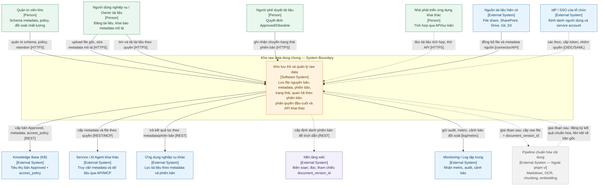

# C4 — MỨC 1: SYSTEM CONTEXT

> **Hệ thống trong phạm vi:** Kho lưu trữ và quản lý raw data dùng chung.
> **Câu hỏi sơ đồ này trả lời:** Ai dùng kho, kho nhận dữ liệu từ đâu, hệ thống nào khai thác dữ liệu của kho, và cái gì nằm ngoài phạm vi.
> **Tham chiếu báo cáo:** mục 1.1, 1.3, 2.1, 2.5, 2.6, 3.3, 7.1.

## 1.1. Sơ đồ ngữ cảnh

## 1.2. Người dùng

| ID | Vai trò | Mục đích sử dụng kho | Yêu cầu liên quan |
|---|---|---|---|
| P1 | Người dùng nghiệp vụ / Owner tài liệu | Đăng tài liệu, khai báo và duy trì metadata mô tả, tìm và tải tài liệu trong phạm vi quyền | 2.2, 2.3, 2.5, 6.3 |
| P2 | Quản trị viên kho | Định nghĩa schema metadata tối thiểu, chính sách truy cập, retention; kiểm tra chất lượng metadata theo mục 4.1; xử lý hàng đợi đối soát lỗi | 4.1, 6.3 |
| P3 | Nhà phát triển ứng dụng khai thác | Tích hợp ứng dụng với API/sự kiện của kho; không được ghi object trực tiếp | 2.5, 3.3 |
| P4 | Người phê duyệt tài liệu | Quyết định phát hành phiên bản. **Workflow xét duyệt nhiều bước nằm ngoài kho**; kho chỉ ghi nhận kết quả chuyển trạng thái và actor/time | 2.1, 2.4 |

## 1.3. Hệ thống bên ngoài

| ID | Hệ thống | Quan hệ với kho | Điểm cần làm rõ |
|---|---|---|---|
| X1 | IdP / SSO | Nguồn định danh duy nhất cho người dùng và service account; kho **không** tạo hệ tài khoản nghiệp vụ riêng | **[cần xác định hệ thống hiện có]** (mục 2.6) |
| X2 | Nguồn tài liệu hiện có | Nguồn tiếp nhận file và metadata; quyền ở nguồn phải ánh xạ được sang kho | Sau khi đưa vào kho, nguồn cũ chỉ đọc / song song / ngừng — **[cần xác định]** (mục 3.10) |
| X3 | Knowledge Base | Hệ thống khai thác đầu tiên; chỉ nhận bản `Approved` kèm `access_policy`, lưu `document_version_id` ổn định | POC-07, POC-11 |
| X4 | Service / AI Agent | Khai thác metadata và dữ liệu qua REST hoặc MCP với phạm vi quyền đã cấp | POC-04, POC-17 |
| X5 | Ứng dụng nghiệp vụ khác | Lọc tài liệu theo metadata, trạng thái, phiên bản, nhóm quản lý | POC-02, POC-19 |
| X6 | Nền tảng wiki (Nimbalyst, Wiki.js, BookStack, Outline, Confluence) | **Không** là kho dữ liệu gốc. Có thể dùng để biên soạn/xuất bản và trích dẫn `document_version_id` | mục 3.2.1 |
| X7 | Monitoring / Log tập trung | Nhận audit log, metric lưu trữ, lỗi đồng bộ, cảnh báo khi retry vượt ngưỡng | 2.7, 3.5 |
| X8 | Pipeline chuẩn hóa nội dung | **Ngoài phạm vi giai đoạn này.** Vẽ để xác định điểm nối: pipeline đọc raw file theo `document_version_id` và đăng ký kết quả về cùng catalog | 2.1, 3.2, 7.1 |

## 1.4. Ranh giới phạm vi

**Trong phạm vi**

- Tiếp nhận và lưu file đúng định dạng gốc: PDF, DOCX, XLSX, PPTX, Markdown, TXT và các định dạng tài liệu thông dụng.
- Quản lý metadata chuẩn và mở rộng, phiên bản nội dung, trạng thái `Draft/Approved/Obsolete`.
- Quan hệ theo phiên bản ở mức tối thiểu: `references`, `derived_from`, `supersedes`.
- Tìm kiếm theo metadata qua API, phân quyền đầu-cuối, audit, sự kiện thay đổi.

**Ngoài phạm vi (không thuộc tiêu chí nghiệm thu)**

- Chuẩn hóa nội dung về Markdown; OCR và parsing nội dung; **tìm kiếm toàn văn trong tài liệu**.
- Chunking, embedding, vector indexing, RAG, suy luận bằng AI.
- Workflow phê duyệt nhiều bước; kho chỉ ghi nhận trạng thái.
- Soạn thảo và cộng tác nội dung tài liệu (thuộc nền tảng wiki, X6).

## 1.5. Những nhu cầu buộc kho tồn tại

Sáu vấn đề ở mục 1.2 báo cáo là **giả thuyết cần khảo sát**, và cũng là các lực kiến trúc đã định hình L1:

| Vấn đề giả thuyết | Hệ quả trên sơ đồ ngữ cảnh |
|---|---|
| Tài liệu nằm ở nhiều nguồn | X2 là nhiều nguồn, nối vào một đầu mối duy nhất |
| Thiếu quy tắc mô tả tài liệu | Kho nắm schema metadata, không để từng ứng dụng tự định nghĩa |
| Thiếu quản lý phiên bản | `document_version_id` là định danh mà X3/X4/X5 phải lưu lại |
| Thiếu liên kết giữa tài liệu | Quan hệ theo phiên bản do kho quản lý, không phải hyperlink ở X6 |
| Quyền truy cập chưa thống nhất | X1 là nguồn định danh duy nhất; kho quyết định quyền trước khi cấp file |
| Mỗi ứng dụng tự kết nối nguồn | X3, X4, X5 chỉ nối tới kho, không nối trực tiếp vào X2 |
