# C4 — MỨC 2: CONTAINER

> **Câu hỏi sơ đồ này trả lời:** Kho gồm những khối triển khai độc lập nào, mỗi khối chịu trách nhiệm gì, dữ liệu đi theo đường nào, và khối nào là tùy chọn phụ thuộc kết quả PoC.
> **Tham chiếu báo cáo:** mục 3.1, 3.3, 3.4, 3.5, 3.8, 3.10, 5.2.

## 2.1. Sơ đồ container

```mermaid
flowchart TB
    classDef builtin  fill:#E8F4FD,stroke:#2E7FB8,color:#0B3C5D
    classDef custom   fill:#FFF3E0,stroke:#E08A1E,color:#5C3A00
    classDef poc      fill:#FDECEC,stroke:#C0392B,color:#5C1A14
    classDef optional fill:#F3F0FB,stroke:#7A5FB8,color:#33265C
    classDef person   fill:#EAF7EE,stroke:#2E8B57,color:#14402A

    P1["Người dùng / Owner<br/>[Person]"]
    P2["Quản trị viên kho<br/>[Person]"]
    X1["IdP / SSO<br/>[External System]"]
    X2["Nguồn tài liệu hiện có<br/>[External System]"]
    X3["KB và ứng dụng khai thác<br/>[External System]"]
    X7["Monitoring / Log<br/>[External System]"]

    subgraph KHO["Kho raw data dùng chung — System Boundary"]
        direction TB

        C11["Admin / Business UI tối giản<br/>[Container · Tùy chọn]<br/>Web app; chỉ xây nếu UI catalog không phù hợp"]
        C9["Search / Query Gateway<br/>[Container · Tùy chọn]<br/>Lọc quyền trên kết quả tra cứu ở quy mô lớn"]
        C12["MCP Server adapter<br/>[Container · Tùy chọn]<br/>Khai thác metadata và dữ liệu cho agent"]

        subgraph DSPROC["Ba tiến trình dùng chung một mã nguồn và một Service State Store"]
            direction LR
            C1["Document Service<br/>[Container · Tự phát triển]<br/>REST API; upload, phiên bản, trạng thái,<br/>quan hệ, policy, cấp file, idempotency"]
            C8["Reconciliation &amp; Recovery Worker<br/>[Container · Tự phát triển]<br/>Tiến trình riêng; đối soát hai chiều<br/>object ↔ catalog, retry intent"]
            C10["Outbox Dispatcher<br/>[Container · Tự phát triển]<br/>Tiến trình riêng; đọc outbox và<br/>phát sự kiện cho downstream"]
        end

        C7[("C7 Service State Store<br/>[Datastore · Cần PoC về sản phẩm]<br/>4 schema: upload_intent · relationship<br/>audit_event · outbox_event")]
        C13["Distributed Lock<br/>[Container · Tùy chọn — bắt buộc khi nhiều instance]<br/>Tuần tự hoá theo document_id"]

        subgraph CATP["Metadata Catalog platform — OpenMetadata (Q1 đã chốt)"]
            direction LR
            C2["Catalog Application<br/>[Container · Có sẵn]<br/>Entity, custom properties,<br/>lineage, search API, change events"]
            C3[("Catalog Metadata DB<br/>[Datastore · Có sẵn]<br/>MySQL / PostgreSQL")]
            C4[("Catalog Search Index<br/>[Datastore · Có sẵn]<br/>Elasticsearch / OpenSearch")]
            C5["Catalog Ingestion<br/>[Container · Tùy chọn]<br/>Airflow; chỉ dùng khảo sát nguồn"]
            C2 --> C3
            C2 --> C4
            C5 -.-> C2
        end

        C6[("Object Storage tương thích S3<br/>[Datastore · Có sẵn]<br/>Object bất biến, versioning,<br/>object lock, mã hóa khi lưu")]
    end

    P1 -->|"upload, tra cứu, tải [HTTPS]"| C1
    P1 -.->|"sửa metadata mô tả [HTTPS]"| C2
    P1 -.->|"dùng khi có UI riêng [HTTPS]"| C11
    P2 -->|"quản trị collection, schema metadata, policy,<br/>retention, hàng đợi lỗi [HTTPS]"| C1
    P2 -->|"quản trị entity và custom properties [HTTPS]"| C2
    X2 -->|"đồng bộ file và metadata nguồn [connector/API]"| C1
    X2 -.->|"khảo sát metadata nguồn [ingestion]"| C5
    X1 -.->|"xác thực người dùng và service account [OIDC]"| C1
    X1 -.->|"xác thực truy cập catalog [OIDC]"| C2

    C1 -->|"① ghi intent bền vững + idempotency_key"| C7
    C1 -->|"② ghi object bất biến [S3 API]"| C6
    C1 -->|"③ đăng ký entity và metadata kiểm soát [REST]"| C2
    C1 -.->|"đọc metadata để kiểm tra ràng buộc [REST]"| C2
    C1 -->|"④ cấp presigned URL hoặc proxy stream [S3 API]"| C6
    C1 -->|"ghi bản ghi outbox, audit, quan hệ"| C7
    C1 -.->|"xin khóa theo document_id khi chạy nhiều instance"| C13
    C11 -.->|"gọi API nghiệp vụ"| C1

    C8 -->|"đọc intent chưa hoàn tất, cập nhật trạng thái"| C7
    C8 -->|"liệt kê object chưa đăng ký [S3 API]"| C6
    C8 -->|"đối soát entity trỏ tới object mất/hỏng [REST]"| C2
    C8 -->|"cảnh báo khi vượt ngưỡng retry"| X7

    C10 -->|"đọc outbox_event chưa phát, ghi kết quả"| C7

    C9 -.->|"truy vấn search có lọc quyền [REST]"| C2
    C9 -.->|"kiểm tra policy theo tài liệu"| C1
    C12 -.->|"metadata"| C2
    C12 -.->|"dữ liệu và link tải có thời hạn"| C1

    X3 -->|"tìm kiếm có kiểm soát quyền [REST]"| C1
    X3 -.->|"tìm kiếm trực tiếp, chỉ khi được cấp quyền phù hợp [REST]"| C2
    X3 -.->|"tìm kiếm qua gateway nếu cần tách tải [REST]"| C9
    C1 -->|"cấp file theo quyền [HTTPS]"| X3
    C10 -->|"sự kiện tài liệu/phiên bản/quyền [webhook/queue]"| X3
    C2 -.->|"change events nếu đủ tin cậy [webhook]"| C10
    C1 -->|"audit, metric"| X7
    C8 -->|"metric đối soát"| X7
    C10 -->|"metric phát sự kiện"| X7
    C2 -.->|"audit, metric"| X7

    class P1,P2 person
    class C1,C8,C10 custom
    class C2,C3,C4,C6 builtin
    class C5,C9,C11,C12,C13 optional
    class C7 poc
    class X1,X2,X3,X7 builtin
```

**Ba tiến trình, một mã nguồn.** C1, C8 và C10 là ba **container C4 riêng** vì chúng được triển khai và scale độc lập (C1 theo tải API, C8 và C10 là tiến trình nền chạy theo chu kỳ), nhưng dùng chung một image, chung lớp `domain`/`domain.port` và chung C7. Không có phần tử nào vừa là container ở mức này vừa là component của container khác ở mức L3: ở [c4-03](c4-03-component-document-service.md) mỗi tiến trình có một biên riêng.

**Vì sao C7 là một datastore chứ không phải chi tiết hiện thực.** Document Service giữ bốn loại trạng thái mà catalog và object storage đều không nhận: intent/idempotency (mục 3.5 báo cáo), audit truy vấn được theo tài liệu (POC-14), bản ghi outbox (POC-11) và — nếu Q4 chọn registry — bảng quan hệ. Vẽ nó ra là điều kiện để nói đúng về backup, RPO/RTO và dung lượng ở [c4-06](c4-06-deployment.md); nếu bỏ đi thì câu "Document Service stateless" là sai và kế hoạch backup sẽ thiếu một thành phần.

## 2.2. Danh mục container

| ID | Container | Công nghệ dự kiến | Trách nhiệm | Trạng thái | Test case |
|---|---|---|---|---|---|
| C1 | **Document Service** | Ứng dụng backend, REST API | Đường ghi duy nhất cho file và trường kiểm soát; sinh và bảo đảm duy nhất `document_version_id`/`version_label`; thực thi máy trạng thái; kiểm tra policy trước khi cấp file; điều phối idempotency và phục hồi lỗi | Tự phát triển | POC-01, 03, 04, 08, 10, 13, 20, 21, 22 |
| C2 | **Catalog Application** | OpenMetadata (ưu tiên) / DataHub (đối chứng) | Lưu metadata chuẩn và custom properties; lịch sử thay đổi metadata; search API; biểu diễn quan hệ; phát change events | Có sẵn + Cần PoC về search/quan hệ/quyền | POC-02, 06, 17, 19 |
| C3 | Catalog Metadata DB | MySQL / PostgreSQL | Lưu trữ bền vững entity và metadata của catalog | Có sẵn | — |
| C4 | Catalog Search Index | Elasticsearch / OpenSearch | Index phục vụ tra cứu, lọc kết hợp và phân trang | Có sẵn + Cần PoC về field được index | POC-02, 16, 19 |
| C5 | Catalog Ingestion | Airflow (theo sản phẩm) | **Chỉ dùng để khảo sát metadata nguồn.** Không dùng làm đường ghi chính vì connector catalog thường thu thập metadata, chưa chắc sao chép file | Tùy chọn | POC-12 |
| C6 | **Object Storage tương thích S3** | Dịch vụ S3-compatible sẵn có của tổ chức **[cần xác định]**; nếu tự vận hành: Ceph RGW / SeaweedFS / Garage | Lưu object bất biến theo `document_version_id`; versioning, object lock, retention, mã hóa khi lưu, link tải có thời hạn | Có sẵn | POC-01, 15 |
| C7 | **Service State Store** | Biến thể A: manifest JSON trên S3 (chỉ cho schema intent). Biến thể B: registry DB — sqlite ở PoC, PostgreSQL/MySQL khi triển khai | Bốn schema: `upload_intent` (`Received → ObjectStored → CatalogRegistered → StatusChangePending → Completed / Failed / RetryPending`), `audit_event` truy vấn được theo `document_id`, `outbox_event`, và `relationship` nếu Q4 chọn registry | Cần PoC về sản phẩm; **đã có bằng chứng nghiêng về biến thể B**, xem [c4-08 mục 4](c4-08-tra-soat-code-vs-thiet-ke.md) | POC-08, 11, 14, 18, 21, 22 |
| C8 | **Reconciliation & Recovery Worker** | Tiến trình riêng, chạy theo chu kỳ hoặc gọi bằng CLI | Đối soát hai chiều: object chưa đăng ký, entity trỏ tới object mất/hỏng, intent bị gián đoạn; retry idempotent; cảnh báo và chuyển xử lý thủ công khi vượt ngưỡng | Tự phát triển | POC-08, 18, 21 |
| C9 | Search / Query Gateway | API service | Chỉ bổ sung nếu cần tách tải tra cứu khỏi C1, hoặc nếu lọc quyền tại C1 không đạt yêu cầu hiệu năng. **Việc lọc quyền kết quả tra cứu không tùy chọn** — nó luôn xảy ra, ở C1 (D18) hoặc ở đây | Tùy chọn | POC-17, 19, 20 |
| C10 | **Outbox Dispatcher** | Tiến trình riêng + webhook/queue | Đọc `outbox_event` ở C7 và phát sự kiện tài liệu mới, phiên bản mới, chuyển trạng thái, thay đổi quyền, thu hồi, xóa; bảo đảm phát hiện được sự kiện thất lạc. **Việc ghi bản ghi outbox nằm trong request của C1 (D14), việc phát đi nằm ở đây** | Tự phát triển (có thể dựa trên change events của catalog nếu đủ tin cậy) | POC-11 |
| C11 | Admin / Business UI tối giản | Web app | Chỉ xây nếu UI catalog không phù hợp người dùng nghiệp vụ, đánh giá sau giai đoạn 3 | Tùy chọn | mục 3.10 |
| C12 | MCP Server adapter | MCP | Cho service/AI agent khai thác metadata và dữ liệu theo phạm vi quyền đã cấp | Tùy chọn | POC-04 |
| C13 | **Distributed Lock** | Redis / etcd / lock table trên C7 | Tuần tự hoá thao tác theo `document_id` giữa **nhiều instance** C1. Với một instance, khóa trong tiến trình là đủ; từ instance thứ hai trở đi, thiếu C13 là **mất bất biến I4, I5** | Tùy chọn khi 1 instance, **bắt buộc khi nhiều instance** | POC-22, 26 |

## 2.3. Bảng luồng dữ liệu chính

| Luồng | Mô tả | Đường đi | Ghi chú rủi ro |
|---|---|---|---|
| ① Tiếp nhận | File gốc từ người dùng hoặc connector nguồn | X2/P1 → C1 | Không chuyển đổi nội dung; chỉ trích xuất metadata kỹ thuật |
| ② Ghi intent | Tạo intent bền vững trước khi ghi file | C1 → C7 | Biến thể A (manifest S3) **không** ràng buộc được tính duy nhất của `idempotency_key`; xem c4-08 mục 4 |
| ③ Ghi file | Object bất biến theo key cố định | C1 → C6 | Dùng điều kiện tạo object để retry không sinh bản trùng |
| ④ Đăng ký metadata | Entity phiên bản và metadata kiểm soát | C1 → C2 | **Không nguyên tử với ③**; phải có đối soát |
| ⑤ Tra cứu | Lọc metadata rồi áp quyền trước khi trả kết quả | X3/P1 → C1 → C2, hoặc X3 → C2 trực tiếp khi đã được ủy quyền, hoặc X3 → C9 → C2 | Khả năng lọc custom fields và phân quyền kết quả là rủi ro lớn nhất |
| ⑥ Cấp file | Kiểm tra policy rồi cấp presigned URL hoặc proxy | C1 → C6 → X3/P1 | Link đã cấp không tự mất hiệu lực khi quyền đổi |
| ⑦ Đồng bộ thay đổi | Ghi outbox trong request, phát sự kiện ở tiến trình riêng | C1 → C7 → C10 → X3 | Phải có tiến trình thực sự chạy C10; outbox có người ghi mà không có người phát thì sự kiện nằm lại vô thời hạn |
| ⑧ Đối soát | Phát hiện và xử lý lệch trạng thái | C8 ↔ C6, C7, C2 | Cảnh báo tới X7 khi retry quá ngưỡng |
| ⑨ Vòng đời file | Hết retention hoặc có yêu cầu xóa: thu hồi object và metadata khai thác, giữ audit | C1 → C6, C2, C7 | Xóa **không** được xóa audit và lịch sử trạng thái (bất biến I17) |

## 2.4. Ranh giới ghi dữ liệu

Đây là ràng buộc kiến trúc quan trọng nhất ở mức container (mục 3.5 báo cáo):

| Nhóm dữ liệu | Ai được ghi | Ai **không** được ghi |
|---|---|---|
| File gốc (object) | C1 Document Service, qua S3 adapter | Ứng dụng khai thác, người dùng cuối, C5 Ingestion |
| `document_id`, `document_version_id`, `storage_uri`, `checksum`, `status`, `current_version_id`, `access_policy`, quan hệ kiểm soát | C1; **và C8 khi phục hồi một intent dở dang** — xem ghi chú dưới bảng | Catalog UI/API trực tiếp; service account của connector |
| `title`, `description`, `tags` và metadata mô tả khác | C2 Catalog UI/API theo phân quyền, có audit; hoặc C1 | — |
| Trạng thái intent, audit, outbox, quan hệ trong C7 | C1 ghi; C8 cập nhật trạng thái intent; C10 cập nhật trạng thái outbox | Mọi thành phần khác, kể cả C9, C11, C12 |
| Khóa theo `document_id` | C1 (và C8 khi retry thao tác cần tuần tự) | Mọi thành phần khác |

**Vì sao C8 cũng ghi được trường kiểm soát.** Một lượt ghi bị gián đoạn để lại intent dở dang, và việc hoàn tất nó **bắt buộc** phải ghi đúng những trường đó: `C8` đăng ký lại entity phiên bản (luồng 7) hoặc hoàn tất ba lệnh patch của một lượt duyệt. C8 không **quyết định** gì — nó chỉ thực hiện lại kết quả đã được C1 ghi vào intent. Hai điều kiện kèm theo: C8 phải lấy **khóa theo `document_id`** như C1, và nó không được tự tạo phiên bản mới khi đối soát.

POC-20 kiểm chứng đúng ràng buộc này: nếu người dùng có thể sửa trực tiếp `status`, `access_policy`, `current_version_id` hoặc quan hệ qua Catalog UI/API thì phải khóa quyền hoặc bổ sung cơ chế chặn.

## 2.5. Biến thể kiến trúc theo ứng viên catalog

| Khía cạnh | Biến thể A — OpenMetadata | Biến thể B — DataHub |
|---|---|---|
| Container bắt buộc thêm | Catalog app + DB + search index (+ Airflow nếu dùng ingestion) | Catalog app + DB + search index + **Kafka và thành phần sự kiện** + graph index |
| Entity cho tài liệu | File / Directory trong Drive Service | `Document`; `DataHubFile` chỉ là file đính kèm, không thay kho raw data |
| Metadata mở rộng | Custom properties | Structured Properties |
| Quan hệ phiên bản | Lineage API + entity reference | Related Documents / structured properties |
| Chi phí vận hành tương đối | Thấp hơn khi chưa cần ingestion phức tạp | Cao hơn do thêm thành phần sự kiện |
| Hệ quả lên sơ đồ L2 | Giữ nguyên sơ đồ 2.1 | Thêm container message broker vào `Metadata Catalog platform` |

Trong cả hai biến thể, C1, C7, C8, C10 **không đổi**: đó là lý do lớp adapter catalog ở L3 là bắt buộc, không phải tùy chọn.

> **Cập nhật 17/11/2026 — quyết định Q1 đã chốt:** hiện thực là **OpenMetadata (biến thể A)**. Mã nguồn chỉ còn một adapter catalog, xem [c4-04b-code-structure.md](c4-04b-code-structure.md). Biến thể B giữ lại trong tài liệu làm **đối chứng khảo sát**, không còn nhánh hiện thực; nếu phải quay lại thì chi phí là viết một adapter mới sau `MetadataCatalogPort`, không phải sửa lõi nghiệp vụ.

## 2.6. Container tùy chọn và điều kiện kích hoạt

| Container | Chỉ xây khi | Chốt sau |
|---|---|---|
| C9 Search / Query Gateway | Cần tách tải tra cứu khỏi C1, hoặc lọc quyền tại C1 không đạt hiệu năng ở quy mô thật | POC-16, 17, 19, 20 |
| C7 biến thể B (registry DB) | Manifest trên S3 không bảo đảm idempotency, concurrency hoặc khả năng phục hồi sau restart. **Audit và outbox cần truy vấn có điều kiện nên gần như chắc chắn cần biến thể B** | POC-18, 21, 22 |
| C13 Distributed Lock | Chạy từ **2 instance C1 trở lên** | Trước khi bật nhiều instance ở môi trường thật |
| C11 Admin / Business UI | UI catalog không phù hợp người dùng nghiệp vụ | Sau giai đoạn 3 |
| C12 MCP Server | Có nhu cầu thực tế từ service/AI agent | Sau khảo sát nhu cầu khai thác |
| C5 Catalog Ingestion | Cần khảo sát metadata ở nguồn quy mô lớn | POC-12 |

Mỗi container tùy chọn được bật đều **làm tăng công tự phát triển và vận hành**, là đầu vào trực tiếp cho tiêu chí tiếp tục/dừng ở mục 6.2 báo cáo.
