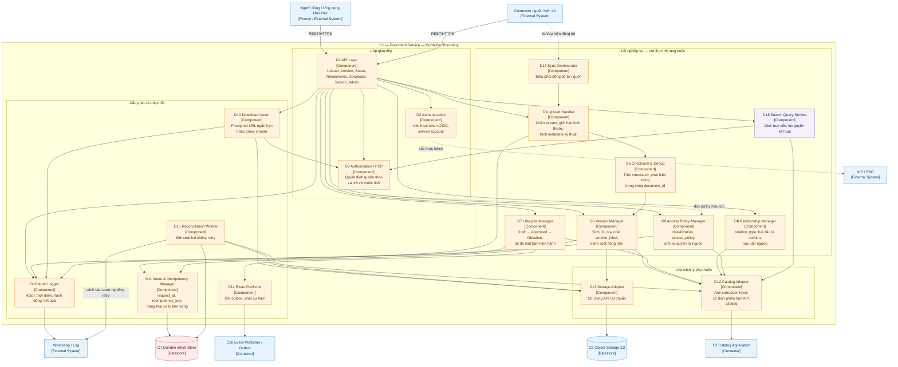
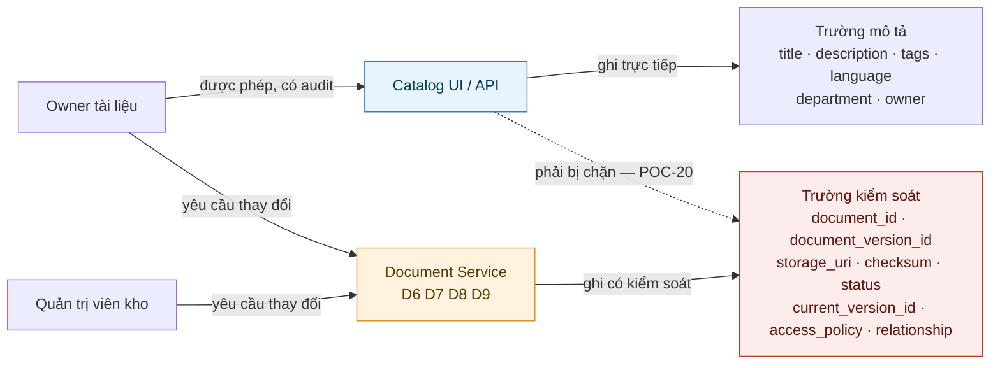
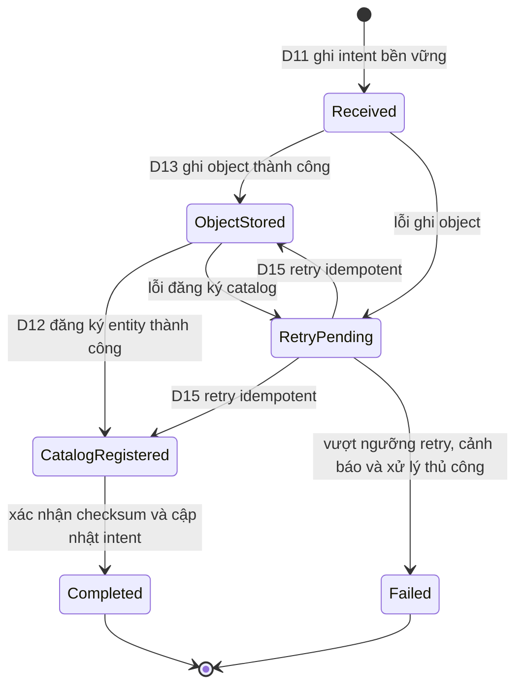

# C4 — MỨC 3: COMPONENT — DOCUMENT SERVICE

> **Container được phân rã:** C1 — Document Service (container duy nhất phải tự phát triển hoàn toàn).
> **Câu hỏi sơ đồ này trả lời:** Trong Document Service có những thành phần nào, thành phần nào thực thi ràng buộc nghiệp vụ, và phần nào cách ly phụ thuộc sản phẩm.
> **Tham chiếu báo cáo:** mục 2.4, 2.6, 3.4, 3.5, 3.9, 6.4.

## 3.1. Sơ đồ thành phần

## 3.2. Danh mục thành phần

| ID | Thành phần | Trách nhiệm | Ràng buộc phải thực thi | Test case |
|---|---|---|---|---|
| D1 | API Layer | Phơi bày API nghiệp vụ: `POST /documents`, `POST /documents/{id}/versions`, `POST /versions/{id}/status`, `POST /relationships`, `GET /versions/{id}/download`, `GET /search`, API quản trị | Mọi API ghi đều yêu cầu `Idempotency-Key`; phân trang bắt buộc cho API danh sách | POC-01, 02, 03 |
| D2 | Authentication | Xác thực token người dùng và service account từ IdP | Không tạo hệ tài khoản nghiệp vụ riêng | POC-04 |
| D3 | Authorization / PDP | Quyết định quyền cho từng hành động: xem metadata, tìm kiếm, tải, sửa, chuyển trạng thái, chia sẻ | Tài liệu chưa xác định được quyền ở chế độ hạn chế, chỉ owner và quản trị viên được ủy quyền; không tự động công khai | POC-04, 17, 20 |
| D4 | Upload Handler | Nhận file dạng stream, kiểm tra định dạng/kích thước, trích xuất metadata kỹ thuật | **Không đọc nội dung tài liệu**; chỉ metadata kỹ thuật như định dạng, kích thước, checksum | POC-01 |
| D5 | Checksum & Dedup | Tính `checksum` và so với các phiên bản của cùng `document_id` | Upload lại cùng nội dung vào cùng tài liệu **không** tạo phiên bản mới; hai tài liệu khác nhau cùng checksum vẫn giữ `document_id` riêng | POC-13 |
| D6 | Version Manager | Sinh `document_version_id` bất biến, bảo đảm `version_label` duy nhất trong tài liệu, kiểm soát hai request đồng thời | Không ghi đè nội dung bản cũ; ID không phụ thuộc `version_label`, tên file hay collection | POC-03, 22 |
| D7 | Lifecycle Manager | Thực thi `Draft → Approved → Obsolete`; khi duyệt bản mới thì chuyển bản `Approved` trước đó sang `Obsolete` trong một thao tác logic có kiểm soát đồng thời | Tối đa một bản `Approved` hiện hành; ghi actor, thời điểm, trạng thái trước–sau | POC-10, 22 |
| D8 | Relationship Manager | Tạo và truy vấn `references`, `derived_from`, `supersedes` với `source_version_id`, `target_version_id` | Liên kết gắn đúng phiên bản ở cả hai đầu, **không tự chuyển sang phiên bản mới**; truy vấn được hai chiều theo loại quan hệ | POC-06, 09 |
| D9 | Access Policy Manager | Quản lý `classification`, `access_policy`, `retention_policy`; ánh xạ quyền từ nguồn sang kho | Quyền xem metadata **không** đồng nghĩa quyền tải file | POC-04, 11, 17 |
| D10 | Download Issuer | Cấp link tải có thời hạn cho tài liệu thông thường; proxy stream cho dữ liệu cần thu hồi ngay | Kiểm tra policy ngay trước khi cấp; ghi audit mỗi lần cấp; đo được cửa sổ hiệu lực của link đã phát hành | POC-04, 23 |
| D11 | Intent & Idempotency Manager | Tạo và cập nhật intent bền vững; bảo đảm retry không sinh phiên bản trùng | Intent phải bền vững **trước** khi ghi object; không giữ trạng thái trong RAM | POC-08, 18, 21 |
| D12 | **Catalog Adapter** | Toàn bộ giao tiếp với catalog đi qua đây: tạo/đọc entity, custom properties, quan hệ, search | Cố định phiên bản catalog; thay OpenMetadata ↔ DataHub chỉ đổi adapter | mục 6.4 |
| D13 | **Storage Adapter** | Ghi/đọc object, presign, kiểm tra object lock và versioning | Chỉ dùng API S3 chuẩn, không dùng tính năng mở rộng riêng của một sản phẩm | POC-01, 15 |
| D14 | Event Publisher | Ghi bản ghi outbox cho mọi thay đổi có ý nghĩa với downstream | Sự kiện phải có `document_version_id` và loại thay đổi; downstream phát hiện được sự kiện thất lạc | POC-11 |
| D15 | Reconciliation Worker | Đối soát hai chiều và retry; chuyển sang xử lý thủ công khi vượt ngưỡng | Có cảnh báo; không tự tạo phiên bản mới khi đối soát | POC-08, 18, 21 |
| D16 | Audit Logger | Ghi log tải, sửa mô tả, chuyển trạng thái, thay đổi quyền, lỗi | Audit đủ để trả lời POC-14 trên một tài liệu cụ thể | POC-14 |
| D17 | Sync Orchestrator | Điều phối đồng bộ từ nguồn hiện có qua đường ghi chính | Sửa file ở nguồn tạo **phiên bản nội dung mới**, không đổi bản đã đăng ký | POC-12 |
| D18 | Search Query Service | Dịch truy vấn nghiệp vụ sang search API của catalog và lọc quyền trên kết quả | Chỉ bắt buộc nếu catalog không phân quyền được kết quả; khi đó có thể tách thành container C9 | POC-02, 17, 19 |

## 3.3. Vì sao cần Document Service — ánh xạ sang thành phần

| Khoảng trống của catalog (mục 3.2 báo cáo) | Thành phần lấp khoảng trống |
|---|---|
| Catalog không lưu file | D13 + C6 Object Storage; catalog chỉ giữ `storage_uri`, `checksum` |
| Version của catalog là lịch sử metadata, không phải version nội dung | D6 tạo entity riêng cho mỗi phiên bản nội dung |
| Quyền xem metadata khác quyền tải file | D3 + D9 + D10 |
| Không có luồng upload file | D1 + D4 + D5 |
| Search và UI của catalog có giới hạn theo custom field | D18, có thể nâng thành C9 Gateway |
| Không có giao dịch nguyên tử giữa storage và catalog | D11 + D15 + C7 |

## 3.4. Ranh giới cập nhật metadata

Service account của catalog và connector **không** được bypass ràng buộc này. Nếu cấu hình quyền của catalog không chặn được, phải thu hẹp quyền ghi của catalog xuống mức chỉ-mô-tả hoặc đặt catalog ở chế độ chỉ nhận ghi từ Document Service.

## 3.5. Xử lý lỗi giữa Object Storage và Catalog

Không mô tả việc ghi file và đăng ký metadata là một giao dịch nguyên tử. Chuỗi trạng thái của một upload:

Nguyên tắc bắt buộc:

- Intent được ghi **trước** khi ghi object, gồm `request_id`, `document_version_id`, checksum dự kiến và trạng thái.
- Dùng key bất biến, `idempotency_key` và kiểm tra điều kiện khi tạo object/entity để retry không sinh phiên bản trùng.
- Job đối soát chạy cả hai chiều: object chưa đăng ký; entity trỏ tới object mất hoặc hỏng; intent bị gián đoạn.
- Nếu chỉ dùng manifest trên S3, PoC phải kiểm chứng race condition, khả năng liệt kê/đối soát và phục hồi sau khi Document Service restart. Không đạt thì **bổ sung registry database**, không cố giữ tiêu chí “service không có database” (mục 3.5 báo cáo).
