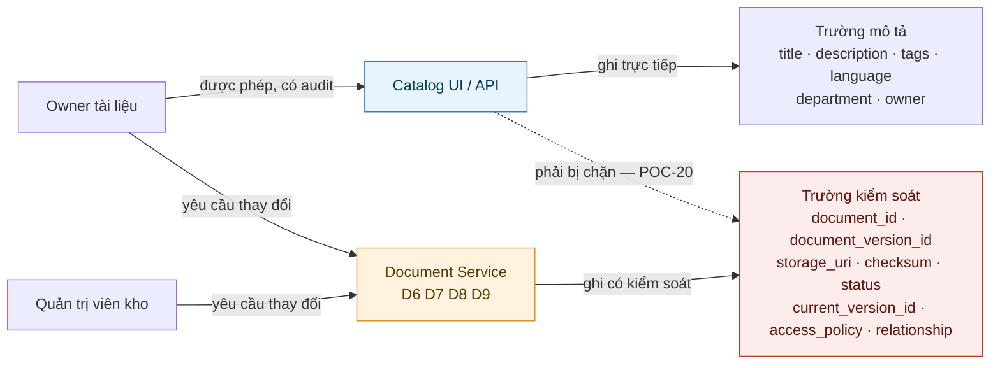
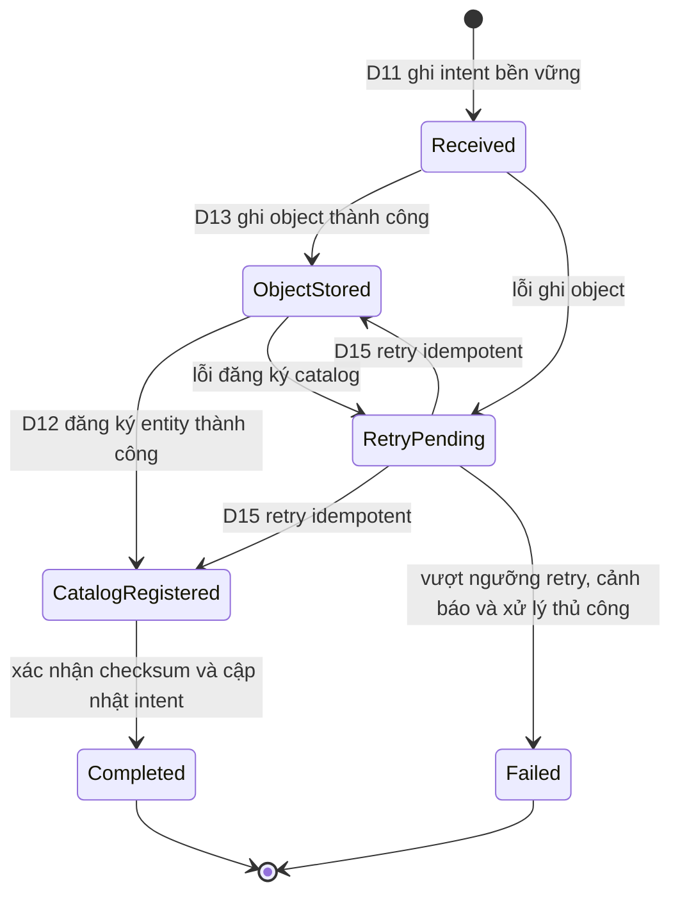

# C4 — MỨC 3: COMPONENT — DOCUMENT SERVICE

> **Container được phân rã:** C1 — Document Service, cùng hai tiến trình dùng chung mã nguồn với nó là C8 — Reconciliation & Recovery Worker và C10 — Outbox Dispatcher.
> **Câu hỏi sơ đồ này trả lời:** Trong Document Service có những thành phần nào, thành phần nào thực thi ràng buộc nghiệp vụ, và phần nào cách ly phụ thuộc sản phẩm.
> **Tham chiếu báo cáo:** mục 2.4, 2.6, 3.4, 3.5, 3.9, 6.4.

## 3.1. Sơ đồ thành phần

```mermaid
flowchart TB
    classDef builtin  fill:#E8F4FD,stroke:#2E7FB8,color:#0B3C5D
    classDef custom   fill:#FFF3E0,stroke:#E08A1E,color:#5C3A00
    classDef poc      fill:#FDECEC,stroke:#C0392B,color:#5C1A14
    classDef optional fill:#F3F0FB,stroke:#7A5FB8,color:#33265C

    EXT_USR["Người dùng / Ứng dụng khai thác<br/>[Person / External System]"]
    EXT_SRC["Connector nguồn hiện có<br/>[External System]"]
    EXT_IDP["IdP / SSO<br/>[External System]"]

    subgraph DS["C1 — Document Service — Container Boundary"]
        direction TB

        subgraph APIL["Lớp giao tiếp"]
            direction LR
            D1["D1 API Layer<br/>[Component]<br/>Document, Collection, Version, Status,<br/>Relationship, Download, Search,<br/>Policy, Retention, Audit, Admin"]
            D2["D2 Authentication<br/>[Component]<br/>Xác thực token OIDC,<br/>service account"]
            D3["D3 Authorization / PDP<br/>[Component]<br/>Quyết định quyền theo<br/>vai trò và thuộc tính"]
        end

        subgraph CORE["Lõi nghiệp vụ — nơi thực thi ràng buộc"]
            direction LR
            D4["D4 Upload Handler<br/>[Component]<br/>Nhận stream, giới hạn kích thước,<br/>trích metadata kỹ thuật"]
            D5["D5 Checksum &amp; Dedup<br/>[Component]<br/>Tính checksum, phát hiện trùng<br/>trong cùng document_id"]
            D6["D6 Version Manager<br/>[Component]<br/>Sinh ID, duy nhất version_label,<br/>kiểm soát đồng thời"]
            D7["D7 Lifecycle Manager<br/>[Component]<br/>Draft → Approved → Obsolete,<br/>tối đa một bản hiện hành"]
            D8["D8 Relationship Manager<br/>[Component]<br/>relation_type, hai đầu là version,<br/>truy vấn ngược kèm direction"]
            D9["D9 Access Policy Manager<br/>[Component]<br/>classification, access_policy,<br/>ánh xạ quyền từ nguồn"]
            D18["D18 Search Query Service<br/>[Component]<br/>Dịch truy vấn, lọc quyền kết quả"]
            D17["D17 Sync Orchestrator<br/>[Component]<br/>Điều phối đồng bộ từ nguồn"]
            D23["D23 Metadata Schema &amp; Validation<br/>[Component]<br/>DocumentTypeSchema, trường bắt buộc<br/>theo loại, nguồn gốc metadata"]
            D24["D24 Collection Manager<br/>[Component]<br/>Tạo, sửa, di chuyển collection;<br/>cây collection"]
            D25["D25 Retention &amp; Deletion Manager<br/>[Component]<br/>Thu hồi, xóa, hết retention;<br/>giữ audit khi xóa"]
        end

        subgraph REL["Cấp phát, bền vững và quan sát"]
            direction LR
            D10["D10 Download Issuer<br/>[Component]<br/>Presigned URL ngắn hạn<br/>hoặc proxy stream"]
            D11["D11 Intent &amp; Idempotency Manager<br/>[Component]<br/>request_id, idempotency_key,<br/>trạng thái xử lý bền vững"]
            D16["D16 Audit Logger<br/>[Component]<br/>Actor, thời điểm, hành động,<br/>trạng thái trước–sau, kết quả"]
            D14["D14 Outbox Writer<br/>[Component]<br/>Ghi outbox_event trong cùng request"]
        end

        subgraph ADPT["Lớp cách ly phụ thuộc — mỗi port một adapter"]
            direction LR
            D12["D12 Catalog Adapter<br/>[Component]<br/>Anti-corruption layer;<br/>cố định phiên bản API catalog"]
            D13["D13 Storage Adapter<br/>[Component]<br/>Chỉ dùng API S3 chuẩn"]
            D19["D19 Relationship Store Adapter<br/>[Component · Q4 còn mở]<br/>Lineage API hoặc registry"]
            D20["D20 State Store Adapter<br/>[Component]<br/>intent · audit · outbox · relationship"]
            D21["D21 Policy Decision Adapter<br/>[Component]<br/>RBAC/ABAC + cache policy"]
            D22["D22 Document Lock Adapter<br/>[Component]<br/>Trong tiến trình, hoặc C13 khi nhiều instance"]
        end
    end

    subgraph RECON["C8 — Reconciliation &amp; Recovery Worker — Container Boundary"]
        direction LR
        D15["D15 Reconcile Runner<br/>[Component]<br/>IntentRecoveryJob · OrphanObjectScanner<br/>DanglingEntityScanner"]
    end

    subgraph DISP["C10 — Outbox Dispatcher — Container Boundary"]
        direction LR
        D26["D26 Outbox Dispatcher<br/>[Component]<br/>Đọc outbox_event chưa phát,<br/>gửi downstream, đếm số lần thử"]
    end

    C2["C2 Catalog Application<br/>[Container]"]
    C6[("C6 Object Storage S3<br/>[Datastore]")]
    C7[("C7 Service State Store<br/>[Datastore]")]
    C13X["C13 Distributed Lock<br/>[Container · Tùy chọn]"]
    X3["KB / downstream<br/>[External System]"]
    X7["Monitoring / Log<br/>[External System]"]

    EXT_USR -->|"REST/HTTPS"| D1
    EXT_SRC -->|"REST/HTTPS"| D1
    D2 -.->|"xác thực token"| EXT_IDP
    D1 --> D2
    D1 --> D3
    D1 --> D4
    D1 --> D6
    D1 --> D7
    D1 --> D8
    D1 --> D9
    D1 --> D10
    D1 --> D18
    D1 --> D24
    D1 --> D25
    EXT_SRC -.->|"lịch/sự kiện đồng bộ"| D17
    D17 --> D4

    D4 --> D5
    D4 --> D23
    D4 --> D11
    D5 --> D6
    D6 --> D11
    D6 --> D13
    D6 --> D12
    D6 --> D22
    D7 --> D22
    D7 --> D12
    D7 --> D14
    D8 --> D19
    D9 --> D12
    D23 --> D12
    D24 --> D12
    D25 --> D12
    D25 --> D13
    D25 --> D14
    D3 --> D21
    D3 -.->|"đọc policy hiệu lực"| D9
    D10 --> D3
    D10 --> D13
    D18 --> D12
    D18 --> D3

    D11 --> D20
    D12 --> C2
    D13 --> C6
    D19 -.->|"biến thể Lineage"| C2
    D19 -.->|"biến thể registry"| D20
    D20 --> C7
    D14 --> D20
    D16 --> D20
    D22 -.->|"khi nhiều instance"| C13X

    D1 --> D16
    D7 --> D16
    D10 --> D16
    D9 --> D16
    D25 --> D16
    D16 --> X7

    D15 --> D20
    D15 --> D12
    D15 --> D13
    D15 -->|"cảnh báo vượt ngưỡng retry"| X7
    D26 --> D20
    D26 -->|"webhook/queue"| X3
    D26 -->|"metric phát sự kiện"| X7

    class D1,D2,D3,D4,D5,D6,D7,D8,D9,D10,D11,D14,D15,D16,D17,D18,D23,D24,D25,D26 custom
    class D12,D13,D19,D20,D21,D22 custom
    class C2,C6 builtin
    class C7 poc
    class C13X optional
    class X3,X7 builtin
    class EXT_USR,EXT_SRC,EXT_IDP builtin
```

**Ba biên, không trùng phần tử.** D1–D14, D16–D25 thuộc tiến trình C1. D15 thuộc tiến trình C8. D26 thuộc tiến trình C10. Trước lần rà soát 19/11/2026, D15 bị vẽ bên trong biên C1 trong khi C8 lại là container ở [c4-02](c4-02-container.md) — một phần tử không được có hai cha trong C4, và cách vẽ đó làm không rõ reconciliation có phải tiến trình riêng hay không. Ba tiến trình dùng chung mã nguồn `domain`/`domain.port` và chung C7, nhưng được triển khai, scale và khởi động riêng.

**Ranh giới ghi outbox.** D14 ghi bản ghi `outbox_event` **trong cùng request** đang ghi dữ liệu nghiệp vụ, nhờ vậy sự kiện không bị mất khi tiến trình chết ngay sau đó. D26 là bên **phát** sự kiện đi, ở tiến trình khác. Hai việc này trước đây đều mang tên "Event Publisher" ở hai mức khác nhau nên dễ bị hiểu là một.

## 3.2. Danh mục thành phần

| ID | Thành phần | Trách nhiệm | Ràng buộc phải thực thi | Test case |
|---|---|---|---|---|
| D1 | API Layer | Phơi bày API nghiệp vụ dưới `/api/v1`, danh sách đầy đủ ở [c4-04b mục 12](c4-04b-code-structure.md#12-hợp-đồng-api-công-khai-của-document-service): documents, collections, versions, status, relationships, download, search, access-policy, retention/delete, audit | Mọi API ghi đều yêu cầu `Idempotency-Key`; phân trang bắt buộc cho API danh sách | POC-01, 02, 03 |
| D2 | Authentication | Xác thực token người dùng và service account từ IdP | Không tạo hệ tài khoản nghiệp vụ riêng | POC-04 |
| D3 | Authorization / PDP | Quyết định quyền cho từng hành động: xem metadata, tìm kiếm, tải, sửa, chuyển trạng thái, chia sẻ | Tài liệu chưa xác định được quyền ở chế độ hạn chế, chỉ owner và quản trị viên được ủy quyền; không tự động công khai | POC-04, 17, 20 |
| D4 | Upload Handler | Nhận file dạng stream, kiểm tra định dạng/kích thước, trích xuất metadata kỹ thuật | **Không đọc nội dung tài liệu**; chỉ metadata kỹ thuật như định dạng, kích thước, checksum | POC-01 |
| D5 | Checksum & Dedup | Tính `checksum` và so với các phiên bản của cùng `document_id` | Upload lại cùng nội dung vào cùng tài liệu **không** tạo phiên bản mới; hai tài liệu khác nhau cùng checksum vẫn giữ `document_id` riêng | POC-13 |
| D6 | Version Manager | Sinh `document_version_id` bất biến, bảo đảm `version_label` duy nhất trong tài liệu, kiểm soát hai request đồng thời | Không ghi đè nội dung bản cũ; ID không phụ thuộc `version_label`, tên file hay collection | POC-03, 22 |
| D7 | Lifecycle Manager | Thực thi `Draft → Approved → Obsolete`; khi duyệt bản mới thì chuyển bản `Approved` trước đó sang `Obsolete` trong một thao tác logic có kiểm soát đồng thời | Tối đa một bản `Approved` hiện hành; ghi actor, thời điểm, trạng thái trước–sau | POC-10, 22 |
| D8 | Relationship Manager | Tạo và truy vấn `references`, `derived_from`, `supersedes` với `source_version_id`, `target_version_id` | Liên kết gắn đúng phiên bản ở cả hai đầu, **không tự chuyển sang phiên bản mới**; truy vấn được hai chiều theo loại quan hệ. Kết quả chiều vào phải trả kèm `direction=incoming` và **giữ nguyên** hai đầu cạnh, không đảo `source`/`target` (bất biến I16) | POC-06, 09 |
| D9 | Access Policy Manager | Quản lý `classification`, `access_policy`, `retention_policy`; ánh xạ quyền từ nguồn sang kho | Quyền xem metadata **không** đồng nghĩa quyền tải file | POC-04, 11, 17 |
| D10 | Download Issuer | Cấp link tải có thời hạn cho tài liệu thông thường; proxy stream cho dữ liệu cần thu hồi ngay | Kiểm tra policy ngay trước khi cấp; ghi audit mỗi lần cấp; đo được cửa sổ hiệu lực của link đã phát hành | POC-04, 23 |
| D11 | Intent & Idempotency Manager | Tạo và cập nhật intent bền vững; bảo đảm retry không sinh phiên bản trùng | Intent phải bền vững **trước** khi ghi object; không giữ trạng thái trong RAM | POC-08, 18, 21 |
| D12 | **Catalog Adapter** | Toàn bộ giao tiếp với catalog đi qua đây: tạo/đọc entity, custom properties, quan hệ, search | Cố định phiên bản catalog; thay OpenMetadata ↔ DataHub chỉ đổi adapter | mục 6.4 |
| D13 | **Storage Adapter** | Ghi/đọc object, presign, kiểm tra object lock và versioning | Chỉ dùng API S3 chuẩn, không dùng tính năng mở rộng riêng của một sản phẩm | POC-01, 15 |
| D14 | Outbox Writer | Ghi bản ghi `outbox_event` vào C7 cho mọi thay đổi có ý nghĩa với downstream, **trong cùng request** với thao tác nghiệp vụ | Sự kiện phải có `document_version_id` và loại thay đổi. Ghi outbox không được là lời gọi mạng ra ngoài: nếu downstream chậm thì request nghiệp vụ không được chậm theo | POC-11 |
| D15 | Reconcile Runner — **thuộc tiến trình C8** | Đối soát hai chiều và retry; chuyển sang xử lý thủ công khi vượt ngưỡng | Có cảnh báo; không tự tạo phiên bản mới khi đối soát. Không phục hồi được một intent mà object chưa tồn tại thì đánh `Failed`, **không** tạo phiên bản rỗng | POC-08, 18, 21 |
| D16 | Audit Logger | Ghi log tải, sửa mô tả, chuyển trạng thái, thay đổi quyền, xóa, lỗi | Bản ghi chuyển trạng thái phải có **cả trạng thái trước và trạng thái sau**, không chỉ trạng thái đích. Audit lưu bền vững ở C7 để truy vấn theo `document_id` (POC-14); chỉ đẩy ra log stream là không đủ | POC-14 |
| D17 | Sync Orchestrator | Điều phối đồng bộ từ nguồn hiện có qua đường ghi chính | Sửa file ở nguồn tạo **phiên bản nội dung mới**, không đổi bản đã đăng ký | POC-12 |
| D18 | Search Query Service | Dịch truy vấn nghiệp vụ sang search API của catalog và lọc quyền trên kết quả | **Bắt buộc**, không phải tùy chọn: mục 2.6 báo cáo yêu cầu người dùng cuối và ứng dụng không tin cậy luôn đi qua một API tra cứu có lọc quyền. Tùy chọn chỉ là việc *tách* phần này thành container riêng C9. Trường dùng để lọc phải nằm trong tập đã đăng ký và đã kiểm chứng lọc được | POC-02, 17, 19 |
| D19 | **Relationship Store Adapter** | Hiện thực `RelationshipStorePort` bằng Lineage API của catalog **hoặc** bảng registry trong C7 | Đổi binding không được làm sửa use case. Nếu chọn registry thì bảng quan hệ vào phạm vi backup và đối soát | POC-06, 09 |
| D20 | **State Store Adapter** | Hiện thực `IntentStorePort`, `AuditPort` và truy cập `outbox_event`, `relationship` trên C7 | Ghi intent phải bền vững **trước** khi ghi object; không giữ trạng thái trong RAM | POC-08, 11, 14, 18, 21 |
| D21 | **Policy Decision Adapter** | Hiện thực `PolicyDecisionPort`: RBAC/ABAC và cache policy hiệu lực | Cache policy có TTL; hết TTL thì **không** đoán quyền (bất biến I11). Thay đổi quyền làm cache mất hiệu lực trong thời hạn cam kết | POC-04, 11, 17 |
| D22 | **Document Lock Adapter** | Hiện thực `DocumentLockPort`: khóa trong tiến trình khi chạy một instance, C13 khi chạy nhiều instance | Chạy từ 2 instance trở lên mà vẫn dùng khóa trong tiến trình là **mất I4, I5**. Không retry khi đang giữ khóa | POC-22, 26 |
| D23 | **Metadata Schema & Validation** | Quản lý `DocumentTypeSchema`: trường bắt buộc/tùy chọn theo `document_type`, trường phải lọc được; validate metadata đầu vào; ghi `MetadataSource` | Bộ bắt buộc giữ ở mức tối thiểu (mục 2.3 báo cáo). Trường khai là lọc được phải được đăng ký và kiểm chứng ở catalog, service **fail fast** nếu thiếu | POC-19, 24 |
| D24 | **Collection Manager** | Tạo, sửa, di chuyển collection; quản lý `parent_collection_id`; liệt kê tài liệu theo collection | Chuyển collection **không** làm đổi `document_id` hay object key (mục 3.6 báo cáo). Tạo collection là việc quản trị, không nằm trong đường ghi tài liệu | POC-05, 27 |
| D25 | **Retention & Deletion Manager** | Thực thi `retention_policy`, thu hồi và xóa tài liệu/phiên bản; phối hợp phát sự kiện thu hồi | Ngừng cấp link/API mới có hiệu lực ngay. Xóa **không** xóa `AuditEvent` và lịch sử trạng thái (bất biến I17). Phải phân biệt xóa logic, hết retention và xóa vật lý | POC-11, 15, 23, 25 |
| D26 | Outbox Dispatcher — **thuộc tiến trình C10** | Đọc `outbox_event` chưa phát, gửi downstream, đếm số lần thử, báo lỗi khi vượt ngưỡng | Phải có tiến trình thật chạy nó. Sự kiện vượt ngưỡng thử phải sinh cảnh báo, không im lặng nằm lại trong bảng | POC-11 |
| D27 | **Hạ tầng xuyên suốt** — dùng chung cho C1/C8/C10 | Lớp hạ tầng chung: `ServiceContainer`, `UseCaseFactory`, `ExecutorRegistry`, `ResilientCallExecutor`, `RetryPolicy`, `BackoffStrategy`, `RetryBudget`, `CircuitBreaker`, `Bulkhead`, `TimeoutPolicy`, `Deadline`, `ClassifiedError`, `HealthProbe`, `HealthIndicator`, `HealthResult`, `HealthReport`, `ReadinessPolicy`, `HealthCheckRegistry`, `DegradedModeGate`, `MetricsRecorder` | Không gắn với một luồng nghiệp vụ cụ thể; phần tử của `infrastructure/` và `adapter/inbound/health/`. Đây là cha của mọi lớp hạ tầng để [bảng 2.2 c4-09](c4-09-lld.md#22-lớp--file--thành-phần--bất-biến) đóng được | — |

## 3.3. Vì sao cần Document Service — ánh xạ sang thành phần

| Khoảng trống của catalog (mục 3.2 báo cáo) | Thành phần lấp khoảng trống |
|---|---|
| Catalog không lưu file | D13 + C6 Object Storage; catalog chỉ giữ `storage_uri`, `checksum` |
| Version của catalog là lịch sử metadata, không phải version nội dung | D6 tạo entity riêng cho mỗi phiên bản nội dung |
| Quyền xem metadata khác quyền tải file | D3 + D9 + D10 + D21 |
| Không có luồng upload file | D1 + D4 + D5 |
| Search và UI của catalog có giới hạn theo custom field | D18, có thể nâng thành C9 Gateway |
| Không có giao dịch nguyên tử giữa storage và catalog | D11 + D20 + D15 + C7 |
| Catalog không ràng buộc metadata bắt buộc theo loại tài liệu | D23 + `DocumentTypeSchema` |
| Catalog không thực thi retention và thu hồi theo chính sách của kho | D25 |
| Catalog không tuần tự hoá được thao tác trên cùng tài liệu (không có If-Match/ETag) | D22 + C13 |
| Audit của catalog không trả lời được "toàn bộ thao tác trên tài liệu X" | D16 + C7 |

## 3.4. Ranh giới cập nhật metadata

Service account của catalog và connector **không** được bypass ràng buộc này. Nếu cấu hình quyền của catalog không chặn được, phải thu hẹp quyền ghi của catalog xuống mức chỉ-mô-tả hoặc đặt catalog ở chế độ chỉ nhận ghi từ Document Service.

## 3.5. Xử lý lỗi giữa Object Storage và Catalog

Không mô tả việc ghi file và đăng ký metadata là một giao dịch nguyên tử. Chuỗi trạng thái của một upload:

Nguyên tắc bắt buộc:

- Intent được ghi **trước** khi ghi object, gồm `request_id`, `document_version_id`, checksum dự kiến và trạng thái.
- Dùng key bất biến, `idempotency_key` và kiểm tra điều kiện khi tạo object/entity để retry không sinh phiên bản trùng.
- Job đối soát chạy cả hai chiều: object chưa đăng ký; entity trỏ tới object mất hoặc hỏng; intent bị gián đoạn.
- Nếu chỉ dùng manifest trên S3, PoC phải kiểm chứng race condition, khả năng liệt kê/đối soát và phục hồi sau khi Document Service restart. Không đạt thì **bổ sung registry database**, không cố giữ tiêu chí “service không có database” (mục 3.5 báo cáo).
- Ngoài upload, **chuyển trạng thái cũng cần intent**: một lượt duyệt gồm ba lệnh ghi xuống catalog (bản mới `Approved`, bản cũ `Obsolete`, `current_version_id`) và ba lệnh này không nằm trong một giao dịch. Lỗi ở lệnh thứ hai hoặc thứ ba phải để lại intent `StatusChangePending` để D15 hoàn tất lại theo đúng thứ tự; nếu không, catalog có thể giữ **hai** bản `Approved` cùng lúc — tức mất bất biến I4 một cách âm thầm. Xem [c4-04b mục 7](c4-04b-code-structure.md#7-luồng-gọi-ở-mức-lớp--duyệt-phiên-bản).
- Sau khi ghi object, Document Service phải **xác nhận lại checksum thực tế** đã lưu trước khi chốt intent `Completed`. Trả lại checksum do client khai báo mà không đối chiếu thì bất biến I10 chỉ còn là tuyên bố, không phải ràng buộc được kiểm tra.
