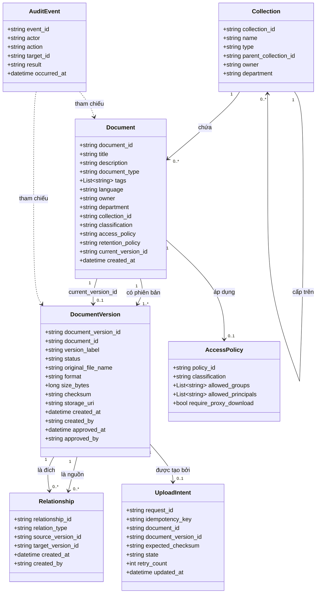
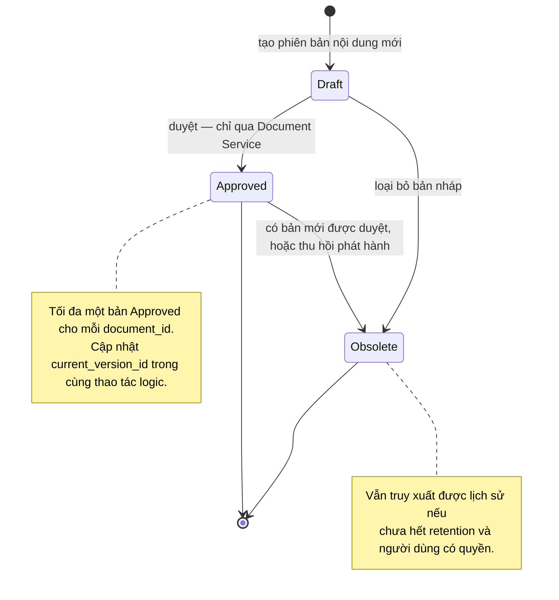
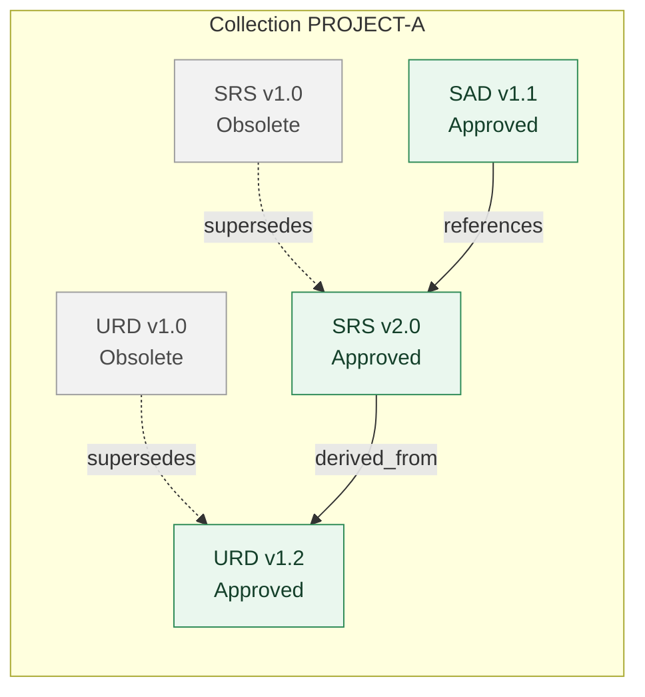

# C4 — MỨC 4: CODE — MÔ HÌNH DỮ LIỆU VÀ RÀNG BUỘC

> **Tài liệu đi kèm:** [c4-04b-code-structure.md](c4-04b-code-structure.md) mô tả cấu trúc mã nguồn, sơ đồ lớp và interface hiện thực các bất biến ở đây.

> **Câu hỏi tài liệu này trả lời:** Mô hình dữ liệu logic của kho gồm những thực thể nào, các bất biến phải được code thực thi là gì, và mô hình đó ánh xạ vào catalog như thế nào.
> **Lưu ý:** Mức 4 trong C4 là mức dễ lạc hậu nhất. Tài liệu này chỉ mô tả **mô hình logic độc lập sản phẩm** và các bất biến, không mô tả class hiện thực cụ thể.
> **Tham chiếu báo cáo:** mục 2.3, 2.4, 3.6.

## 4.1. Mô hình dữ liệu logic



## 4.2. Bất biến phải được code thực thi

| # | Bất biến | Thành phần thực thi | Test case |
|---|---|---|---|
| I1 | `document_id` và `document_version_id` bất biến, không phụ thuộc `version_label`, tên file, collection hay đường dẫn | D6 | POC-03 |
| I2 | `version_label` duy nhất trong phạm vi một `document_id` | D6 | POC-03, 22 |
| I3 | Nội dung phiên bản cũ không bị ghi đè khi phát hành bản mới | D6, D13 | POC-03, 15 |
| I4 | Mỗi `document_id` có **tối đa một** `DocumentVersion` ở trạng thái `Approved`; chưa có bản duyệt thì `current_version_id` là rỗng | D7 | POC-10, 22 |
| I5 | Duyệt bản mới làm bản `Approved` trước đó chuyển `Obsolete` trong một thao tác logic có kiểm soát đồng thời | D7 | POC-10, 22 |
| I6 | `Relationship` luôn gắn vào `document_version_id` ở **cả hai đầu**, không trỏ vào `document_id` và không tự chuyển đích khi có phiên bản mới | D8 | POC-06, 09 |
| I7 | `Relationship` truy vấn được **hai chiều theo `relation_type`** | D8 (native catalog hoặc registry) | POC-06 |
| I8 | Upload lại cùng nội dung vào cùng `document_id` không tạo phiên bản nội dung mới; cập nhật metadata vẫn được phép và có audit | D5 | POC-13 |
| I9 | Hai `Document` khác nhau có thể cùng `checksum` nhưng giữ `document_id` riêng | D5 | POC-13 |
| I10 | `storage_uri` trỏ tới object bất biến ứng với đúng `document_version_id` | D13 | POC-01 |
| I11 | Tài liệu chưa xác định được quyền ở chế độ hạn chế; không tự động công khai | D9 | POC-04 |
| I12 | Mọi thay đổi `status`, `access_policy`, `current_version_id`, quan hệ đều có `AuditEvent` với actor và thời điểm | D16 | POC-10, 14 |
| I13 | Retry với cùng `idempotency_key` không sinh thêm `DocumentVersion` | D11 | POC-18, 21 |
| I14 | `latest` theo thứ tự phiên bản **khác** `current approved`; chỉ D7 được cập nhật trường bản hiện hành | D7 | POC-07, 10 |

## 4.3. Máy trạng thái của Document Version



Chuyển `Obsolete` làm thay đổi điều kiện khai thác bản hiện hành, **không mặc nhiên xóa quyền xem lịch sử** (mục 2.6 báo cáo).

## 4.4. Nhóm metadata và vị trí gắn

| Nhóm | Trường ví dụ | Gắn với | Ai được ghi |
|---|---|---|---|
| Technical | `file_name`, `format`, `size`, `checksum`, `storage_uri` | Document Version | Document Service (tự động trích xuất) |
| Descriptive | `title`, `description`, `document_type`, `tags`, `language` | Document | Owner qua Catalog UI/API hoặc Document Service |
| Organizational | `owner`, `department`, `collection_id` | Document | Owner / Quản trị viên |
| Lifecycle | `version_label`, `status`, `created_at`, `approved_at`, `approved_by` | Document Version | Document Service |
| Governance | `classification`, `access_policy`, `retention_policy` | Document | Document Service |
| Relationship | `relation_type`, `source_version_id`, `target_version_id` | Document Version | Document Service |

Trường dùng để **lọc** bắt buộc phải có đường truy vấn đã kiểm chứng, không chỉ có khả năng lưu giá trị (POC-19).

## 4.5. Ánh xạ mô hình logic vào catalog

Bảng sau là **ứng viên ánh xạ**, không phải khẳng định sản phẩm hỗ trợ đầy đủ:

| Mô hình logic | OpenMetadata (ứng viên) | DataHub (ứng viên) |
|---|---|---|
| Kho/nguồn | Drive Service (Custom Drive) | Data platform/instance hoặc cách nhóm tương đương |
| Collection | Directory cấp trên | Container/Domain hoặc browse path — cần kiểm chứng |
| Document | Directory đại diện tài liệu | `Document` hoặc entity riêng; **không mặc định VersionSet hỗ trợ Document** |
| DocumentVersion | File entity riêng cho mỗi bản | Một entity riêng cho mỗi bản; kiểm chứng biểu diễn file gốc qua `storage_uri` |
| Metadata mở rộng | Custom properties trên File/Directory | Structured Properties, `documentInfo.customProperties` |
| `derived_from` | Lineage nếu File entity được API/UI hỗ trợ thực tế | Related Documents hoặc metadata/edge tùy kiểu entity |
| `references`, `supersedes` | Entity reference / custom properties hoặc registry relation | Related Documents / structured properties hoặc registry relation |
| `current_version_id` | Thuộc tính có kiểm soát trên Document/Directory | Thuộc tính có kiểm soát; **không đồng nhất với `latest` của VersionSet** |
| File gốc | S3 object nằm ngoài catalog | S3 object nằm ngoài catalog; `DataHubFile` là file đính kèm, không thay kho này |
| UploadIntent, AuditEvent của Document Service | Nằm ngoài catalog (C7 + log) | Nằm ngoài catalog (C7 + log) |

## 4.6. Quy ước object key

```text
s3://raw-documents/objects/{document_id}/{document_version_id}/source
```

- `original_file_name`, `version_label`, `collection_id` là **metadata**, không nằm trong key.
- Đổi tên tài liệu hoặc chuyển collection **không** làm đổi object key.
- S3 Versioning và Object Lock là **lớp bảo vệ**, không thay mô hình phiên bản tài liệu.
- Manifest intent (nếu chọn biến thể A của C7) nằm ở prefix riêng, ví dụ `s3://raw-documents/intents/{request_id}.json`, tách khỏi prefix `objects/`.

## 4.7. Ví dụ bản ghi một phiên bản

```json
{
  "document_version_id": "DOC-002-VER-0002",
  "document_id": "DOC-002",
  "collection_id": "PROJECT-A",
  "original_file_name": "srs.pdf",
  "title": "Software Requirements Specification",
  "document_type": "SRS",
  "version_label": "2.0",
  "status": "Approved",
  "classification": "internal",
  "checksum": "sha256:...",
  "storage_uri": "s3://raw-documents/objects/DOC-002/DOC-002-VER-0002/source",
  "relationships": [
    {"type": "derived_from", "target_version_id": "DOC-001-VER-0003"}
  ]
}
```

ID trong ví dụ mang tính minh họa. Khi triển khai nên dùng UUID/ULID hoặc cơ chế sinh ID không trùng để tránh phụ thuộc cách đặt `version_label`.

## 4.8. Ví dụ đồ thị quan hệ theo phiên bản



Khi SRS lên v2.1, quan hệ `SRS v2.0 --derived_from--> URD v1.2` **phải giữ nguyên**, không tự chuyển sang v2.1 (bất biến I6, test case POC-09).
