# C4 — MỨC 4: CODE — CẤU TRÚC MÃ NGUỒN DOCUMENT SERVICE (HIỆN THỰC THEO OPENMETADATA)

> **Quyết định đã chốt:** Catalog hiện thực là **OpenMetadata**. Quyết định Q1 ở [c4-07](c4-07-element-catalog.md#4-quyết-định-kiến-trúc-còn-mở) đóng lại ở mức mã nguồn: **không còn nhánh adapter DataHub trong code**. DataHub chỉ còn là đối chứng tài liệu ở mục 3.7 báo cáo.
> **Phần tử được phân rã:** C1 — Document Service, các thành phần D1–D18 ở [c4-03](c4-03-component-document-service.md).
> **Quan hệ với [c4-04](c4-04-code-data-model.md):** tài liệu kia mô tả **dữ liệu và bất biến I1–I14**; tài liệu này mô tả **mã nguồn thực thi các bất biến đó trên OpenMetadata**.
> **Còn mở:** Q2 (intent store: manifest S3 hay registry DB) và Q4 (quan hệ: Lineage API hay registry) vẫn có hai hiện thực trong code, chốt sau POC-06, 09, 18, 21, 22.
> **Cảnh báo:** Tên lớp là hợp đồng thiết kế, không phải mã đã viết. Đường dẫn API OpenMetadata phải đối chiếu với OpenAPI của **phiên bản được cố định** trước khi code.

## 1. Hệ quả của việc chốt OpenMetadata

| Trước khi chốt | Sau khi chốt |
|---|---|
| `MetadataCatalogPort` có 2 adapter, phải giữ mẫu số chung của hai sản phẩm | Port giữ lại **1 adapter**; được dùng đúng tính năng riêng của OpenMetadata: File/Directory entity, custom properties, Lineage API, Search API |
| Mô hình dữ liệu phải trung tính | Ánh xạ cố định: `Document → Directory`, `DocumentVersion → File`, `Collection → Directory cấp trên`, metadata mở rộng → `extension` |
| Chưa biết cơ chế đồng thời của catalog | OpenMetadata dùng **JSON Patch + trường `version` của entity**, **không có If-Match/ETag** → bắt buộc tự khóa theo `document_id` ở Document Service (lớp `DocumentLockPort`) |
| Chưa rõ cách lọc custom field | Lọc qua `extension.<tên trường>` trong `query_filter` của Search API; UI facet cho custom property là **giới hạn đã biết** (issue #25217) → `OmSearchQueryBuilder` + khả năng bật C9 Gateway |

**Lý do vẫn giữ `MetadataCatalogPort` dù chỉ còn một adapter:** (1) cố định phiên bản API và cách ly thay đổi không tương thích giữa các bản lớn của OpenMetadata (rủi ro ở mục 6.4 báo cáo); (2) cho phép test lõi nghiệp vụ bằng fake in-memory, không cần dựng OpenMetadata; (3) giữ đường rút nếu POC-17/19 thất bại ở mức không khắc phục được.

## 2. Cấu trúc package

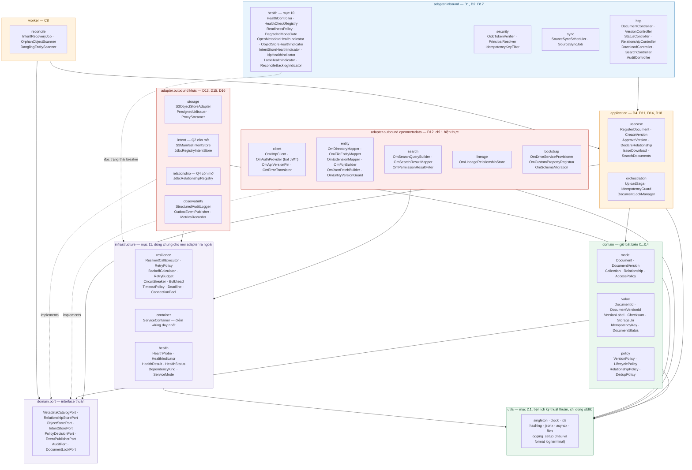

**Cấu hình nằm ngoài mã nguồn:** mọi tham số đọc được của hệ thống nằm ở `configs/*.yml` ở thư mục gốc, chia theo khối — `app`, `logging`, `catalog`, `storage`, `intent_store`, `relationship_store`, `security`, `resilience`, `health`. `config.py` nạp chúng với thứ tự ưu tiên **init → biến môi trường (`DS_`, lồng nhau bằng `__`) → `.env` → YAML → mặc định trong code**. Bí mật (bot token của OpenMetadata, khóa S3) **không** đặt trong YAML, chỉ truyền qua biến môi trường. Bảng tham số ở mục 11.3 là nội dung của `configs/resilience.yml`, không phải hằng số trong code.

**Quy tắc phụ thuộc bắt buộc:** `domain` và `domain.port` **không import** SDK hay model của OpenMetadata, không import AWS SDK. Chỉ package `adapter.outbound.openmetadata` được biết tới khái niệm `Directory`, `File`, `extension`, `fullyQualifiedName`. `utils` không import bất kỳ package nào khác của service. CI phải chặn vi phạm bằng một test kiểm tra phụ thuộc (AST hoặc import-linter).

### 2.1. Package `utils` — tiện ích kỹ thuật

`utils` là lớp trong cùng của đồ thị phụ thuộc: **không** chứa khái niệm nghiệp vụ, **không** import `domain`, `application`, `adapter`, `config`, chỉ dùng stdlib. Nhờ vậy mọi lớp khác import được `utils` mà không tạo vòng phụ thuộc.

| Module | Nội dung | Ai dùng |
|---|---|---|
| `singleton` | `SingletonMeta` có `threading.Lock`, `clear()`, `has_instance()` | `ServiceContainer`, `OmHttpClient`, `CircuitBreaker`, `HealthCheckRegistry`, `LoggingConfigurator` |
| `clock` | `utc_now`, `Clock`, `SystemClock`, `FixedClock` | model nghiệp vụ, intent store, breaker, test thời gian |
| `ids` | `IdGenerator`, `UlidGenerator`, `SequentialIdGenerator` | `VersionPolicy` sinh `document_version_id`, `request_id` |
| `hashing` | `StreamingHasher`, `digest_of` | D4 Upload Handler, D5 Dedup, job đối soát toàn vẹn |
| `jsonx` | `JsonCodec` với `sort_keys` | manifest intent trên S3, outbox, audit |
| `asyncx` | `ThreadOffloader`, `ConcurrencyLimiter` | adapter boto3/sqlite gọi từ code async |
| `files` | `LocalPaths` | sqlite, dữ liệu tạm |
| `logging_setup` | `LogPalette`, `TerminalFormatter`, `JsonLogFormatter`, `LoggingConfigurator`, `get_logger` | toàn bộ service, worker, CLI |

**Ranh giới giữa log kỹ thuật và audit nghiệp vụ** — hai thứ hay bị trộn lẫn:

| | Thuộc về | Nội dung |
|---|---|---|
| *Cách hiển thị* log | `utils/logging_setup.py` | màu ANSI theo mức log, layout một dòng, chọn `TerminalFormatter` hay `JsonLogFormatter`, mức log, handler |
| *Nội dung audit* | `adapter/outbound/observability/StructuredAuditLogger` (D16) | `AuditEvent`: ai tải file, ai chuyển trạng thái, ai đổi quyền, lỗi — phục vụ bất biến I12 và POC-14 |

`StructuredAuditLogger` chỉ **dùng** formatter của `utils`, không tự định nghĩa cách in. `LogPalette.supports_color()` tôn trọng `NO_COLOR` và `FORCE_COLOR`, và tự tắt màu khi đầu ra không phải TTY để log trong CI hoặc file không lẫn ký tự điều khiển.

### 2.2. Phân cấp lớp: base class và kế thừa

Mọi hợp đồng trong mã nguồn là một **abstract base class** (`abc.ABC` + `@abstractmethod`), hiện thực kế thừa nó. Lý do chọn base class thay vì structural typing: ràng buộc được kiểm tra ngay khi khởi tạo đối tượng, mypy báo ngay khi thiếu method, và base class là nơi đặt hành vi dùng chung thay vì lặp ở từng lớp con.

```mermaid
classDiagram
    direction TB

    class MetadataCatalogPort {
        <<abstract>>
    }
    class ObjectStorePort {
        <<abstract>>
    }
    class IntentStorePort {
        <<abstract>>
    }
    class RelationshipStorePort {
        <<abstract>>
    }
    class OpenMetadataCatalogAdapter
    class InMemoryCatalog
    class S3ObjectStoreAdapter
    class InMemoryObjectStore
    class SqliteRegistryIntentStore
    class S3ManifestIntentStore
    class OmLineageRelationshipStore
    class SqliteRelationshipRegistry

    MetadataCatalogPort <|-- OpenMetadataCatalogAdapter
    MetadataCatalogPort <|-- InMemoryCatalog
    ObjectStorePort <|-- S3ObjectStoreAdapter
    ObjectStorePort <|-- InMemoryObjectStore
    IntentStorePort <|-- SqliteRegistryIntentStore
    IntentStorePort <|-- S3ManifestIntentStore
    RelationshipStorePort <|-- OmLineageRelationshipStore
    RelationshipStorePort <|-- SqliteRelationshipRegistry

    class UseCase {
        <<abstract>>
        +execute(command) TResult
        #authorize(principal, action, resource)
        #audit(actor, action, target, result)
        #publish(event)
    }
    class ReadUseCase {
        <<abstract>>
    }
    class WriteUseCase {
        <<abstract>>
        #run_exclusive(document_id, operation)
    }
    class CreateVersionUseCase
    class ApproveVersionUseCase
    class RegisterDocumentUseCase
    class DeclareRelationshipUseCase
    class UpdateAccessPolicyUseCase
    class SearchDocumentsUseCase
    class QueryRelationshipsUseCase
    class IssueDownloadUseCase
    class ListAuditUseCase

    UseCase <|-- ReadUseCase
    UseCase <|-- WriteUseCase
    WriteUseCase <|-- CreateVersionUseCase
    WriteUseCase <|-- ApproveVersionUseCase
    WriteUseCase <|-- RegisterDocumentUseCase
    WriteUseCase <|-- DeclareRelationshipUseCase
    WriteUseCase <|-- UpdateAccessPolicyUseCase
    ReadUseCase <|-- SearchDocumentsUseCase
    ReadUseCase <|-- QueryRelationshipsUseCase
    ReadUseCase <|-- IssueDownloadUseCase
    ReadUseCase <|-- ListAuditUseCase

    class DomainPolicy {
        <<abstract>>
        +policy_name() str
        #require(condition, error)
    }
    class VersionPolicy
    class LifecyclePolicy
    class RelationshipPolicy
    class DedupPolicy

    DomainPolicy <|-- VersionPolicy
    DomainPolicy <|-- LifecyclePolicy
    DomainPolicy <|-- RelationshipPolicy
    DomainPolicy <|-- DedupPolicy

    class OutboundAdapter {
        <<abstract>>
        #call(operation, deadline)
        +ping()
    }
    class HealthIndicator {
        <<abstract>>
        +name() str
        +kind() DependencyKind
        +check(deadline) HealthResult
        #probe() HealthResult
    }
    class BackoffStrategy {
        <<abstract>>
        +next_delay(attempt) float
        +jittered_delay(attempt) float
    }
    class FullJitterBackoff
    class FixedBackoff

    BackoffStrategy <|-- FullJitterBackoff
    BackoffStrategy <|-- FixedBackoff
    OutboundAdapter <|-- OpenMetadataCatalogAdapter
    OutboundAdapter <|-- S3ObjectStoreAdapter
    OutboundAdapter <|-- SqliteRegistryIntentStore
```

| Base class | Nơi đặt | Hành vi dùng chung đặt ở base | Lớp con |
|---|---|---|---|
| 8 port | `domain/port.py` | chỉ chữ ký trừu tượng — domain không giữ hành vi hạ tầng | adapter thật và fake |
| `UseCase` → `ReadUseCase`, `WriteUseCase` | `application/usecase/base.py` | `_authorize`, `_audit`, `_publish`; nhánh write thêm `_run_exclusive` qua `DocumentLockManager` | 9 use case |
| `DomainPolicy` | `domain/policy.py` | `_require` phát đúng loại lỗi miền, `policy_name` cho log | 4 policy |
| `OutboundAdapter` | `adapter/outbound/base.py` | giữ `ResilientCallExecutor` và logger, `_call()` bọc mọi lời gọi ra ngoài | adapter OpenMetadata, S3, intent, relationship, outbox |
| `HealthIndicator` | `adapter/inbound/health/base.py` | cache theo TTL, đo độ trễ, bọc timeout, đọc trạng thái breaker | 6 indicator |
| `BackoffStrategy` | `infrastructure/resilience/retry.py` | `jittered_delay` dựng trên `next_delay` của lớp con | `FullJitterBackoff`, `FixedBackoff` |
| `DomainError` | `domain/errors.py` | phân cấp lỗi để lớp inbound dịch sang mã HTTP theo nhánh cây | 11 lỗi nghiệp vụ |

**Hai giới hạn tự đặt:** base class chỉ sinh ra khi có hành vi dùng chung thật hoặc để ràng buộc hợp đồng — không có lớp trung gian rỗng; và phân cấp **tối đa 2 tầng** dưới base, để không tạo cây kế thừa sâu khó lần.

## 3. Sơ đồ lớp: lõi nghiệp vụ và port

```mermaid
classDiagram
    direction TB

    class DocumentStatus {
        <<enumeration>>
        Draft
        Approved
        Obsolete
    }
    class RelationType {
        <<enumeration>>
        references
        derived_from
        supersedes
    }

    class Document {
        +DocumentId id
        +string documentType
        +string collectionId
        +AccessPolicy accessPolicy
        +DocumentVersionId currentVersionId
        +addVersion(DocumentVersion) DocumentVersion
        +approve(DocumentVersionId, Actor) ApprovalResult
        +currentApproved() DocumentVersion
        +assertLabelUnique(VersionLabel)
    }

    class DocumentVersion {
        +DocumentVersionId id
        +DocumentId documentId
        +VersionLabel label
        +DocumentStatus status
        +Checksum checksum
        +StorageUri storageUri
        +markApproved(Actor, Instant)
        +markObsolete(Actor, Instant)
    }

    class Relationship {
        +RelationType type
        +DocumentVersionId sourceVersionId
        +DocumentVersionId targetVersionId
        +assertBothEndsAreVersions()
    }

    class AccessPolicy {
        +string classification
        +List~string~ allowedGroups
        +bool requireProxyDownload
        +permits(Principal, Action) bool
    }

    class VersionPolicy {
        <<domain service>>
        +nextVersion(Document, UploadRequest) DocumentVersion
        +rejectIfDuplicateContent(Document, Checksum)
    }
    class LifecyclePolicy {
        <<domain service>>
        +transition(DocumentVersion, DocumentStatus, Actor)
        +assertAtMostOneApproved(Document)
    }
    class RelationshipPolicy {
        <<domain service>>
        +validate(Relationship)
        +assertTargetNotRebound(Relationship)
    }

    class MetadataCatalogPort {
        <<abstract>>
        +ensureCollection(Collection) EntityRef
        +registerDocument(Document) EntityRef
        +registerVersion(DocumentVersion, Metadata) EntityRef
        +patchControlledFields(DocumentVersionId, Map~string,object~) void
        +readDocument(DocumentId) Document
        +listVersions(DocumentId) List~DocumentVersion~
        +search(SearchQuery) SearchPage
    }
    class RelationshipStorePort {
        <<abstract>>
        +upsert(Relationship) void
        +query(DocumentVersionId, Direction, RelationType) List~Relationship~
        +remove(Relationship) void
    }
    class ObjectStorePort {
        <<abstract>>
        +putImmutable(StorageUri, Stream, Checksum) PutResult
        +head(StorageUri) ObjectInfo
        +presign(StorageUri, Duration) Url
        +openStream(StorageUri) Stream
        +listUnderPrefix(string) List~ObjectInfo~
    }
    class IntentStorePort {
        <<abstract>>
        +create(UploadIntent) void
        +advance(RequestId, IntentState) void
        +findByIdempotencyKey(IdempotencyKey) UploadIntent
        +findUnfinished(Duration) List~UploadIntent~
    }
    class PolicyDecisionPort {
        <<abstract>>
        +decide(Principal, Action, ResourceRef) Decision
        +effectivePolicy(DocumentId) AccessPolicy
    }
    class DocumentLockPort {
        <<abstract>>
        +withLock(DocumentId, Callable) Result
    }
    class EventPublisherPort {
        <<abstract>>
        +publish(DomainEvent) void
    }
    class AuditPort {
        <<abstract>>
        +record(AuditEvent) void
    }

    Document "1" *-- "1..*" DocumentVersion
    Document --> AccessPolicy
    DocumentVersion --> DocumentStatus
    Relationship --> RelationType
    VersionPolicy ..> Document
    LifecyclePolicy ..> Document
    RelationshipPolicy ..> Relationship
```

Tám port là abstract base class (xem mục 2.2). `RelationshipStorePort` được **tách khỏi** `MetadataCatalogPort` vì đây là điểm rủi ro cao nhất (POC-06, 09): nếu Lineage API của OpenMetadata không truy vấn ngược được theo `relation_type` cho File entity, chỉ cần đổi binding sang registry, không sửa use case.

## 4. Sơ đồ lớp: adapter OpenMetadata

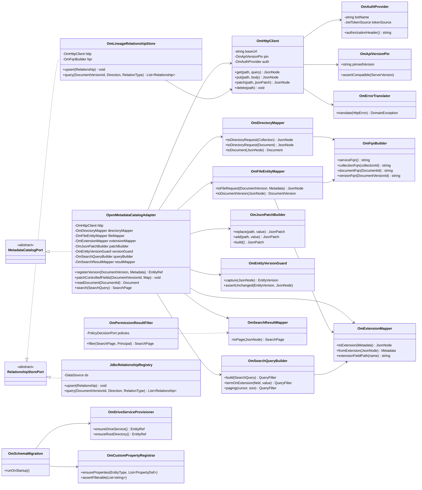

## 5. Ánh xạ mã nguồn sang API OpenMetadata

Bảng dưới là **hợp đồng cần đối chiếu với OpenAPI của phiên bản được cố định** trước khi code. Không coi đây là tài liệu API chính thức.

| Mô hình logic | Entity OpenMetadata | API dự kiến | Lớp phụ trách |
|---|---|---|---|
| Kho/nguồn | Drive Service (Custom Drive) | `PUT /api/v1/services/driveServices` | `OmDriveServiceProvisioner` |
| Collection | Directory cấp trên | `PUT /api/v1/drives/directories` | `OmDirectoryMapper` |
| Document | Directory đại diện tài liệu | `PUT /api/v1/drives/directories` | `OmDirectoryMapper` |
| DocumentVersion | **File entity** cho mỗi bản nguồn | `PUT /api/v1/drives/files` | `OmFileEntityMapper` |
| Metadata mở rộng | `extension` theo custom property đã đăng ký | `PATCH /api/v1/drives/files/{id}` dạng JSON Patch | `OmExtensionMapper`, `OmJsonPatchBuilder` |
| Định nghĩa custom property | Custom property trên entity type | `PATCH /api/v1/metadata/types/{id}` | `OmCustomPropertyRegistrar` |
| `derived_from` | Lineage edge giữa hai File entity | `PUT /api/v1/lineage`, `GET /api/v1/lineage/...` | `OmLineageRelationshipStore` |
| `references`, `supersedes` | Lineage có `lineageDetails`, hoặc registry ngoài | như trên hoặc bảng registry | `OmLineageRelationshipStore` / `JdbcRelationshipRegistry` |
| Tìm kiếm theo metadata | Search index | `GET /api/v1/search/query` với `query_filter` trên `extension.<field>` | `OmSearchQueryBuilder` |
| Lịch sử metadata | Entity version của OpenMetadata | `GET /api/v1/drives/files/{id}/versions` | `OpenMetadataCatalogAdapter` |
| Service account của Document Service | Bot user + JWT | cấu hình, không gọi lúc chạy | `OmAuthProvider` |
| File gốc | **Không** nằm trong OpenMetadata | S3 API | `S3ObjectStoreAdapter` |
| UploadIntent, Audit của Document Service | **Không** nằm trong OpenMetadata | C7 + log | `IntentStorePort`, `AuditPort` |

Ba điểm khác biệt so với mô hình trung tính trước đây, phải phản ánh đúng trong code:

1. **`version` của File entity là lịch sử metadata, không phải phiên bản nội dung.** `OmEntityVersionGuard` chỉ dùng trường này để phát hiện ghi đè đồng thời, **không** dùng làm `version_label`.
2. **OpenMetadata không có If-Match/ETag.** Mọi thao tác cần tuần tự hóa phải nằm trong `DocumentLockPort.withLock(documentId, ...)`; `OmEntityVersionGuard` chỉ là lớp phát hiện xung đột thứ hai, không thay khóa.
3. **Custom property chỉ có nghĩa khi đã đăng ký trước.** `OmSchemaMigration.runOnStartup()` phải chạy `OmCustomPropertyRegistrar.ensureProperties(...)` và `assertFilterable(...)` cho `document_type`, `status`, `classification`, `collection_id`, `version_label`; service **fail fast** nếu thiếu, không âm thầm ghi `extension` không lọc được.

## 6. Luồng gọi ở mức lớp — tạo phiên bản mới trên OpenMetadata

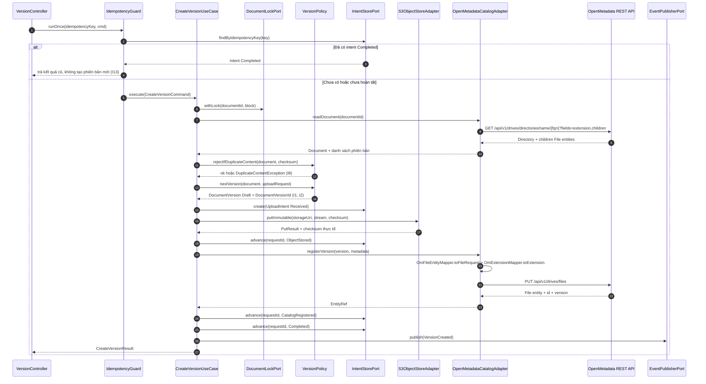

Khi bất kỳ bước nào từ `create(UploadIntent)` trở đi thất bại, `IntentRecoveryJob.runOnce()` gọi `UploadSaga.resume(intent)` với **cùng** `DocumentVersionId` và `IdempotencyKey`; `PUT /api/v1/drives/files` theo FQN cố định là thao tác idempotent nên retry không sinh entity trùng — xem [luồng 7 ở c4-05](c4-05-dynamic-views.md#7-phục-hồi-sau-lỗi-một-phía).

## 7. Luồng gọi ở mức lớp — duyệt phiên bản

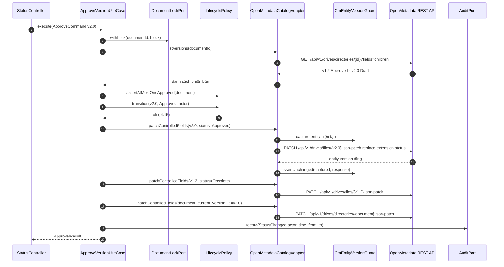

Ba lệnh `PATCH` trên **không** nằm trong một giao dịch của OpenMetadata. Vì vậy:

- Toàn bộ khối nằm trong `withLock(documentId)` để không có hai luồng duyệt chen nhau (POC-22).
- Nếu lệnh thứ hai hoặc ba lỗi, `ApproveVersionUseCase` ghi intent `StatusChangePending` và `IntentRecoveryJob` hoàn tất lại theo cùng thứ tự; bất biến "tối đa một bản Approved" được kiểm tra lại ở mỗi lần phục hồi.
- `DanglingEntityScanner` có kiểm tra định kỳ: mọi `Document` có `current_version_id` trỏ tới phiên bản không ở trạng thái `Approved` đều bị báo lệch.

## 8. Tìm kiếm: nơi rủi ro tập trung

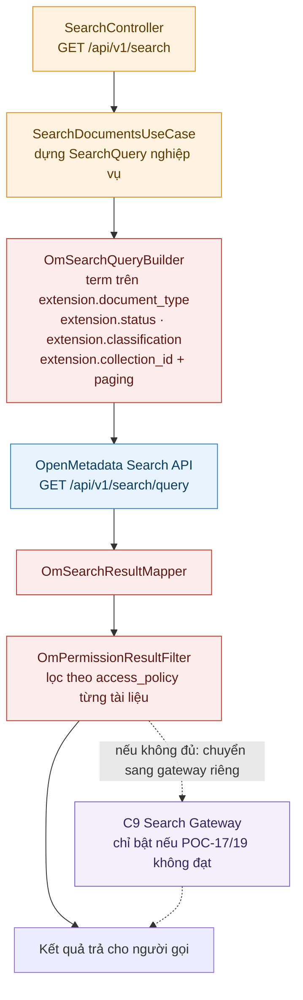

Ba giới hạn đã biết của OpenMetadata phải được xử lý ngay trong code, không để đến lúc tích hợp:

| Giới hạn | Xử lý trong mã nguồn | Test case |
|---|---|---|
| Custom property **không mặc định** là UI facet (issue #25217) | `OmSearchQueryBuilder` chỉ cam kết đường API; UI facet là yêu cầu riêng, đánh giá theo đối tượng sử dụng | POC-19 |
| Trường chưa đăng ký hoặc chưa được index thì lọc **âm thầm sai** | `OmCustomPropertyRegistrar.assertFilterable(...)` chạy lúc khởi động; service fail fast | POC-19 |
| Phân quyền kết quả tra cứu chưa chắc đủ cho người dùng cuối | `OmPermissionResultFilter` lọc lại theo `access_policy`; nếu chi phí/độ chính xác không đạt thì bật C9 | POC-02, 17, 20 |

## 9. Quan hệ theo phiên bản: hai hiện thực, một port

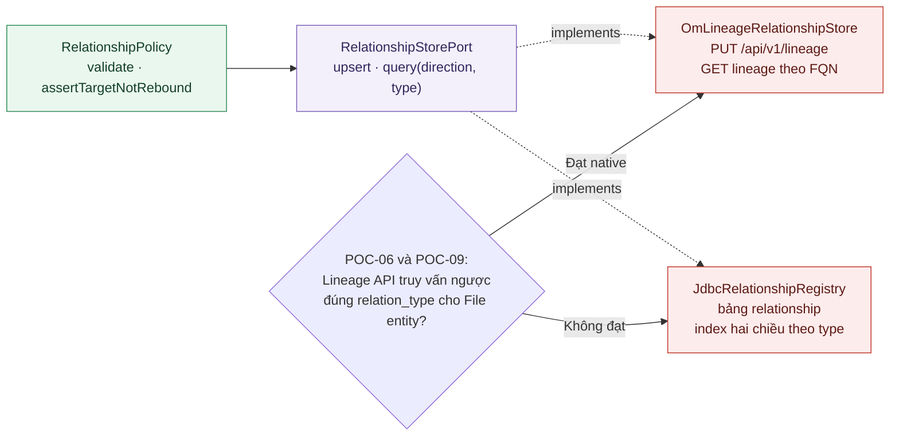

Nếu chọn `OmLineageRelationshipStore`, `lineageDetails` phải mang `relation_type`, và `OmFqnBuilder.versionFqn(...)` bảo đảm hai đầu edge là **File entity của phiên bản**, không phải Directory của tài liệu (bất biến I6). Nếu chọn `JdbcRelationshipRegistry`, bảng registry trở thành nguồn sự thật cho quan hệ và phải được đưa vào backup, đối soát và dự toán hạ tầng.

## 10. Health check

### 10.1. Nguyên tắc

Document Service phụ thuộc 5 thành phần ngoài tiến trình (OpenMetadata, Object Storage, Intent Store, IdP, khóa phân tán). Health check phải phân biệt **tiến trình còn sống** với **tiến trình đủ điều kiện nhận việc**, nếu không một sự cố của OpenMetadata sẽ làm orchestrator restart hàng loạt pod Document Service mà không giải quyết được gì.

| Quy tắc | Lý do |
|---|---|
| `liveness` **không** kiểm tra phụ thuộc ngoài | Tránh restart lan truyền khi catalog hoặc storage chậm |
| `readiness` kiểm tra đúng những phụ thuộc mà **nhóm API đang bật** cần | Cho phép chạy ở chế độ suy giảm thay vì tắt toàn bộ |
| Health check **chỉ đọc**, không tạo entity, không ghi object, không sinh intent | Health không được để lại dữ liệu rác trong catalog |
| Kết quả được **cache 5–10 giây**, mỗi indicator có timeout riêng ngắn hơn chu kỳ probe | Probe không trở thành nguồn tải lên OpenMetadata |
| Endpoint chi tiết **không phơi ra ngoài**, chỉ mạng nội bộ hoặc có xác thực | Chi tiết phụ thuộc là thông tin hạ tầng |
| `startup` cho phép thử lại có backoff đến hạn chót, rồi mới thất bại | Thứ tự khởi động giữa service và OpenMetadata không đảm bảo |
| **Mỗi adapter outbound tự khai báo health check của mình** | Chỉ adapter biết phép thử rẻ và chỉ-đọc cho phụ thuộc của nó; thêm phụ thuộc mới không phải sửa lớp health |

### 10.2. Sơ đồ lớp

Hợp đồng health nằm ở `infrastructure/health.py` để **cả hai phía** dùng được: adapter outbound hiện thực `HealthProbe`, lớp inbound tổng hợp qua `HealthIndicator`.

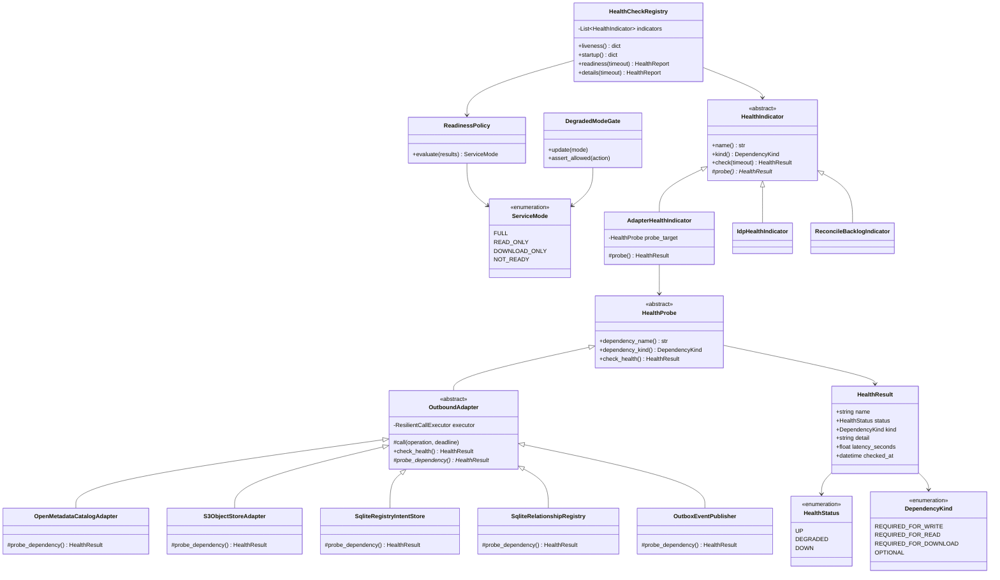

**Vì sao `check_health()` thuộc adapter chứ không thuộc lớp health:** phép thử rẻ và chỉ-đọc của mỗi phụ thuộc chỉ adapter mới biết (`GET /api/v1/system/version` cho OpenMetadata, `HEAD` bucket cho S3, đọc bản ghi canary cho intent store). Adapter cũng là nơi giữ `CircuitBreaker`, nên nó đọc được trạng thái breaker **trước** khi quyết định có gọi thật hay không. Nhờ vậy thêm một phụ thuộc mới chỉ cần hiện thực `_probe_dependency()`, không phải sửa `HealthCheckRegistry`.

### 10.3. Từng indicator kiểm tra gì

| Indicator / adapter | Phép kiểm tra do adapter hiện thực | Kind | Khi DOWN thì mất gì |
|---|---|---|---|
| `OpenMetadataCatalogAdapter._probe_dependency` | `GET /api/v1/system/version` + `OmApiVersionPin.assertCompatible(...)` + xác nhận custom property bắt buộc còn tồn tại | REQUIRED_FOR_WRITE, REQUIRED_FOR_READ | Không đăng ký phiên bản, không tra cứu metadata. Vẫn cấp được file nếu policy còn trong cache |
| `S3ObjectStoreAdapter._probe_dependency` | `HEAD` bucket và `HEAD` một object canary chỉ-đọc | REQUIRED_FOR_WRITE, REQUIRED_FOR_DOWNLOAD | Không upload, không cấp file |
| `SqliteRegistryIntentStore._probe_dependency` | đọc bản ghi canary, đo độ trễ ghi-đọc nếu là registry DB | REQUIRED_FOR_WRITE | Không nhận upload mới — **không được bỏ qua intent để ghi trực tiếp** |
| `IdpHealthIndicator` (lớp inbound, không có adapter) | JWKS còn hiệu lực hoặc tải lại được | REQUIRED_FOR_READ | Token mới không xác thực được; token đang hiệu lực vẫn dùng JWKS trong cache |
| `DocumentLock._probe_dependency` | lấy và nhả một khóa canary | REQUIRED_FOR_WRITE | Không duyệt phiên bản, không tạo phiên bản — vì mất bất biến I4, I5 |
| `ReconcileBacklogIndicator` (đọc qua `IntentStorePort`) | số intent chưa hoàn tất và tuổi intent cũ nhất so với ngưỡng | OPTIONAL, báo DEGRADED | Không mất chức năng, nhưng cảnh báo lệch trạng thái đang tích tụ |

Nguyên tắc với `IntentStoreHealthIndicator` và `LockHealthIndicator`: khi hai thành phần này DOWN thì **từ chối ghi**, không có chế độ suy giảm. Ghi khi thiếu intent hoặc thiếu khóa sẽ phá I4, I5, I13 — tức đổi một sự cố tạm thời thành sai dữ liệu lâu dài.

### 10.4. Endpoint và chế độ suy giảm

| Endpoint | Ai gọi | Nội dung | Điều kiện trả không khỏe |
|---|---|---|---|
| `GET /livez` | orchestrator | chỉ tiến trình, thread pool, heap | deadlock hoặc tiến trình không phục vụ được |
| `GET /startupz` | orchestrator | `OmSchemaMigration` đã chạy xong | migration chưa xong và còn trong hạn chót |
| `GET /readyz` | load balancer | tổng hợp theo `ReadinessPolicy` | mọi phụ thuộc REQUIRED của nhóm API đang bật không UP |
| `GET /internal/healthz/deps` | vận hành, mạng nội bộ | từng indicator, độ trễ, lần kiểm tra cuối, trạng thái circuit breaker | — |

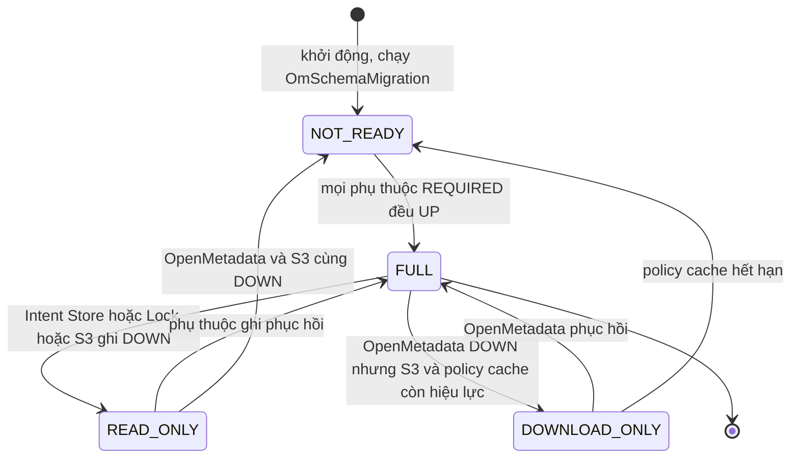

`DegradedModeGate.assertAllowed(Action)` là nơi duy nhất quyết định chặn hành động theo `ServiceMode`; use case không tự kiểm tra sức khỏe phụ thuộc. Ở chế độ `READ_ONLY` và `DOWNLOAD_ONLY`, API ghi trả `503` kèm `Retry-After`, **không** trả `500`, để client phân biệt được sự cố tạm thời với lỗi dữ liệu.

`DOWNLOAD_ONLY` chỉ được bật khi `PolicyDecisionPort` có cache policy còn trong TTL **và** tài liệu không thuộc nhóm `requireProxyDownload`; hết TTL thì chuyển `NOT_READY` thay vì đoán quyền — đây là ràng buộc của I11.

## 11. Retry, timeout và chịu lỗi kết nối

### 11.1. Sơ đồ lớp

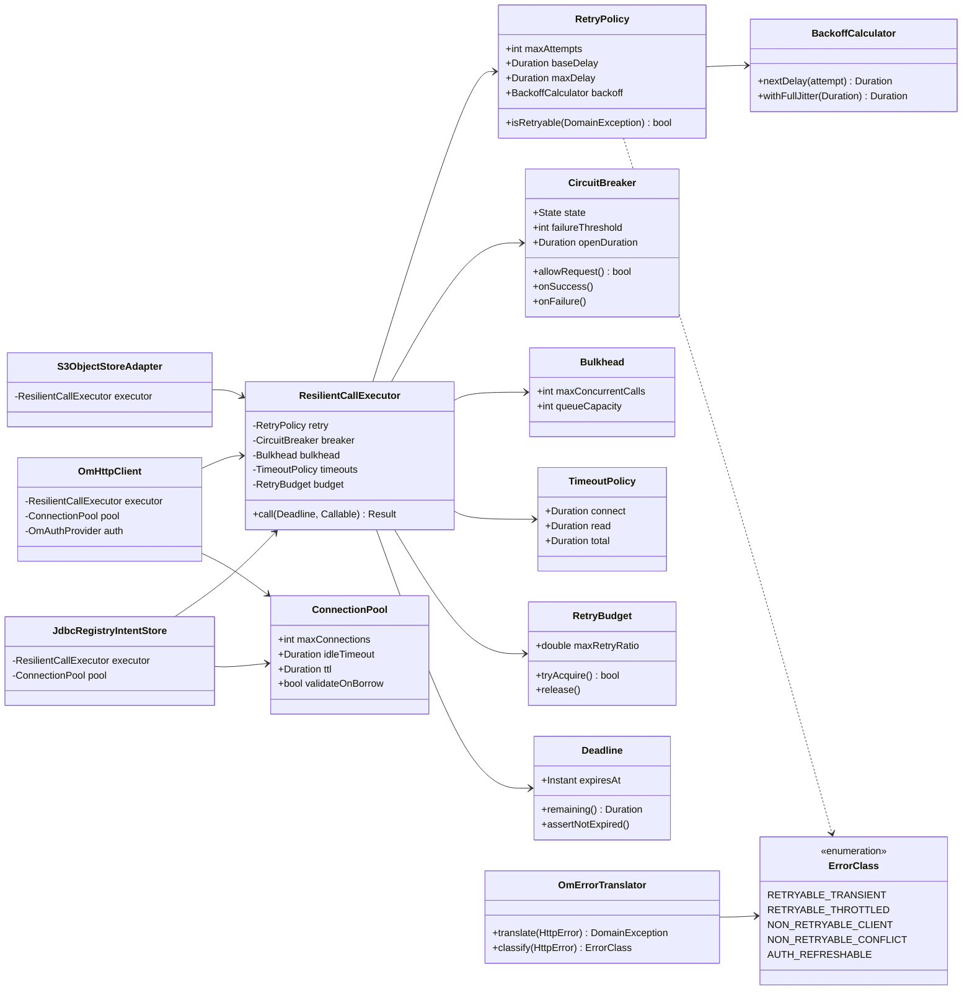

Mỗi phụ thuộc có **một `ResilientCallExecutor` riêng**, không dùng chung: circuit breaker của OpenMetadata mở không được làm chặn lời gọi S3, và ngược lại. `Bulkhead` tách pool để một phụ thuộc chậm không chiếm hết thread của toàn service.

### 11.2. Phân loại lỗi trước khi quyết định retry

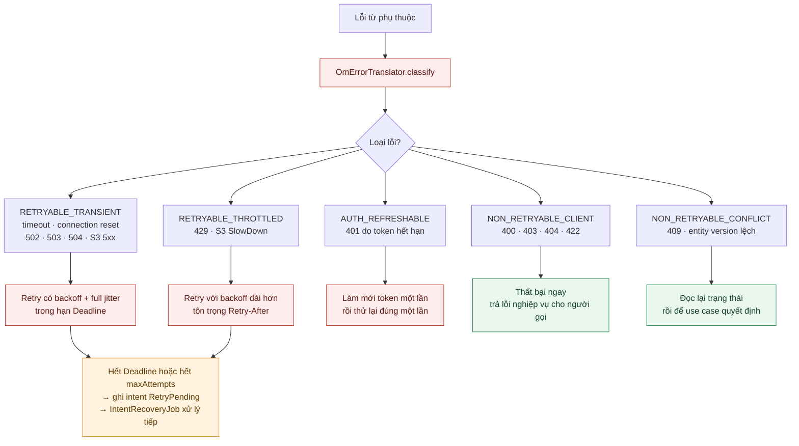

**Điều kiện tiên quyết của mọi retry:** thao tác phải idempotent. Trong hiện thực OpenMetadata:

| Thao tác | Idempotent? | Cách retry an toàn |
|---|---|---|
| `PUT /api/v1/drives/files` theo FQN cố định | Có | retry trực tiếp |
| `PATCH` JSON Patch dạng `replace` trên đường dẫn cố định | Có | retry sau khi `OmEntityVersionGuard` xác nhận giá trị chưa bị người khác đổi |
| `PATCH` JSON Patch dạng `add` vào mảng | **Không** | đọc lại entity rồi dựng patch mới, không retry nguyên trạng |
| `PUT /api/v1/lineage` | Có | retry trực tiếp |
| `GET` mọi loại | Có | retry trực tiếp |
| Ghi object S3 theo key bất biến | Có | retry trực tiếp, checksum xác nhận lại |
| Tạo intent mới | Có, nhờ `idempotency_key` | retry qua `IdempotencyGuard` |

### 11.3. Tham số theo từng phụ thuộc

Giá trị dưới đây là **giá trị khởi điểm đề xuất**, nằm trong `configs/resilience.yml` và chốt lại sau POC-16 và POC-21:

| Phụ thuộc | connect | read | total trong một request | maxAttempts | backoff | breaker mở sau | Ghi chú |
|---|---|---|---|---|---|---|---|
| OpenMetadata — đọc | 1s | 3s | 5s | 3 | 100ms base, full jitter, cap 1s | 50% lỗi trong 20 lời gọi | trả `503` cho client khi mở |
| OpenMetadata — ghi/patch | 1s | 5s | 8s | 2 | 200ms base, cap 2s | như trên | hết attempts thì chuyển intent `RetryPending` |
| Object Storage — metadata, presign | 1s | 2s | 4s | 3 | 100ms base, cap 1s | 50% trong 20 | presign là tính toán cục bộ, hiếm khi cần retry |
| Object Storage — ghi object | 2s | theo kích thước file | theo kích thước file | 3 ở mức **từng part** | 200ms base, cap 5s | không mở breaker cho upload đang chạy | dùng multipart để retry theo part, không gửi lại toàn file |
| Intent Store — registry DB | 500ms | 1s | 2s | 3 | 50ms base, cap 500ms | 50% trong 20 | thất bại thì từ chối ghi, không bỏ qua intent |
| Intent Store — manifest S3 | 1s | 2s | 4s | 3 | 100ms base, cap 1s | như trên | Q2 còn mở |
| IdP — JWKS | 1s | 2s | 3s | 2 | 200ms base | không mở | JWKS cache có TTL và dùng được bản cũ trong hạn |
| Khóa phân tán | 300ms | 1s | **không retry quá hạn khóa** | 1 | — | — | hết hạn thì trả `409`, không giữ khóa để retry |

Ba ràng buộc không được vi phạm:

1. **Deadline lan truyền.** `Deadline` được tạo ở `adapter.inbound` theo timeout của API công khai và truyền xuống mọi lời gọi; không lớp nào tự đặt thời gian chờ dài hơn deadline còn lại. Không có deadline thì retry sẽ nhân thời gian chờ của client.
2. **Không retry khi đang giữ khóa.** `DocumentLockPort.withLock(...)` chỉ bọc các lời gọi ngắn. Nếu lời gọi bên trong thất bại thì nhả khóa, ghi `RetryPending` và để `IntentRecoveryJob` chạy lại từ đầu — giữ khóa để retry sẽ chặn mọi thao tác khác trên cùng tài liệu.
3. **Retry budget dùng chung cho mỗi phụ thuộc.** `RetryBudget` giới hạn tỷ lệ retry (đề xuất ≤10% tổng lời gọi). Khi OpenMetadata quá tải, retry phải **giảm**, không tăng, nếu không service sẽ tự gây bão retry.

### 11.4. Trạng thái circuit breaker

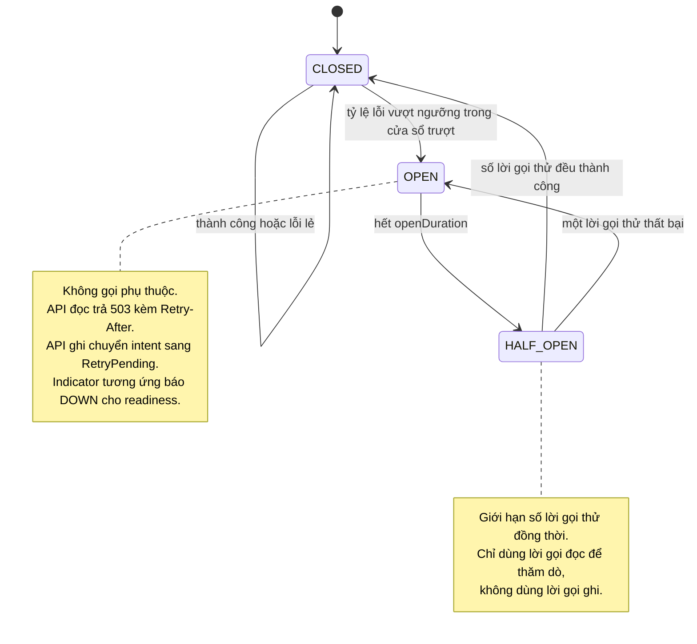

Trạng thái breaker là **đầu vào của health check**, không phải thông tin nội bộ: `OpenMetadataHealthIndicator` đọc trạng thái breaker thay vì tự gọi thêm một lời gọi mới, để health check không làm nặng thêm phụ thuộc đang quá tải.

### 11.5. Ranh giới giữa retry trong request và phục hồi bất đồng bộ

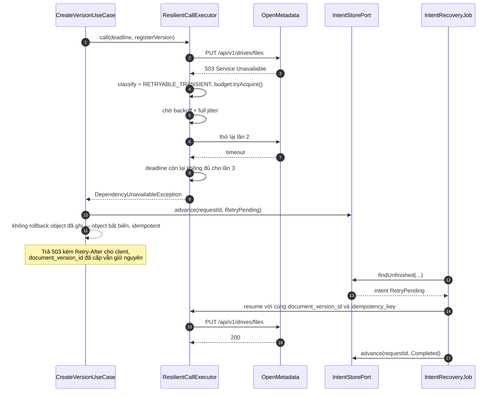

Ranh giới cố định: **retry trong request tính bằng giây**, chỉ để vượt qua lỗi tức thời; mọi thứ dài hơn thế thuộc `IntentRecoveryJob`. Client không bao giờ phải chờ một phụ thuộc phục hồi, và `document_version_id` đã cấp không bị thu hồi — nhờ vậy retry của client với cùng `Idempotency-Key` trả về đúng phiên bản đó (I13).

### 11.6. Kết nối và cấu hình pool

| Hạng mục | Yêu cầu |
|---|---|
| Connection pool | Mỗi phụ thuộc một pool riêng, có `maxConnections`, `idleTimeout`, TTL kết nối để DNS được phân giải lại sau khi OpenMetadata hoặc storage đổi IP |
| Kiểm tra khi lấy kết nối | `validateOnBorrow` cho registry DB, tránh dùng kết nối đã bị firewall đóng im lặng |
| Keep-alive | Bật cho OpenMetadata và S3; thời gian keep-alive phải nhỏ hơn idle timeout của proxy/load balancer phía trước |
| Token | `OmAuthProvider` làm mới JWT trước khi hết hạn, có khóa chống làm mới đồng thời; `401` chỉ kích hoạt làm mới **một lần** |
| Giới hạn đồng thời | `Bulkhead` cho mỗi phụ thuộc, có hàng đợi giới hạn và từ chối nhanh khi đầy, thay vì để thread chờ vô hạn |
| Upload lớn | Multipart với retry theo part; không giữ toàn bộ file trong bộ nhớ, không gửi lại từ đầu khi một part lỗi |
| Khởi động | Thất bại kết nối lúc khởi động thì thử lại có backoff đến hạn chót của `startup` probe; quá hạn thì tiến trình thoát để orchestrator xử lý |

### 11.7. Chỉ số và cảnh báo bắt buộc

| Chỉ số | Dùng để |
|---|---|
| `dependency_call_duration` p50/p95 theo phụ thuộc và loại thao tác | đặt lại timeout sau POC-16 |
| `dependency_retry_total`, `retry_budget_rejected_total` | phát hiện bão retry |
| `circuit_breaker_state`, số lần mở | cảnh báo phụ thuộc suy giảm kéo dài |
| `service_mode` hiện tại và thời gian ở chế độ suy giảm | báo cáo mức độ sẵn sàng thực tế |
| `intent_retry_pending_count`, tuổi intent cũ nhất | cảnh báo lệch trạng thái tích tụ, đầu vào của `ReconcileBacklogIndicator` |
| `health_check_duration` theo indicator | bảo đảm health check không trở thành nguồn tải |

## 12. Hợp đồng API công khai của Document Service

| Thành phần | Endpoint | Lớp xử lý | Bất biến bảo vệ |
|---|---|---|---|
| D1 | `POST /api/v1/documents` | `DocumentController.create` | I11 |
| D1 | `POST /api/v1/documents/{documentId}/versions` | `VersionController.createVersion` | I1, I2, I3, I8, I9, I13 |
| D1 | `POST /api/v1/versions/{versionId}/status` | `StatusController.transition` | I4, I5, I12, I14 |
| D1 | `POST /api/v1/relationships` | `RelationshipController.declare` | I6 |
| D1 | `GET /api/v1/versions/{versionId}/relationships?direction=both&type=` | `RelationshipController.query` | I7 |
| D1 | `GET /api/v1/versions/{versionId}/download` | `DownloadController.download` | I11, POC-23 |
| D1 | `GET /api/v1/search` | `SearchController.search` | POC-02, 17, 19 |
| D1 | `PATCH /api/v1/documents/{documentId}/access-policy` | `PolicyController.update` | I11, I12 |
| D1 | `GET /api/v1/documents/{documentId}/audit` | `AuditController.list` | I12 |
| C8 | `POST /internal/reconcile/run` | `ReconcileController.run` | I13 |

Endpoint vận hành (`/livez`, `/startupz`, `/readyz`, `/internal/healthz/deps`) nằm ở [mục 10.4](#104-endpoint-và-chế-độ-suy-giảm), tách khỏi `/api/v1` và không nằm trong hợp đồng công khai cho ứng dụng khai thác.

API của Document Service **không** phơi bày khái niệm của OpenMetadata: không có `fqn`, `extension`, `entityType` trong payload công khai. Đổi phiên bản hoặc sản phẩm catalog không được làm vỡ hợp đồng này.

Quy ước chung cho endpoint ghi: `Idempotency-Key` bắt buộc, `409 Conflict` khi điều kiện tiền đề đã đổi, `412` khi phiên bản entity không khớp, mọi API danh sách phân trang theo con trỏ.

## 13. Bộ test cho adapter OpenMetadata

| Bộ test | Chạy trên | Khẳng định chính | Test case PoC |
|---|---|---|---|
| `MetadataCatalogPortContractTest` | OpenMetadata thật (phiên bản đã cố định) + fake in-memory | Đăng ký Directory/File; đọc lại đúng `extension`; lọc tổ hợp `document_type` + `status` + `classification` + `collection_id` có phân trang; không trả tài liệu ngoài quyền | POC-02, 17, 19 |
| `RelationshipStorePortContractTest` | `OmLineageRelationshipStore` **và** `JdbcRelationshipRegistry` | Truy vấn hai chiều đúng `relation_type`; tạo phiên bản mới không làm đổi đích quan hệ cũ | POC-06, 09 |
| `OmSchemaMigrationTest` | OpenMetadata thật | Custom property được tạo đúng kiểu; `assertFilterable` phát hiện trường chưa index; service fail fast | POC-19 |
| `OmEntityVersionGuardTest` | OpenMetadata thật | Hai `PATCH` đồng thời lên cùng entity bị phát hiện, không mất thay đổi | POC-22 |
| `ObjectStorePortContractTest` | S3-compatible được chọn | Object bất biến; presign đúng TTL; head trả checksum; liệt kê theo prefix | POC-01, 15 |
| `IntentStorePortContractTest` | `S3ManifestIntentStore` **và** `JdbcRegistryIntentStore` | `findByIdempotencyKey` đúng khi gọi song song; `findUnfinished` đủ sau restart; hai writer không ghi đè nhau | POC-18, 21, 22 |
| `PolicyDecisionPortContractTest` | Cấu hình RBAC/ABAC được chọn | Quyền xem metadata khác quyền tải; tài liệu chưa ánh xạ quyền ở chế độ hạn chế | POC-04, 11, 17 |
| `EventPublisherPortContractTest` | Outbox + change events của OpenMetadata | Không mất sự kiện khi downstream lỗi; phát hiện được sự kiện thất lạc | POC-11 |
| `CatalogBypassGuardTest` | OpenMetadata thật | Tài khoản người dùng **không** sửa được `extension.status`, `access_policy`, `current_version_id` qua API/UI của catalog | POC-20 |
| `HealthIndicatorTest` | OpenMetadata thật + phụ thuộc bị chặn bằng proxy lỗi | `readyz` chuyển đúng `ServiceMode`; `livez` **không** đổi khi phụ thuộc ngoài DOWN; health check không tạo entity hay object | POC-21 |
| `ResilienceTest` | proxy chèn lỗi (timeout, 429, reset, 503) | backoff có jitter, tôn trọng `Retry-After`, retry budget chặn bão retry, breaker mở/nửa mở đúng, không retry khi đang giữ khóa, hết deadline thì chuyển `RetryPending` | POC-08, 18, 21 |

Hai bộ test quyết định hai quyết định còn mở: `RelationshipStorePortContractTest` chốt Q4, `IntentStorePortContractTest` chốt Q2. Adapter không vượt qua bộ test của mình thì bị loại, không thương lượng theo tiêu chí "service không có database".

## 14. Kiểm tra bất biến trong mã nguồn

| Bất biến (xem [c4-04](c4-04-code-data-model.md#42-bất-biến-phải-được-code-thực-thi)) | Nơi thực thi | Loại test |
|---|---|---|
| I1, I2 | `VersionPolicy.nextVersion`, `Document.assertLabelUnique` | unit + concurrency |
| I3 | `ObjectStorePort.putImmutable` với điều kiện tạo object | contract |
| I4, I5, I14 | `LifecyclePolicy` trong `DocumentLockPort.withLock` | unit + concurrency (POC-22) |
| I6, I7 | `RelationshipPolicy.assertTargetNotRebound`, `RelationshipStorePort.query` | unit + contract (POC-06, 09) |
| I8, I9 | `VersionPolicy.rejectIfDuplicateContent`, `DedupPolicy` | unit (POC-13) |
| I10 | `OmFileEntityMapper` + `ObjectStorePort.head` khi đối soát | contract |
| I11 | `AccessPolicy.permits`, mặc định hạn chế khi thiếu mapping | unit (POC-04) |
| I12 | `AuditPort.record` trong mọi use case ghi | unit + kiểm tra phụ thuộc |
| I13 | `IdempotencyGuard.runOnce` | contract + chaos test kill/restart (POC-21) |

Ba kiểm tra bắt buộc trong CI, không phải tùy chọn:

1. **Kiểm tra phụ thuộc:** không package nào trong `domain` hoặc `domain.port` import model/SDK của OpenMetadata hoặc AWS.
2. **Kiểm tra đường ghi:** không use case nào ghi `status`, `access_policy`, `current_version_id` hay quan hệ mà không đi qua `LifecyclePolicy`/`RelationshipPolicy` và `AuditPort` — phiên bản mã nguồn của ranh giới ở [c4-02 mục 2.4](c4-02-container.md#24-ranh-giới-ghi-dữ-liệu).
3. **Kiểm tra phiên bản catalog:** `OmApiVersionPin.assertCompatible(...)` chạy trong health check (mục 10); server OpenMetadata lệch phiên bản đã cố định thì `readyz` báo không khỏe, và phải chạy lại hồi quy bằng Phụ lục B trước khi nâng cấp.
