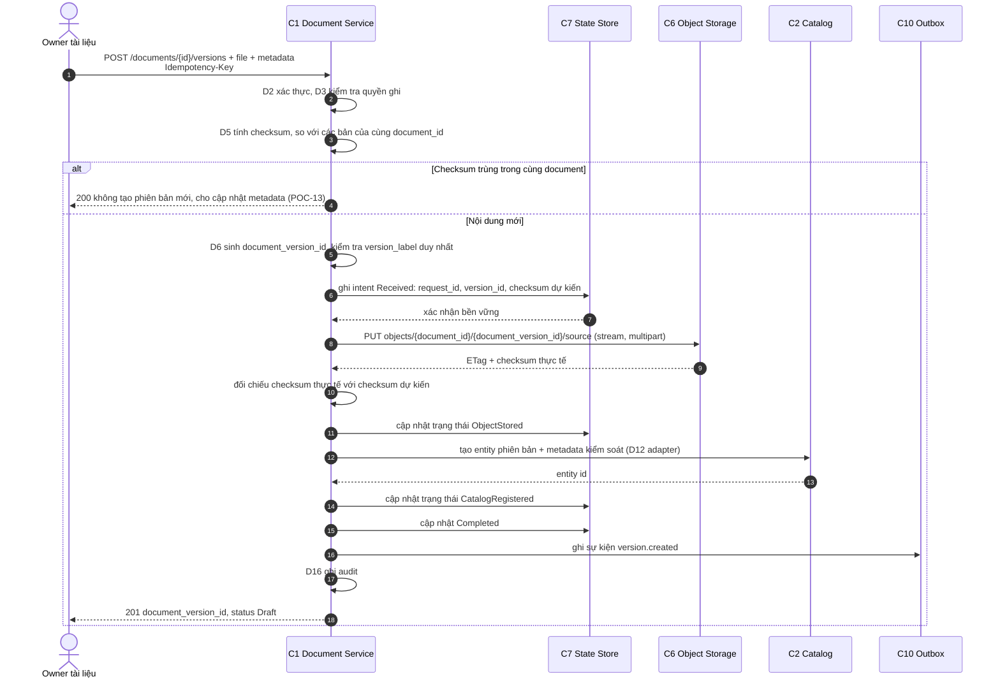
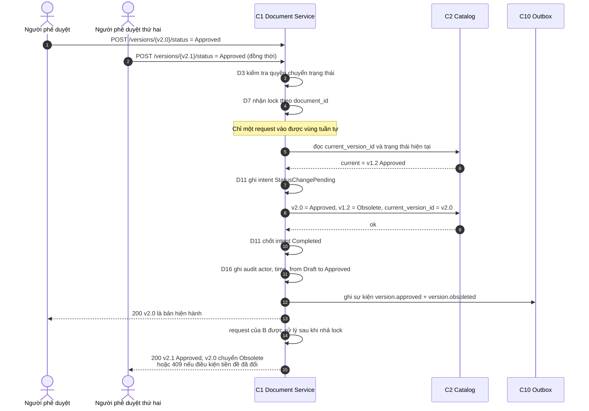
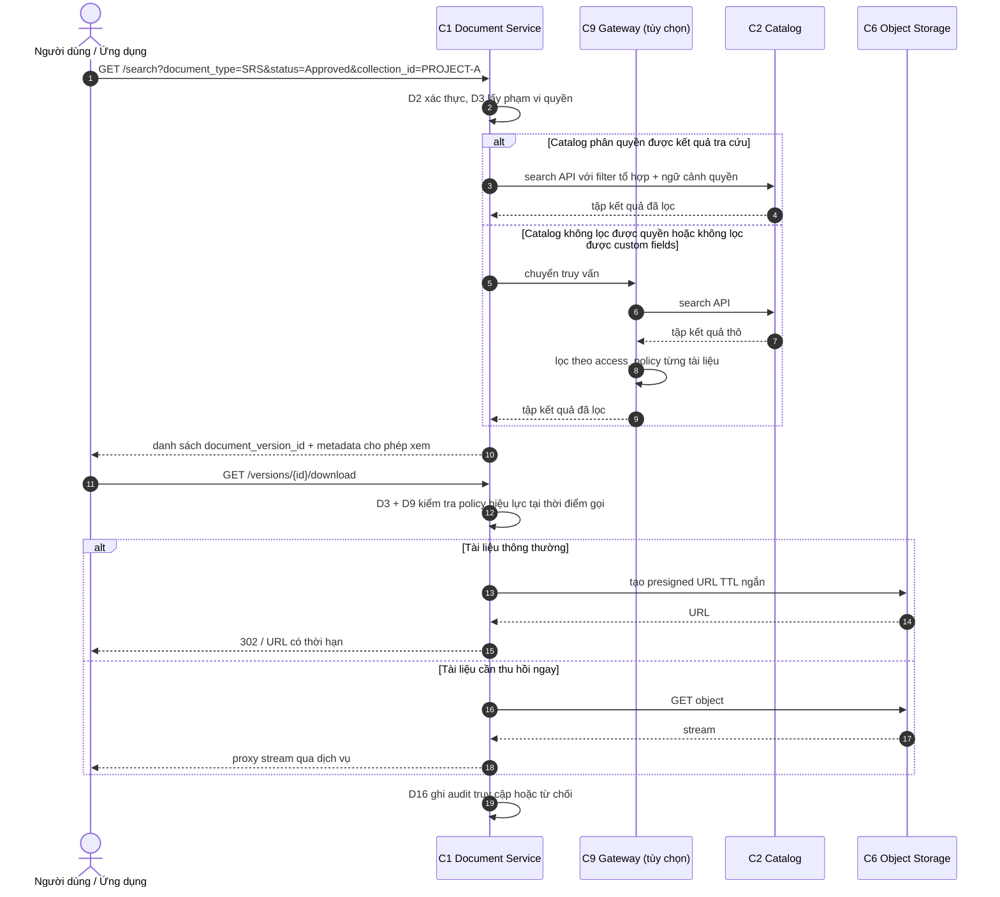
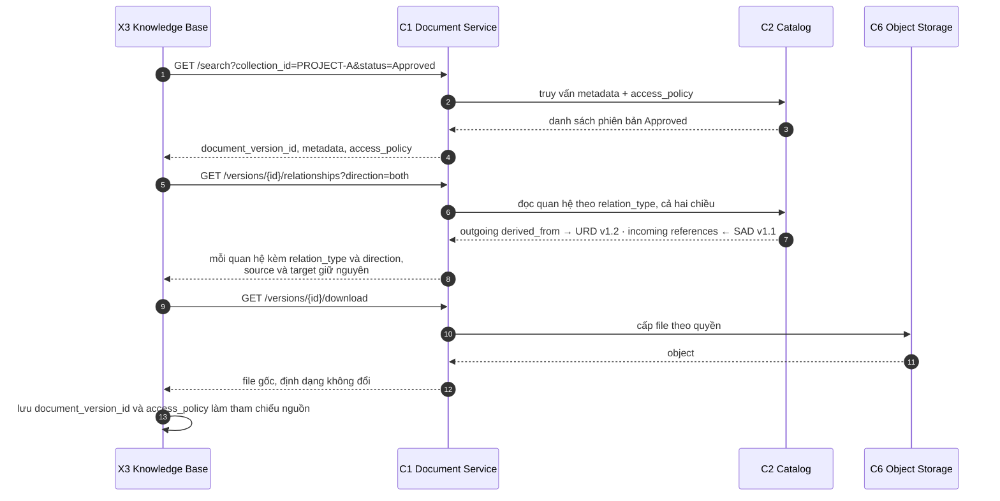
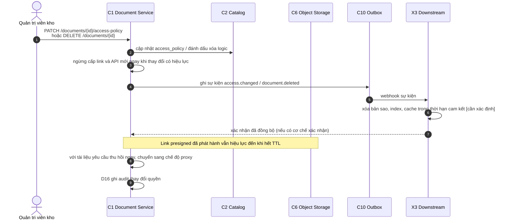
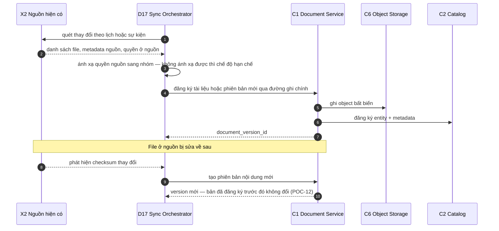
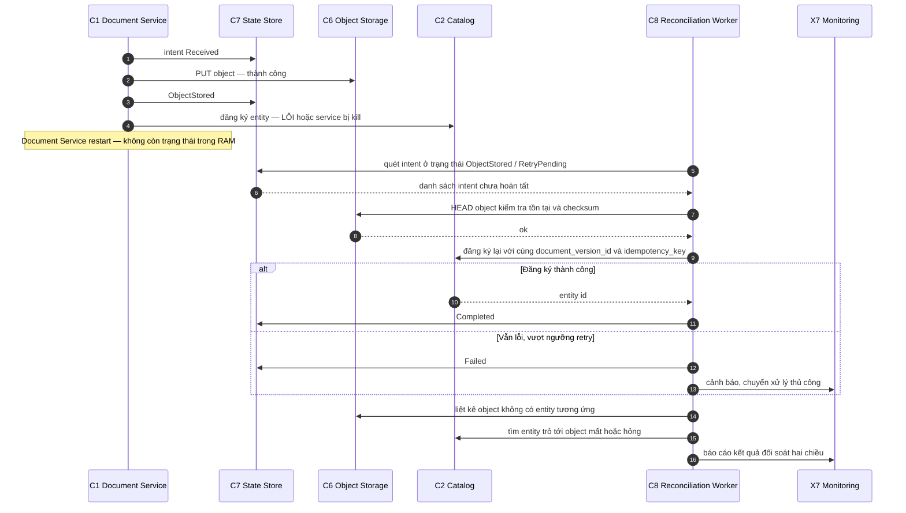
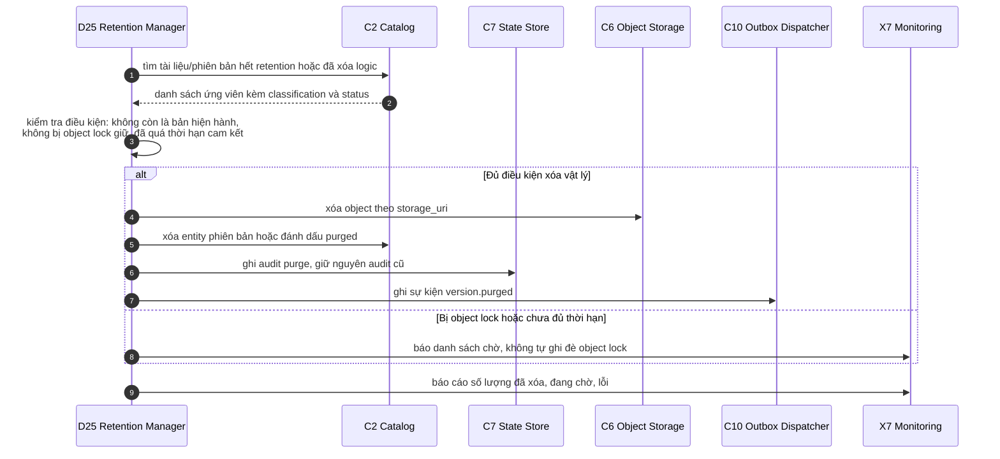

# C4 — DYNAMIC VIEWS: CÁC LUỒNG NGHIỆP VỤ CHÍNH

> **Câu hỏi tài liệu này trả lời:** Các container và thành phần phối hợp theo thứ tự nào trong từng tình huống, và ở bước nào xuất hiện rủi ro cần PoC.
> **Tham chiếu báo cáo:** mục 2.4, 2.6, 3.3, 3.9, Phụ lục B.

Danh sách luồng:

| # | Luồng | Test case liên quan |
|---|---|---|
| [1](#1-upload-và-đăng-ký-phiên-bản) | Upload và đăng ký phiên bản | POC-01, 08, 13, 18, 21 |
| [2](#2-duyệt-phiên-bản-có-cạnh-tranh-đồng-thời) | Duyệt phiên bản, có cạnh tranh đồng thời | POC-10, 22 |
| [3](#3-tra-cứu-và-tải-file-theo-quyền) | Tra cứu và tải file theo quyền | POC-02, 04, 17, 19 |
| [4](#4-kb-tiêu-thụ-bản-approved) | KB tiêu thụ bản Approved | POC-05, 06, 07 |
| [5](#5-thu-hồi-quyền-và-xóa-tài-liệu-đã-cấp) | Thu hồi quyền và xóa tài liệu đã cấp | POC-11, 23 |
| [6](#6-đồng-bộ-từ-nguồn-hiện-có) | Đồng bộ từ nguồn hiện có | POC-12 |
| [7](#7-phục-hồi-sau-lỗi-một-phía) | Phục hồi sau lỗi một phía | POC-08, 18, 21 |
| [8](#8-hết-retention-và-xóa-vật-lý) | Hết retention và xóa vật lý | POC-15, 25 |

---

## 1. Upload và đăng ký phiên bản

**Ba điều kiện của luồng này, không phải tùy chọn hiện thực:**

- Bước ghi object và bước đăng ký catalog **không nguyên tử**. Mọi lỗi sau bước ghi intent đều phải phục hồi được từ intent, xem [luồng 7](#7-phục-hồi-sau-lỗi-một-phía).
- **Checksum phải được đối chiếu với giá trị đọc lại từ storage** trước khi chốt `Completed`. Lấy lại chính con số mà client khai báo rồi coi là đã xác nhận thì bất biến I10 không được kiểm tra ở đâu cả.
- **File đi qua service dưới dạng stream**, cả ở lớp nhận HTTP và lớp ghi S3. Đọc hết body vào bộ nhớ rồi mới ghi làm bộ nhớ service tỷ lệ với kích thước file nhân số request đồng thời, và mâu thuẫn với yêu cầu multipart ở [c4-04b mục 11.6](c4-04b-code-structure.md#116-kết-nối-và-cấu-hình-pool).
- Metadata bắt buộc theo `document_type` được D23 kiểm tra **trước** khi sinh phiên bản, để không tạo object cho một phiên bản sẽ bị từ chối (bất biến I18).

---

## 2. Duyệt phiên bản, có cạnh tranh đồng thời

**Kết quả bắt buộc (POC-22):** không trùng `version_label`/ID, **tối đa một** bản `Approved`, và không mất thay đổi nào.

Hai chi tiết quyết định tính đúng của luồng này:

- Ba lệnh ghi xuống catalog (`v2.0 = Approved`, `v1.2 = Obsolete`, `current_version_id`) **không** nằm trong một giao dịch. Vì vậy phải có intent `StatusChangePending`: lỗi ở lệnh thứ hai mà không có intent sẽ để lại **hai** bản `Approved` cho tới lượt đối soát kế tiếp.
- Bản ghi audit phải có **cả trạng thái trước và trạng thái sau**. Chỉ ghi trạng thái đích thì không trả lời được câu hỏi của POC-14 về lịch sử phát hành.
- Vùng tuần tự ở đây chỉ đúng khi **một instance** C1. Chạy từ hai instance mà vẫn dùng khóa trong tiến trình là mất I4, I5 — cần C13 Distributed Lock.

---

## 3. Tra cứu và tải file theo quyền

**Rủi ro lớn nhất của cả đề xuất nằm ở nhánh `else` đầu tiên:** nếu catalog không lọc được tổ hợp custom fields hoặc không phân quyền kết quả (POC-17, 19), C9 Gateway trở thành bắt buộc và công tự phát triển tăng.

---

## 4. KB tiêu thụ bản Approved

KB **không** quyết định cấu trúc lưu trữ gốc và **phải** tuân thủ `access_policy` do kho cấp (mục 7.1 báo cáo). POC-07 kiểm chứng đúng điều này.

**Cách trả quan hệ chiều vào là một quyết định ngữ nghĩa, không phải cách trình bày.** Cạnh `SAD v1.1 --references--> SRS v2.0` khi truy vấn từ SRS v2.0 phải trả về với `direction=incoming` và **nguyên hai đầu** (`source=SAD v1.1`, `target=SRS v2.0`). Nếu đảo hai đầu để "hướng ra ngoài" thì kết quả phát biểu rằng *SRS v2.0 references SAD v1.1* — một quan hệ chưa từng được khai báo, và KB sẽ lưu nó làm nguồn (bất biến I16).

---

## 5. Thu hồi quyền và xóa tài liệu đã cấp

Ba điểm phải phân biệt rõ khi nghiệm thu:

- **Ngừng cấp mới** có hiệu lực tức thì — kiểm chứng ở POC-11.
- **Link đã phát hành** chỉ hết hiệu lực khi hết TTL; cửa sổ này phải được đo và chấp nhận theo mức phân loại dữ liệu — kiểm chứng ở POC-23.
- **Xóa logic không xóa audit.** `AuditEvent` và lịch sử trạng thái của tài liệu vẫn truy vấn được sau khi xóa, nếu không thì không trả lời được ai đã xóa cái gì (bất biến I17). Xóa vật lý object là việc của [luồng 8](#8-hết-retention-và-xóa-vật-lý).

---

## 6. Đồng bộ từ nguồn hiện có

Connector của catalog **không** được dùng làm đường ghi chính: connector catalog thường thu thập metadata, chưa chắc sao chép file (mục 3.4, 6.4 báo cáo). C5 Ingestion chỉ dùng để khảo sát nguồn.

---

## 7. Phục hồi sau lỗi một phía

**Kết quả bắt buộc (POC-21):** sau kill/restart tại **từng bước**, hệ thống không mất và không nhân đôi phiên bản. Nếu biến thể manifest trên S3 không đạt, bổ sung registry database theo mục 3.10 báo cáo.

**Giới hạn của việc phục hồi:** job chỉ phục hồi được intent mà object **đã** nằm trên storage, vì nó không còn bytes gốc trong tay. Intent chết ở trạng thái `Received` (chưa ghi object xong) phải được đánh `Failed` và báo lên vận hành, **không** được đăng ký một entity phiên bản trỏ tới object không tồn tại.
---

## 8. Hết retention và xóa vật lý

Ba ràng buộc của luồng này:

- **Xóa vật lý là không hồi phục được**, nên nó tách khỏi xóa logic ở [luồng 5](#5-thu-hồi-quyền-và-xóa-tài-liệu-đã-cấp) và chỉ chạy khi quá thời hạn cam kết. POC-15 kiểm chứng kịch bản xóa nhầm rồi khôi phục — tức là trong cửa sổ trước khi xóa vật lý, S3 Versioning phải khôi phục được.
- **Object lock thắng retention policy của kho.** Nếu object còn bị lock, D25 không được cố xóa; nó báo lên hàng đợi chờ. Lớp bảo vệ ở storage không được phép bị kho vượt qua.
- **Audit sống lâu hơn dữ liệu.** `AuditEvent` của một tài liệu đã purge vẫn phải truy vấn được, với thời hạn lưu riêng theo chính sách audit (bất biến I17).

