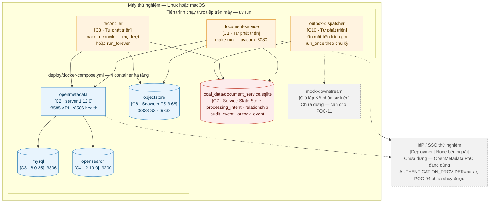
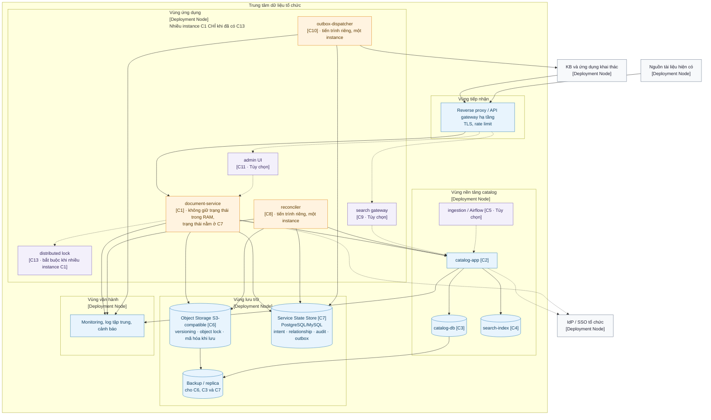

# C4 — DEPLOYMENT VIEW

> **Câu hỏi tài liệu này trả lời:** Các container được triển khai ở đâu, với tài nguyên nào, ở hai mốc: môi trường PoC và triển khai ban đầu on-premise.
> **Trạng thái:** Mọi con số là **mức tham khảo từ tài liệu sản phẩm**, phải đối chiếu lại với phiên bản được chọn và số liệu khảo sát. Không dùng làm dự toán.
> **Tham chiếu báo cáo:** mục 3.8, 5.1, 5.2, 6.1, 6.2.

## 6.1. Môi trường PoC — một máy: hạ tầng trong Compose, service chạy trên máy



**Hai điều sơ đồ này nói ra mà bản vẽ trước ngày 19/11/2026 không nói:**

1. **Chỉ hạ tầng nằm trong Docker Compose.** `document-service`, `reconciler` và `outbox-dispatcher` chạy như tiến trình trên máy, `make run` và `make reconcile`. Bản vẽ trước vẽ cả ba thành container compose, nên ai đọc cũng tưởng `docker compose up` là dựng được toàn bộ hệ thống.
2. **Hai node nét xám là khoảng trống đã biết, không phải thành phần đã có.** Chưa có IdP thử nghiệm — PoC đang chạy `AUTHENTICATION_PROVIDER=basic`, nên **POC-04 chưa thể chạy**. Chưa có mock downstream, nên **POC-11 chưa thể chạy đầu-cuối**. Vẽ ra để hai khoảng trống này nằm trong kế hoạch, không bị phát hiện vào tuần cuối.


| Đặc điểm | Giá trị |
|---|---|
| Thời lượng sử dụng | Trong **2–4 tuần (đề xuất)** của giai đoạn 1 |
| Mục tiêu | Chạy được bộ test case ở Phụ lục B, đặc biệt POC-02, 06, 09, 17, 18, 19, 20, 21, 22, 23 |
| Giới hạn | Chỉ prototype; **không** phát triển đầy đủ registry/gateway cho production |
| Dữ liệu | Một dự án phần mềm thực có đủ URD–SRS–SAD nhiều phiên bản, cộng một bộ tài liệu thông thường từ ít nhất một nguồn hiện có |
| Catalog | **OpenMetadata, phiên bản cố định 1.12.0** (quyết định Q1 đã chốt 17/11/2026). DataHub không còn là nhánh triển khai; nó chỉ là đối chứng tài liệu ở mục 3.7 báo cáo |
| Còn thiếu để chạy đủ Phụ lục B | IdP thử nghiệm (POC-04), mock downstream nhận webhook (POC-11), tiến trình chạy outbox dispatcher theo chu kỳ (POC-11) |

## 6.2. Triển khai ban đầu on-premise



## 6.3. Tài nguyên tham khảo

| Thành phần | Tài nguyên cần xem xét | Mức tham khảo |
|---|---|---|
| C6 Object Storage | Disk, network, IOPS, backup | Theo công thức ở mục 6.4 |
| C2 Catalog app | CPU, RAM | Chốt sau PoC |
| C3 Catalog DB (MySQL/PostgreSQL) | CPU, RAM, disk | Khuyến nghị tối thiểu của OpenMetadata cho production: **4 vCPU, 16 GiB RAM, từ 100 GiB disk** |
| C4 Search index (Elasticsearch/OpenSearch) | CPU, RAM, dung lượng index | Khuyến nghị tối thiểu: **2 vCPU, 8 GiB RAM, 100 GiB mỗi node** |
| C5 Ingestion (Airflow), nếu dùng | CPU, RAM | Khuyến nghị tối thiểu: **4 vCPU, 16 GiB RAM** |
| C1 Document Service | CPU, RAM, concurrency. **RAM tỷ lệ với kích thước file × số upload đồng thời nếu upload không đi theo stream** — đây là tham số phải đo, không phải hằng số | Chốt sau PoC về lỗi và đồng thời |
| C7 Service State Store | CPU, RAM, disk, IOPS; **vào phạm vi backup và RPO/RTO** vì chứa audit và outbox. Dung lượng tăng theo số thao tác, không theo số tài liệu | Chốt sau khảo sát khối lượng thao tác |
| C8 reconciler + C10 outbox dispatcher | CPU, RAM nhỏ; chu kỳ chạy; hàng đợi tồn | Chốt sau PoC |
| C13 Distributed Lock, nếu nhiều instance C1 | CPU, RAM nhỏ; độ sẵn sàng phải cao hơn C1 vì mất khóa là chặn mọi ghi | Chốt khi quyết định số instance |
| Monitoring / Audit | Dung lượng log, metric, thời gian lưu | Chốt sau khảo sát |

Nếu chọn DataHub, **cộng thêm Kafka và graph index** vào vùng nền tảng catalog.

## 6.4. Ước lượng dung lượng

```text
Dung lượng file ≈ Số tài liệu × Kích thước file trung bình × Số phiên bản lưu bình quân
```

Phải tính thêm: index tìm kiếm, metadata database, **C7 Service State Store** (intent, quan hệ, audit, outbox), audit log tập trung, backup/replication và dự phòng tăng trưởng. Nếu dùng search gateway hoặc khóa phân tán, cộng thêm chi phí triển khai và vận hành. **Document Service không stateless:** phần xử lý không giữ trạng thái trong RAM, nhưng hệ thống vẫn có một datastore riêng ngoài catalog và object storage, và datastore đó phải có kế hoạch backup.

Các thông số đầu vào đều **chưa khảo sát** tại thời điểm lập tài liệu:

| Thông số | Trạng thái |
|---|---|
| Số lượng tài liệu và tổng dung lượng | Chưa khảo sát |
| Kích thước file trung bình và lớn nhất | Chưa khảo sát |
| Số phiên bản lưu bình quân | Chưa khảo sát |
| Số file tăng theo tháng/năm | Chưa khảo sát |
| Số người dùng/ứng dụng truy cập đồng thời | Chưa khảo sát |
| Retention, RPO/RTO | Chưa xác định |

## 6.5. Yêu cầu vận hành theo vùng triển khai

| Vùng | Yêu cầu |
|---|---|
| Tiếp nhận | TLS bắt buộc; giới hạn tần suất; không phơi bày catalog UI ra ngoài phạm vi người dùng đã được ủy quyền |
| Ứng dụng | Trạng thái xử lý nằm ở C7 chứ không ở RAM để restart không mất intent. **Chỉ bật nhiều instance C1 sau khi có C13 Distributed Lock** — khóa trong tiến trình không tuần tự hoá được giữa các instance, nên bất biến I4/I5 sẽ vỡ. C8 và C10 mỗi loại chạy **một** instance, hoặc phải có khóa chọn leader. Probe: `/livez` cho liveness (**không** phụ thuộc OpenMetadata/S3 để tránh restart lan truyền), `/startupz` cho migration custom property, `/readyz` cho load balancer — chi tiết ở [c4-04b mục 10](c4-04b-code-structure.md#10-health-check) |
| Nền tảng catalog | Cố định phiên bản; kiểm thử hồi quy bằng Phụ lục B trước mỗi lần nâng cấp |
| Lưu trữ | Bucket đóng, không public; service account chỉ có quyền S3 tối thiểu; object lock/versioning theo retention. C7 nằm trong cùng kế hoạch backup và kiểm tra restore như C3 và C6; mất C7 là mất audit và outbox, không chỉ mất intent |
| Vận hành | Cảnh báo khi retry vượt ngưỡng, khi hàng đợi đối soát tăng, khi dung lượng vượt ngưỡng, khi circuit breaker mở kéo dài, khi service ở chế độ suy giảm — bộ chỉ số bắt buộc ở [c4-04b mục 11.7](c4-04b-code-structure.md#117-chỉ-số-và-cảnh-báo-bắt-buộc) |

## 6.6. Lưu ý chọn sản phẩm Object Storage

- Thứ tự ưu tiên: **dịch vụ S3-compatible sẵn có của tổ chức [cần xác định]**; nếu tự vận hành thì Ceph RGW, SeaweedFS hoặc Garage, chọn theo năng lực vận hành và kết quả PoC.
- **Không ưu tiên MinIO OSS bản cũ cho triển khai mới:** repository `minio/minio` được archive ngày 25/04/2026, bản OSS không còn được duy trì. Nếu cân nhắc AIStor phải đánh giá riêng điều kiện cấp phép, yêu cầu hạ tầng và mức độ phù hợp.
- Phải kiểm chứng tương thích S3, object lock, policy và lifecycle **theo phiên bản thực tế**; không đồng nhất "tương thích API S3" với đầy đủ chức năng mở rộng của AWS S3.
