# LOW LEVEL DESIGN — DOCUMENT SERVICE

> **Vai trò của tài liệu này.** [c4-04b](c4-04b-code-structure.md) là **mức Code tổng quan**: có những lớp nào, vì sao tách như vậy, giới hạn nào của OpenMetadata phải xử lý trong code. Tài liệu này là **bản thi công**: chữ ký method, thứ tự gọi, khóa và index của từng bảng, ai sở hữu circuit breaker nào, deadline đi đường nào.
> **Vì sao cần nó.** Lần rà soát 19/11/2026 tìm ra **12 tên lớp** trong `c4-04b` không tồn tại trong `src/`, một loạt chữ ký lệch, và những lỗi chỉ lộ ra khi đọc tới mức method — chiều quan hệ bị đảo, checksum không bao giờ được đối chiếu, executor bị bọc hai lần. Những thứ đó không thể thấy ở mức danh mục lớp.
> **Ngày lập:** 19/11/2026. **Nguồn:** [c4-01](c4-01-context.md)…[c4-07](c4-07-element-catalog.md) và mã nguồn tại commit hiện tại.
> **Trạng thái đối soát:** sổ công việc và ma trận đầy đủ ở [c4-08](c4-08-tra-soat-code-vs-thiet-ke.md).

## Quy ước đọc

| Ký hiệu | Nghĩa |
|---|---|
| **(hiện có)** | Đã tồn tại trong `src/` đúng như mô tả |
| **(Bx)** | Trạng thái đích, đạt được ở bước refactor `Bx` của kế hoạch; đọc `c4-08` mục 2b để biết đã làm chưa |
| **(ngoài phạm vi)** | Thuộc D23/D24/D25/provenance — đã chốt hoãn, chỉ có chỗ cắm |
| `Tên.method(...)` | Tên thật trong mã nguồn. Mọi tên lớp ở tài liệu này phải tồn tại trong `src/` — cổng CI ở [mục 15.6](#156-cổng-tài-liệu--mã-nguồn) kiểm điều đó |

Chữ ký viết bằng Python thật, không phải UML. Sơ đồ dùng Mermaid `classDiagram`/`sequenceDiagram`; generic viết `list~RelatedEdge~` vì Mermaid không nhận `[]`.

### Phạm vi container

Tài liệu này thi công **C1** (Document Service), **C8** (Reconcile Worker), **C10** (Outbox Dispatcher), **C7** (Service State Store) và **C13** (Distributed Lock) — tức mọi container phải tự phát triển. Các container còn lại chỉ xuất hiện ở đây dưới dạng **điểm nối**, vì chúng là sản phẩm có sẵn hoặc đã chốt ngoài phạm vi:

| Container | Vai trò trong tài liệu này |
|---|---|
| C2 Catalog Application (OpenMetadata) | điểm nối qua `OmHttpClient`; đường API ở mục 5.2 |
| C3 Catalog Metadata DB, C4 Catalog Search Index | không thi công — thuộc nội bộ C2; C4 xuất hiện gián tiếp qua Search API ở mục 9.5 |
| C5 Catalog Ingestion, C9 Search Gateway, C11 Admin UI, C12 MCP Server | **ngoài phạm vi (đã chốt)** — xem [c4-02 mục 2.6](c4-02-container.md#26-container-tùy-chọn-và-điều-kiện-kích-hoạt) |
| C6 Object Storage | điểm nối qua `S3ObjectStoreAdapter`; **khôi phục file** (đề bài 2.2) là năng lực của C6 — S3 Versioning và Object Lock — không phải một method của `ObjectStorePort`; thủ tục vận hành ở [c4-06 mục 6.6](c4-06-deployment.md#66-lưu-ý-chọn-sản-phẩm-object-storage) và POC-15 |

---

## 1. Quan hệ với các tài liệu khác

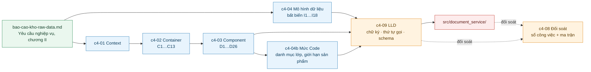

Ba điều tài liệu này **không** làm, để không trùng lặp: không nhắc lại lý do kiến trúc (ở `c4-02`, `c4-03`), không nhắc lại giới hạn sản phẩm OpenMetadata (ở `c4-04b` mục 1, 5, 8), không nhắc lại phát biểu bất biến (ở `c4-04` mục 4.2 — ở đây chỉ ánh xạ bất biến sang lớp và test).

---

## 2. Bản đồ mã nguồn

### 2.1. Cây package

```text
src/document_service/
├── main.py                  ApplicationFactory, create_app, cli
├── config.py                Settings theo khối + SettingsProvider
├── domain/                  không import httpx, boto3, fastapi, sqlite3, jwt, config
│   ├── value.py             5 enum + 8 value object  (6 enum sau B9a)
│   ├── model.py             11 model nghiệp vụ
│   ├── dto.py               10 dataclass truyền qua port  (13 sau B4, B14)
│   ├── policy.py            DomainPolicy + 4 policy
│   ├── port.py              8 abstract base class
│   ├── errors.py            DomainError + 11 lỗi nghiệp vụ  (12 sau B6)
│   ├── metadata_fields.py   nguồn duy nhất của danh sách trường
│   └── metadata_builder.py  CatalogMetadataBuilder  (B1: chuyển từ application/)
├── application/
│   ├── context.py           PortBundle, PolicySet
│   ├── factory.py           UseCaseFactory
│   ├── usecase/             base + 9 use case (hiện có)
│   └── orchestration/       UploadSaga, StatusChangeSaga (B9b), IdempotencyGuard,
│                            DocumentLockManager, VersionSnapshot, StatusChangeSnapshot (B9b)
├── adapter/
│   ├── inbound/
│   │   ├── http/            routes, schemas, context, dependencies, errors,
│   │   │                    upload_handler, health_routes
│   │   ├── security/        OidcTokenVerifier, PrincipalResolver, IdempotencyKeyFilter
│   │   ├── health/          ReadinessPolicy, HealthCheckRegistry, DegradedModeGate,
│   │   │                    AdapterHealthIndicator, IdpHealthIndicator, ReconcileBacklogIndicator
│   │   └── sync/            SourceSyncJob, FileSystemSourceConnector, SourcePermissionMapper,
│   │                        SourceSyncScheduler
│   └── outbound/
│       ├── base.py          OutboundAdapter
│       ├── sqlite_support.py SqliteDatabase + SCHEMA_STATEMENTS của C7
│       ├── openmetadata/    client, endpoints, entity, search, lineage, bootstrap, catalog_adapter
│       ├── storage/         S3ObjectStoreAdapter, PresignedUrlIssuer, ProxyStreamer
│       ├── intent/          SqliteRegistryIntentStore, S3ManifestIntentStore
│       ├── relationship/    SqliteRelationshipRegistry
│       ├── policy/          CachingPolicyDecision
│       ├── lock/            RedisDocumentLock  (B17)
│       ├── observability/   StructuredAuditLogger, MetricsRecorder,
│       │                    outbox_store / outbox_publisher / outbox_dispatcher  (B1: tách 3 file)
│       └── fake/            7 adapter in-memory + AllowAllPolicyDecision
├── infrastructure/
│   ├── container.py         ServiceContainer — điểm wiring duy nhất
│   ├── health.py            HealthProbe, HealthProbeMixin, HealthIndicator, HealthResult, HealthReport
│   └── resilience/          executor, retry, breaker, deadline
├── utils/                   chỉ stdlib, không import package nào khác của service
└── worker/
    ├── reconcile.py         ReconcileRunner + 3 job
    └── dispatch.py          OutboxDispatchRunner  (B15)
```

### 2.2. Lớp ↔ file ↔ thành phần ↔ bất biến

Bảng này thay cho bảng D1–D18 sơ lược ở [src/README.md](../src/README.md). Cột **Bất biến** chỉ ghi bất biến mà lớp đó **thực thi**, không phải bất biến mà nó đi qua.

| Thành phần | Lớp | File | Bất biến |
|---|---|---|---|
| D1 API Layer | `routes` (10 endpoint hiện có + collections/retention ngoài phạm vi), `schemas`, `DomainErrorTranslator`, `RequestContext`/`WriteContext`/`UploadContext`/`SearchParams`, `SearchParamsProvider` | `adapter/inbound/http/` | — |
| D2 Authentication | `OidcTokenVerifier`, `PrincipalResolver` | `adapter/inbound/security/auth.py` | — |
| D3 Authorization / PDP | `CachingPolicyDecision`, `AccessPolicy.permits` | `adapter/outbound/policy/`, `domain/model.py` | I11 |
| D4 Upload Handler | `UploadHandler`, `PreparedUpload`, `SpooledUploadBody` (B16), `IdempotencyKeyFilter`, `StreamingHasher` | `adapter/inbound/http/upload_handler.py`, `utils/hashing.py` | — |
| D5 Checksum & Dedup | `DedupPolicy` | `domain/policy.py` | I8, I9 |
| D6 Version Manager | `VersionPolicy`, `Document.assert_label_unique`, `StorageUri.for_version` | `domain/policy.py`, `domain/model.py`, `domain/value.py` | I1, I2, I3 |
| D7 Lifecycle Manager | `LifecyclePolicy`, `Document.approve`/`obsolete`, `DocumentVersion.mark_approved`/`mark_obsolete`, `ApproveVersionUseCase` | `domain/policy.py`, `domain/model.py`, `application/usecase/approve_version.py` | I4, I5, I14 |
| D8 Relationship Manager | `RelationshipPolicy`, `DeclareRelationshipUseCase`, `QueryRelationshipsUseCase`, `RelatedEdge` (B4) | `domain/policy.py`, `application/usecase/relationships.py`, `domain/dto.py` | I6, I7, I16 |
| D9 Access Policy Manager | `UpdateAccessPolicyUseCase`, `AccessPolicy` | `application/usecase/access_policy.py` (B1) | I11 |
| D10 Download Issuer | `IssueDownloadUseCase`, `PresignedUrlIssuer`, `ProxyStreamer` | `application/usecase/issue_download.py`, `adapter/outbound/storage/download.py` | I11 |
| D11 Intent & Idempotency | `IdempotencyGuard`, `UploadSaga`, `StatusChangeSaga` (B9b), `VersionSnapshot`, `StatusChangeSnapshot` (B9b), `ProcessingIntent` (B9a) | `application/orchestration/`, `domain/model.py` | I13 |
| D12 Catalog Adapter | `OpenMetadataCatalogAdapter`, `OmHttpClient`, `OmAuthProvider`, `OmApiVersionPin`, `OmErrorTranslator`, `OmFqnBuilder`, `OmExtensionMapper`, `OmDirectoryMapper`, `OmFileEntityMapper`, `OmJsonPatchBuilder`, `OmEntityVersionGuard`, `OmSearchQueryBuilder`, `OmSearchResultMapper`, `OmDriveServiceProvisioner`, `OmCustomPropertyRegistrar`, `OmSchemaMigration` | `adapter/outbound/openmetadata/` | I10 |
| D13 Storage Adapter | `S3ObjectStoreAdapter` | `adapter/outbound/storage/s3_store.py` | I3, I10 |
| D14 Outbox Writer | `OutboxEventPublisher`, `SqliteOutbox`, `OutboxRecord` | `adapter/outbound/observability/outbox_*.py` (B1) | — |
| D15 Reconcile Runner (**C8**) | `ReconcileRunner`, `IntentRecoveryJob`, `OrphanObjectScanner`, `DanglingEntityScanner`, `ReconcileReport` | `worker/reconcile.py` | I13, I14 |
| D16 Audit Logger | `StructuredAuditLogger`, `AuditEvent`, `AuditTarget`, `AuditOutcome` | `adapter/outbound/observability/audit_log.py`, `application/usecase/base.py` | I12 |
| D17 Sync Orchestrator | `SourceSyncJob`, `SourceConnector`, `FileSystemSourceConnector`, `SourcePermissionMapper`, `SourceSyncScheduler`, `SourceFile`, `SyncReport` | `adapter/inbound/sync/source_sync.py` | I9, I11 |
| D18 Search Query Service | `SearchDocumentsUseCase`, `SearchPage.filtered`, `OmSearchQueryBuilder`, `OmSearchResultMapper` | `application/usecase/search_documents.py`, `domain/dto.py`, `adapter/outbound/openmetadata/search.py` | — |
| D19 Relationship Store Adapter | `SqliteRelationshipRegistry`, `OmLineageRelationshipStore`, `_VersionIndex` | `adapter/outbound/relationship/`, `adapter/outbound/openmetadata/lineage.py` | I6, I7, I16 |
| D20 State Store Adapter | `SqliteDatabase`, `SqliteRegistryIntentStore`, `S3ManifestIntentStore`, `SqliteOutbox`, `StructuredAuditLogger` | `adapter/outbound/sqlite_support.py`, `intent/`, `observability/` | I13 |
| D21 Policy Decision Adapter | `CachingPolicyDecision`, `CachedPolicy` | `adapter/outbound/policy/policy_decision.py` | I11 |
| D22 Document Lock Adapter | `InMemoryDocumentLock`, `RedisDocumentLock` (B17), `DocumentLockManager` | `adapter/outbound/fake/`, `adapter/outbound/lock/`, `application/orchestration/lock_manager.py` | I4, I5 |
| D23 Metadata Schema & Validation | — **(ngoài phạm vi)**; chỗ cắm: `domain/metadata_fields.py` và `OmCustomPropertyRegistrar.assert_filterable` | — | I15, I18 |
| D24 Collection Manager | — **(ngoài phạm vi)**; chỗ cắm: `MetadataCatalogPort.ensure_collection` và `find_collection` (B13) | — | — |
| D25 Retention & Deletion | — **(ngoài phạm vi)**; chỗ cắm: `Document.retention_policy`, `CatalogMetadataBuilder.document_fields` | — | I17 |
| D26 Outbox Dispatcher (**C10**) | `OutboxDispatcher`, `OutboxDispatchRunner` (B15), `EventSender`, `WebhookEventSender`, `DispatchReport` | `adapter/outbound/observability/outbox_dispatcher.py`, `worker/dispatch.py` | — |
| **D27 Hạ tầng xuyên suốt** *(đề xuất thêm vào `c4-03`/`c4-07` ở B21)* | `ServiceContainer`, `UseCaseFactory`, `ExecutorRegistry`, `ResilientCallExecutor`, `RetryPolicy`, `BackoffStrategy`, `RetryBudget`, `CircuitBreaker`, `Bulkhead`, `TimeoutPolicy`, `Deadline`, `ClassifiedError`, `HealthProbe`, `HealthProbeMixin`, `HealthIndicator`, `HealthResult`, `HealthReport`, `ReadinessPolicy`, `HealthCheckRegistry`, `DegradedModeGate`, `MetricsRecorder` | `infrastructure/`, `adapter/inbound/health/` | — |

**Lớp không gắn với một thành phần D cụ thể**, vì chúng là kiểu dữ liệu hoặc phần chung của nhiều thành phần — bảng này làm bảng trên **đóng**, tức mọi lớp trong `src/` đều truy được về một chủ:

| Lớp | Thuộc | Ghi chú |
|---|---|---|
| `IntentSaga` (B9b) | D11 | base của `UploadSaga` và `StatusChangeSaga`, giữ `_fail`/`_advance` |
| `TransitionResult` (B2) | D7 | thay `ApprovalResult` |
| `ReplayDecision` | D11 | kết quả của `IdempotencyGuard.inspect` |
| `StatusChangePlan` (B9b) | D11 | nội dung `payload` của intent `kind=STATUS_CHANGE` |
| `Page`, `PageRequest` (B14) | D16, D18, D19 | kiểu phân trang dùng chung |
| `CatalogMetadataBuilder` | D12 | dựng dict metadata cho catalog; B1 chuyển sang `domain/` |
| `SourceFile`, `SyncReport`, `SourceConnector` | D17 | |
| `RequestContext`, `WriteContext`, `UploadContext`, `SearchParams`, `SearchParamsProvider`, `DomainErrorTranslator`, `IdempotencyKeyFilter` | D1 | |
| `InMemoryAdapter` và 7 adapter `InMemory*` + `AllowAllPolicyDecision` | D12, D13, D19, D20, D21, D22 (profile `fake`) | |
| `ThreadOffloader`, `ConcurrencyLimiter`, `StreamingHasher`, `JsonCodec`, `SingletonMeta`, `Clock`, `IdGenerator`, `LocalPaths`, `LogPalette`, `TerminalFormatter`, `JsonLogFormatter`, `LoggingConfigurator`, `SqliteDatabase` | `utils`, `adapter.outbound` | tiện ích kỹ thuật thuần, không mang khái niệm nghiệp vụ |

`LockKind` nằm ở `config.py` chứ không ở `domain/value.py` — bảng mục 3.1 ghi rõ cột File — vì nó là một lựa chọn cấu hình, không phải khái niệm nghiệp vụ.

### 2.3. Hướng phụ thuộc giữa các lớp kiến trúc

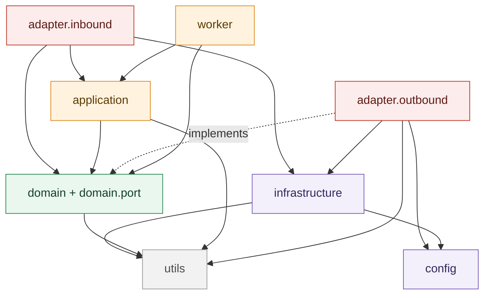

Bốn luật, có test tự động ở `tests/unit/test_architecture_rules.py`:

| # | Luật | Trạng thái |
|---|---|---|
| 1 | `domain` không import `httpx`, `boto3`, `botocore`, `fastapi`, `uvicorn`, `sqlite3`, `jwt` | hiện có, kiểm bằng AST |
| 2 | `domain` không import `document_service.config` | hiện có |
| 3 | `application` không import `document_service.adapter` | hiện có |
| 4 | **`adapter.outbound` không import `document_service.application`** | **B1** chuyển `CatalogMetadataBuilder` sang `domain/metadata_builder.py`. Inbound gọi use case qua `application`. |
| 5 | `utils` chỉ dùng stdlib, không import package nào của service (trừ `logging_setup.py`) | hiện có |

---

## 3. Lớp `domain`

### 3.1. Enum

| Enum | File | Giá trị |
|---|---|---|
| `DocumentStatus` | `value.py` | `DRAFT="Draft"`, `APPROVED="Approved"`, `OBSOLETE="Obsolete"` |
| `RelationType` | `value.py` | `REFERENCES="references"`, `DERIVED_FROM="derived_from"`, `SUPERSEDES="supersedes"` |
| `Direction` | `value.py` | `OUTGOING="outgoing"`, `INCOMING="incoming"`, `BOTH="both"` |
| `IntentState` | `value.py` | `RECEIVED`, `OBJECT_STORED`, `CATALOG_REGISTERED`, `STATUS_CHANGE_PENDING`, `COMPLETED`, `RETRY_PENDING`, `FAILED`; property `is_terminal` = `COMPLETED`/`FAILED` |
| `IntentKind` **(B9a)** | `value.py` | `UPLOAD="upload"`, `STATUS_CHANGE="status_change"` |
| `Action` | `value.py` | `VIEW_METADATA`, `SEARCH`, `DOWNLOAD`, `WRITE`, `TRANSITION_STATUS`, `MANAGE_POLICY` |
| `LockKind` **(B17)** | `config.py` | `IN_MEMORY="in_memory"`, `REDIS="redis"` |

`STATUS_CHANGE_PENDING` **đã tồn tại** trong `IntentState` nhưng hiện **không nơi nào dùng** — B9b là nơi nó trở thành trạng thái thật.

### 3.2. Value object

Mọi value object là `@dataclass(frozen=True, slots=True)` có `__post_init__` gọi `validate()` và `__str__`.

| Lớp | Field | `validate()` |
|---|---|---|
| `DocumentId` | `value: str` | `^[A-Za-z0-9][A-Za-z0-9._:-]{0,127}$` |
| `DocumentVersionId` | `value: str` | cùng pattern |
| `RequestId` | `value: str` | cùng pattern |
| `VersionLabel` | `value: str` | `^[A-Za-z0-9][A-Za-z0-9._-]{0,63}$` |
| `Checksum` | `algorithm: str`, `hex_digest: str` | algorithm ∈ {sha256, sha512, md5}, digest `^[0-9a-f]{32,128}$`. `parse("alg:hex")`, `__str__ → "alg:hex"` |
| `StorageUri` | `bucket: str`, `key: str` | cả hai không rỗng. `for_version(bucket, document_id, version_id)`, `parse("s3://…")`, `__str__ → "s3://bucket/key"` |
| `IdempotencyKey` | `value: str` | độ dài 8…200 |
| `Actor` | `principal_id: str`, `display_name: str = ""` | `principal_id` không rỗng |

```python
# value.py — StorageUri.for_version  (B18: dùng object_prefix thay vì hằng "objects/")
@classmethod
def for_version(cls, bucket: str, document_id: DocumentId, version_id: DocumentVersionId,
                prefix: str = "objects") -> StorageUri:
    return cls(bucket=bucket, key=f"{prefix}/{document_id}/{version_id}/source")
```

Hiện `for_version` hard-code `objects/`, trong khi `StorageSettings.object_prefix` **có** một người đọc duy nhất: `OrphanObjectScanner` (`worker/reconcile.py:196`). Tức là **hai nguồn sự thật tách nhau** — đổi `object_prefix` trong cấu hình làm job quét đi tìm sai chỗ, trong khi đường ghi vẫn đặt object ở `objects/`. Điều này nguy hiểm hơn một knob chết, vì nó có tác dụng một nửa. B18 cho `for_version` nhận prefix từ cùng một nguồn. Quy ước key giữ nguyên như [c4-04 mục 4.6](c4-04-code-data-model.md#46-quy-ước-object-key): tên file, version label và collection là **metadata**, không nằm trong key, nên đổi tên tài liệu hoặc chuyển collection không làm đổi object key.

### 3.3. Model nghiệp vụ

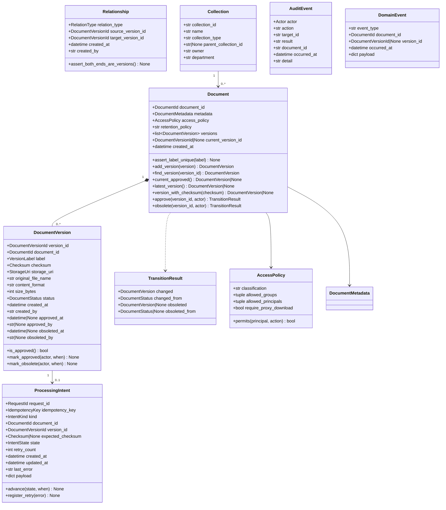

**Ba thay đổi so với hiện trạng**, mỗi cái có lý do kỹ thuật:

| # | Hiện trạng | Đích | Lý do |
|---|---|---|---|
| 1 | `DocumentVersion.mark_obsolete` ghi `approved_by = self.approved_by or actor.principal_id` (`model.py:141`) | **(B2)** không ghi trường đó; thêm `obsoleted_at`/`obsoleted_by` | Loại bỏ một bản `Draft` hiện làm nó mang `approved_by` là người loại bỏ nó. Sai dữ liệu lặng lẽ, không lỗi nào phát ra. Dòng `approved_at = self.approved_at or when` (`model.py:142`) thực tế **không** ghi gì, vì cả hai người gọi (`model.py:222`, `:229`) đều truyền `mark_obsolete(actor)` không có `when` — nhưng nó là một cái bẫy chờ nổ: thêm một người gọi truyền `when` là `approved_at` bị bẩn ngay |
| 2 | `ApprovalResult(approved, obsoleted)`; nhánh obsolete đặt bản vừa bị Obsolete vào field tên `approved` | **(B2)** `TransitionResult(changed, changed_from, obsoleted, obsoleted_from)` | Tên field phải nói đúng nội dung. `changed_from`/`obsoleted_from` là đầu vào của audit `"Draft -> Approved"` (B7) |
| 3 | `UploadIntent` với `expected_checksum: Checksum` bắt buộc | **(B9a)** `ProcessingIntent` + `kind: IntentKind` + `expected_checksum: Checksum \| None` | Lượt chuyển trạng thái cũng cần intent bền vững nhưng không có checksum. Một bảng, một port — tách ra sẽ làm `UNIQUE(idempotency_key)` tách theo, và I13 đòi khóa duy nhất **toàn cục cho mọi API ghi** |

`Relationship` **không có** `relationship_id`: khóa tự nhiên là bộ ba `(relation_type, source_version_id, target_version_id)`, dùng cho `remove()` và cho tính idempotent của `upsert`. `reversed_direction()` **bị xóa ở B4** — xem mục 3.5.

### 3.4. Policy

```python
class DomainPolicy(ABC):
    @abstractmethod
    def policy_name(self) -> str: ...
    def _require(self, condition: bool, error: DomainError) -> None: ...

class DedupPolicy(DomainPolicy):                                       # D5, I8, I9
    def duplicate_of(self, document: Document, checksum: Checksum) -> DocumentVersion | None
    def assert_not_duplicate(self, document: Document, checksum: Checksum) -> None

class VersionPolicy(DomainPolicy):                                     # D6, I1, I2, I3
    def __init__(self, bucket: str, id_generator: IdGenerator | None = None,
                 dedup: DedupPolicy | None = None) -> None
    def reject_if_duplicate_content(self, document: Document, checksum: Checksum) -> None
    def next_version(self, document: Document, request: UploadRequest) -> DocumentVersion
    def _next_label(self, document: Document) -> VersionLabel          # "v{n}", tăng tới khi không trùng

class LifecyclePolicy(DomainPolicy):                                   # D7, I4, I5, I14
    def assert_at_most_one_approved(self, document: Document) -> None
    def approve(self, document, version_id, actor) -> ApprovalResult      # (B2) -> TransitionResult
    def transition(self, document, version_id,
                   target: DocumentStatus, actor) -> ApprovalResult       # (B2) -> TransitionResult
    def current_version_fields(self, document: Document) -> dict[str, str]

class RelationshipPolicy(DomainPolicy):                                # D8, I6
    def validate(self, relationship: Relationship) -> None
    def assert_target_not_rebound(self, relationship: Relationship,
                                  existing: list[Relationship]) -> None
```

**`LifecyclePolicy.transition` — thứ tự bắt buộc**, vì đây là nơi I4/I5 được thực thi. Sơ đồ dưới vẽ **trạng thái đích sau B2**; hiện cả hai method trả `ApprovalResult`:

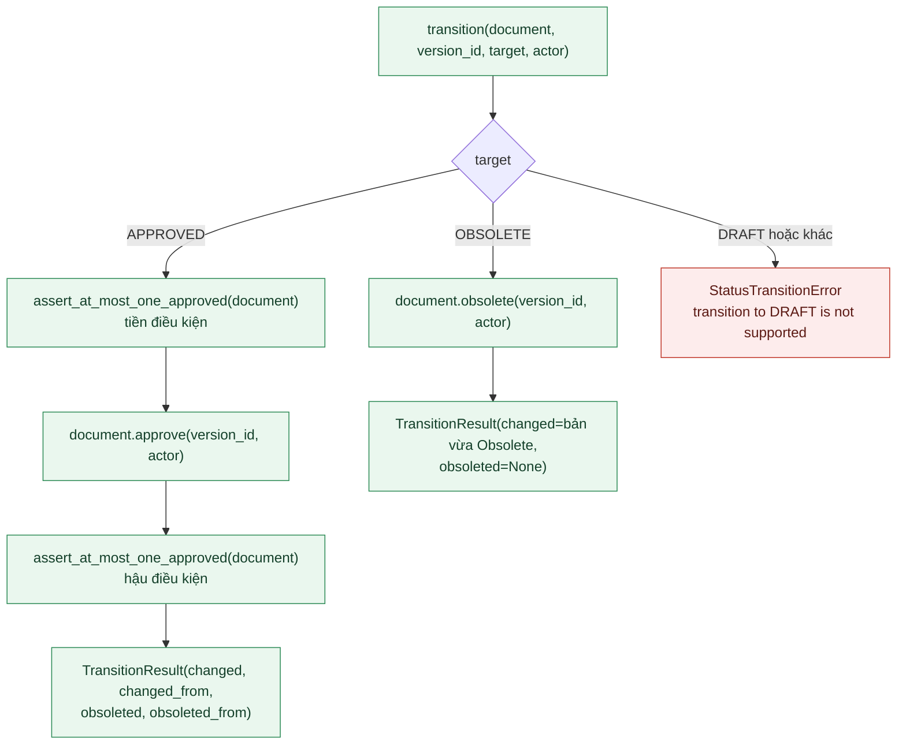

`Document.approve` bên trong: `find_version` (thiếu → `DocumentNotFoundError`) → `current_approved()` → nếu bản Approved hiện tại **chính là** `version_id` thì `StatusTransitionError("already the current one")` → `mark_approved(actor)` → nếu có bản cũ thì `previous.mark_obsolete(actor)` → `self.current_version_id = version_id`. Hai lần `assert_at_most_one_approved` quanh nó là tiền và hậu điều kiện — đúng cách thực thi I4.

`VersionPolicy.__init__` nhận `bucket` của hạ tầng storage. Đây là **lệch có chủ ý** so với nguyên tắc "domain không biết hạ tầng": `next_version` phải sinh `storage_uri` ngay để `UploadSaga` có key bất biến trước khi ghi object. `bucket` là một `str` thuần, không phải client, nên domain vẫn test được không cần S3.

### 3.5. DTO truyền qua port

| Lớp | Field |
|---|---|
| `EntityRef` | `entity_id`, `entity_type`, `fully_qualified_name=""`, `entity_version: float \| None` |
| `PutResult` | `etag`, `size_bytes`, `checksum`, `already_existed=False` |
| `ObjectInfo` | `key`, `size_bytes`, `etag=""`, `checksum: Checksum \| None` |
| `UploadRequest` | `document_id`, `original_file_name`, `content_format`, `checksum`, `size_bytes`, `actor`, `idempotency_key`, `label: VersionLabel \| None` |
| `SearchFilter` | `field_name`, `value` |
| `SearchQuery` | `text=""`, `filters: tuple[SearchFilter, ...]`, `page_size=20`, `cursor: str \| None`; `filter_value(field_name)` |
| `SearchHit` | `version_id`, `document_id`, `status`, `metadata`, `label`, `access_policy` |
| `SearchPage` | `hits`, `next_cursor`, `total_hits`, **`visible_hits=0` (B3)**; `filtered(principal, action)` |
| `Decision` | `allowed`, `reason=""`; `allow()`, `deny(reason)` |
| `DownloadGrant` | `version_id`, `url`, `proxied=False`, `expires_in_seconds=0` |
| **`RelatedEdge` (B4)** | `relationship: Relationship`, `direction: Direction` |
| **`PageRequest` (B14)** | `page_size=50`, `cursor: str \| None` |
| **`Page[T]` (B14)** | `items: tuple[T, ...]`, `next_cursor: str \| None` |

**`RelatedEdge` — vì sao không thêm `direction` vào `Relationship`.** `direction` là thuộc tính của **kết quả truy vấn**, không phải của thực thể: cùng một cạnh là `outgoing` khi hỏi từ đầu này và `incoming` khi hỏi từ đầu kia. Thêm field vào `Relationship` còn phá hai thứ đang dùng khóa tự nhiên: `remove()` xóa theo bộ ba, và `InMemoryRelationshipStore.upsert` idempotent nhờ `if relationship not in self._items`.

**`SearchPage.filtered` — hợp đồng sau B3:**

```python
def filtered(self, principal: Principal, action: Action = Action.VIEW_METADATA) -> SearchPage:
    """Lọc theo quyền, GIỮ total_hits là chặn trên do catalog trả về.

    Một trang có thể rỗng mà next_cursor khác None: đó là hệ quả tất yếu của việc
    lọc quyền SAU phân trang, không phải lỗi. Client phải đi tiếp con trỏ.
    """
```

Hiện `filtered` đặt `total_hits = len(allowed)`, nên `total_hits` đổi theo từng trang và client không phân trang đúng được. B3 giữ `total_hits` nguyên và thêm `visible_hits` để client biết số phần tử thực của trang.

### 3.6. Cây lỗi và mã HTTP

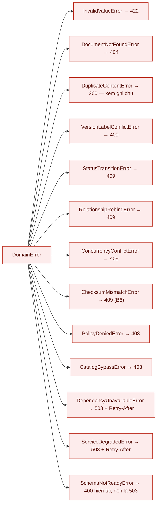

Bảng ánh xạ nằm ở `adapter/inbound/http/errors.py::STATUS_BY_ERROR`; `DomainErrorTranslator.status_for` duyệt bảng theo `isinstance` nên một lỗi mới chưa khai rơi về mặc định `400`, không thành `500`.

**Hai chỗ hiện sai, gate G1 phát hiện:**

- `DuplicateContentError` được map sang **`200`** (`errors.py:34`). Một *lỗi* trả `200` kèm body lỗi là hợp đồng tự mâu thuẫn. Luồng trùng nội dung đúng ra không ném lỗi — `CreateVersionUseCase` trả `CreateVersionResult(duplicate=True)` với `200`, và `DedupPolicy.assert_not_duplicate` hiện **không có người gọi nào**. Mapping này là dấu vết của một thiết kế cũ.
- `SchemaNotReadyError` **không** có trong bảng nên nhận `400`, trong khi nó nghĩa là service chưa sẵn sàng — phải là `503`. Lớp này nằm ở `openmetadata/bootstrap.py:27`, không ở `domain/errors.py`, nên cây trên vẽ nó là để thấy mã HTTP, không phải vị trí.

### 3.7. Tám port — chữ ký đích

```python
class MetadataCatalogPort(ABC):                                        # D12
    async def ensure_collection(self, collection: Collection) -> EntityRef
    async def find_collection(self, collection_id: str) -> Collection | None          # (B13)
    async def register_document(self, document: Document) -> EntityRef
    async def register_version(self, version: DocumentVersion, metadata: dict[str, Any]) -> EntityRef
    async def patch_controlled_fields(self, document_id: DocumentId,
                                      version_id: DocumentVersionId,
                                      fields: dict[str, Any]) -> None
    async def patch_document_fields(self, document_id: DocumentId,
                                    fields: dict[str, Any]) -> None
    async def read_document(self, document_id: DocumentId) -> Document
    async def list_versions(self, document_id: DocumentId) -> list[DocumentVersion]
    async def search(self, query: SearchQuery) -> SearchPage

class RelationshipStorePort(ABC):                                      # D19
    async def upsert(self, relationship: Relationship) -> None
    async def query(self, version_id: DocumentVersionId,
                    direction: Direction = Direction.BOTH,
                    relation_type: RelationType | None = None,
                    page: PageRequest | None = None) -> list[RelatedEdge]   # (B4, B14)
    async def remove(self, relationship: Relationship) -> None

class ObjectStorePort(ABC):                                            # D13
    async def put_immutable(self, uri: StorageUri, stream: AsyncIterator[bytes],
                            checksum: Checksum) -> PutResult
    async def put_overwrite(self, uri: StorageUri, payload: bytes,
                            content_type: str = "application/json") -> PutResult
    async def head(self, uri: StorageUri) -> ObjectInfo
    async def presign(self, uri: StorageUri, ttl: timedelta) -> str
    def open_stream(self, uri: StorageUri) -> AsyncIterator[bytes]
    async def list_under_prefix(self, prefix: str) -> list[ObjectInfo]

class IntentStorePort(ABC):                                            # D20
    async def create(self, intent: ProcessingIntent) -> None
    async def advance(self, request_id: RequestId, state: IntentState) -> None
    async def save(self, intent: ProcessingIntent) -> None
    async def find_by_idempotency_key(self, key: IdempotencyKey) -> ProcessingIntent | None
    async def find_by_request_id(self, request_id: RequestId) -> ProcessingIntent | None
    async def find_unfinished(self, stale_after: timedelta,
                              kind: IntentKind | None = None) -> list[ProcessingIntent]  # (B9a)

class PolicyDecisionPort(ABC):                                         # D21
    async def decide(self, principal: Principal, action: Action, resource: str) -> Decision
    async def effective_policy(self, document_id: DocumentId) -> AccessPolicy
    async def invalidate(self, document_id: DocumentId | None = None) -> None          # (B11)

class EventPublisherPort(ABC):                                         # D14
    async def publish(self, event: DomainEvent) -> None

class AuditPort(ABC):                                                  # D16
    async def record(self, event: AuditEvent) -> None
    async def list_for_document(self, document_id: DocumentId,
                                page: PageRequest | None = None) -> Page[AuditEvent]   # (B14)

class DocumentLockPort(ABC):                                           # D22
    async def with_lock(self, document_id: DocumentId,
                        operation: Callable[[], Awaitable[T]]) -> T
```

**Đúng tám port, không chín.** Bề mặt này được đóng băng bằng test (`test_port_surface_is_eight_abstract_classes`, B20): thêm port thứ chín là một hành động có ý thức kéo theo sửa `c4-04b` mục 3 và tài liệu này. Đó là cái giữ cho phương án "port riêng cho status-change intent" không bị chọn một cách im lặng.

**`invalidate` là `async`** dù hiện thực hiện tại chỉ xóa một dict: mọi method khác của port là async, và cache policy có thể chuyển sang Redis cùng chỗ với khóa. Để sync rồi đổi về sau là một breaking change nữa.

---

## 4. Lớp `application`

### 4.1. Cây use case

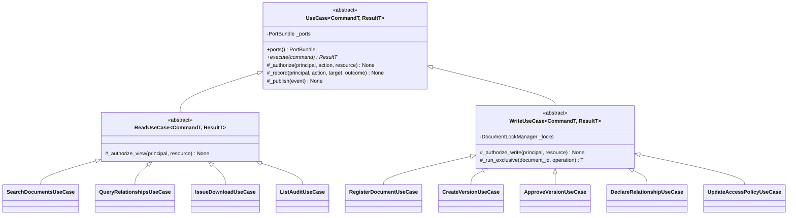

**Chín use case, không mười một.** `c4-04b` mục 2.2 vẽ thêm `ManageCollectionUseCase` và `ApplyRetentionUseCase`; cả hai thuộc D24/D25 nên **ngoài phạm vi lần này** và không tồn tại trong `src/`.

```python
# application/usecase/base.py
@dataclass(frozen=True, slots=True)
class AuditTarget:
    document_id: str
    target_id: str
    @classmethod
    def of_document(cls, document_id: object) -> AuditTarget
    @classmethod
    def of_version(cls, document_id: object, version_id: object) -> AuditTarget

@dataclass(frozen=True, slots=True)
class AuditOutcome:
    result: str
    detail: str = ""
    @classmethod
    def ok(cls, detail: str = "") -> AuditOutcome                    # result="ok"
    @classmethod
    def denied(cls, reason: str) -> AuditOutcome                     # result="denied"
    @classmethod
    def transition(cls, before: DocumentStatus,                      # (B7)
                   after: DocumentStatus) -> AuditOutcome            # detail="Draft -> Approved"
```

`_record` nhận `action: str` chứ không phải `Action`: tên hành động audit (`"version.created"`, `"version.status_changed"`, `"document.access_policy_changed"`) là một không gian tên riêng, rộng hơn tập `Action` dùng để phân quyền. Hai thứ không được trộn.

`AuditTarget`/`AuditOutcome` **không có trong `c4-04b`** — lệch có chủ ý, xem [mục 16](#16-khác-biệt-có-chủ-ý-so-với-c4-04b).

### 4.2. `PortBundle` và `PolicySet`

```python
@dataclass(frozen=True, slots=True)
class PortBundle:
    catalog: MetadataCatalogPort
    relationships: RelationshipStorePort
    objects: ObjectStorePort
    intents: IntentStorePort
    policies: PolicyDecisionPort
    events: EventPublisherPort
    audit: AuditPort
    locks: DocumentLockPort

@dataclass(frozen=True, slots=True)
class PolicySet:
    version: VersionPolicy
    lifecycle: LifecyclePolicy
    relationship: RelationshipPolicy
    dedup: DedupPolicy
```

Lý do gom: pylint `max-args=5` của repo. Từng port vẫn truy cập qua thuộc tính cùng tên (`self.ports.catalog`), nên hợp đồng thiết kế ở `c4-04b` mục 3 không đổi — chỉ cách truyền đổi.

### 4.3. `UseCaseFactory`

```python
class UseCaseFactory:
    def __init__(self, ports: PortBundle, policies: PolicySet,
                 presign_ttl_seconds: int = 300,
                 builder: CatalogMetadataBuilder | None = None) -> None
    def register_document(self) -> RegisterDocumentUseCase        # (ports, builder)
    def create_version(self) -> CreateVersionUseCase              # (ports, policies, builder)
    def approve_version(self) -> ApproveVersionUseCase            # (ports, policies, builder)
    def declare_relationship(self) -> DeclareRelationshipUseCase  # (ports, policies)
    def query_relationships(self) -> QueryRelationshipsUseCase    # (ports)
    def issue_download(self) -> IssueDownloadUseCase              # (ports, presign_ttl_seconds)
    def search_documents(self) -> SearchDocumentsUseCase          # (ports)
    def update_access_policy(self) -> UpdateAccessPolicyUseCase   # (ports, builder)
    def list_audit(self) -> ListAuditUseCase                      # (ports)
```

Mỗi lời gọi tạo instance mới, **không cache**: use case không giữ trạng thái giữa các request, và cache chúng sẽ giữ sống một `PortBundle` cũ sau khi container reset.

### 4.4. Orchestration

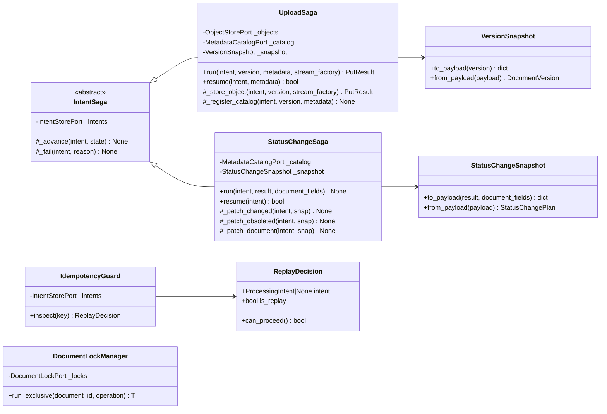

`IntentSaga` base **(B9b)** tồn tại để `_fail`/`_advance` không bị viết hai lần — pylint `R0801` với `min-similarity-lines=4` sẽ đánh ngay nếu hai saga lặp cùng một khuôn.

**`IdempotencyGuard.inspect` — hợp đồng sau B10:**

| Intent tìm được | Kết quả |
|---|---|
| không có | `ReplayDecision(None, is_replay=False)` → xử lý mới |
| `COMPLETED` | `ReplayDecision(intent, is_replay=True)` → trả lại kết quả cũ (I13) |
| `FAILED` | **(B10)** `ConcurrencyConflictError` → `409` |
| trạng thái khác | `ConcurrencyConflictError` → `409` (đang xử lý) |

Hiện nhánh `FAILED` trả `is_replay=False`, hàm ý cho xử lý lại; nhưng `processing_intent.idempotency_key` có ràng buộc `UNIQUE` nên `create` luôn ném `ConcurrencyConflictError`. Đó là một nhánh code không bao giờ tới đích. B10 cho `inspect` ném luôn, khớp với `c4-04b` mục 12 đã chốt: *một `Idempotency-Key` kết thúc ở `Failed` không được dùng lại*.

**`StatusChangeSnapshot` serialize kết quả đã quyết, không serialize yêu cầu:**

```python
@dataclass(frozen=True, slots=True)
class StatusChangePlan:
    version_id: DocumentVersionId
    target_status: DocumentStatus
    previous_status: DocumentStatus
    obsoleted_version_id: DocumentVersionId | None
    current_version_id: str          # "" nghĩa là xóa trường
    actor: Actor
```

Lý do: `StatusChangeSaga.resume` **không được** gọi lại `LifecyclePolicy.transition`. Khi job phục hồi chạy, phiên bản đã ở `Approved`, nên `mark_approved` sẽ ném `StatusTransitionError`. Nhiệm vụ của `resume` là đưa catalog về đúng **kết quả đã lưu**, bằng ba lệnh patch idempotent — không phải quyết định lại.

### 4.5. Ranh giới trách nhiệm trong luồng ghi

| Việc | Lớp | Không phải lớp nào |
|---|---|---|
| Quyết định phiên bản mới, label, storage_uri | `VersionPolicy` | không phải use case |
| Quyết định chuyển trạng thái, bản nào thành Obsolete | `LifecyclePolicy` | không phải adapter catalog |
| Ghi intent bền vững trước khi chạm phụ thuộc ngoài | use case ghi | không phải saga — saga chỉ `advance` |
| Gọi phụ thuộc ngoài theo thứ tự, chịu lỗi từng bước | saga | không phải use case |
| Tuần tự hóa theo `document_id` | `WriteUseCase._run_exclusive` → `DocumentLockManager` | không phải policy |
| Lọc quyền kết quả tra cứu | `SearchPage.filtered` ở `domain` | **không phải** adapter catalog |
| Ghi audit mọi thao tác ghi | `UseCase._record` | không phải adapter |

Luật cuối được kiểm tự động: mọi `WriteUseCase` phải có lời gọi `_record` ([mục 15](#15-quy-ước-code)).

---

## 5. Lớp `adapter.outbound`

### 5.1. Sơ đồ lớp theo package

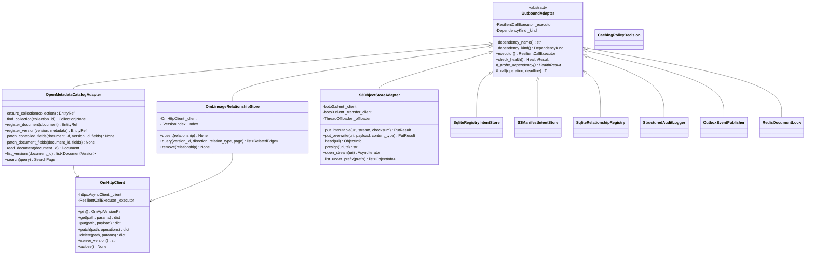

`CachingPolicyDecision` **không** kế thừa `OutboundAdapter`: nó không gọi ra ngoài tiến trình, nó đọc qua `MetadataCatalogPort`. Vì vậy nó không có breaker riêng và không là `HealthProbe`.

### 5.2. Bộ cộng tác của adapter OpenMetadata

| Lớp | Việc | Ghi chú thi công |
|---|---|---|
| `OmFqnBuilder` | `service_fqn`, `root_fqn`, `collection_fqn(id)`, `document_fqn(id)`, `version_fqn(document_id, version_id)`, `document_name`, `version_name` | `version_fqn` nhận **cả** `document_id` — `c4-04b` mục 4 vẽ thiếu tham số này |
| `OmExtensionMapper` | `to_extension`, `from_extension`, `extension_field_path(name)`, `to_document_metadata` | `extension_field_path` sinh `extension.<field>` cho `query_filter` |
| `OmDirectoryMapper` | `collection_payload`, `document_payload`, `to_document` | Directory của tài liệu nằm **trực tiếp** dưới root, không dưới collection — xem lệch L13 ở `c4-08` |
| `OmFileEntityMapper` | `to_file_payload`, `to_version` | Hàm cấp module `_as_file_type` (`entity.py:85`, **không** phải method của lớp) ánh xạ MIME sang enum `fileType` của OpenMetadata |
| `OmJsonPatchBuilder` | `replace_extension(field, value)`, `build()`, `from_fields(fields)` | **Chỉ** sinh `replace` trên đường dẫn cố định, để retry không nhân bản phần tử |
| `OmEntityVersionGuard` | `capture(payload) -> float`, `version_went_backwards(captured, payload) -> bool` **(B12)** | Hiện tên là `changed_unexpectedly` và so `current < captured`, nên chỉ phát hiện version **tụt**. B12 so `!=`. Lớp này **không hứa** phát hiện hai `PATCH` đồng thời — việc đó là của khóa |
| `OmSearchQueryBuilder` | `build(query) -> dict` | Trả **query params** cho `GET /search/query`, không phải một kiểu `QueryFilter` riêng. `query_filter` phải được JSON-encode, không gửi dict thuần |
| `OmSearchResultMapper` | `to_page(payload, query) -> SearchPage` | Nhận `query` để tính `next_cursor` |
| `OmDriveServiceProvisioner` | `ensure_drive_service`, `ensure_root_directory` | |
| `OmCustomPropertyRegistrar` | `field_type_id`, `existing_properties`, `ensure_properties`, `assert_filterable` | `assert_filterable` **fail fast** lúc khởi động nếu trường bắt buộc chưa đăng ký |
| `OmSchemaMigration` | `run_on_startup()` | Gọi từ `ApplicationFactory._run_startup`, bỏ qua ở profile `fake` |
| `_VersionIndex` | `remember`, `entity_of(version_id) -> (uuid, fqn)`, `_refresh()` | Lớp **không có** trong `c4-04b`. Cache `version_id → (uuid, fqn)`; **(B18)** thêm TTL và `forget()` khi `remove()` |

**Endpoint, tập trung ở `endpoints.py`:**

| Hằng | Giá trị |
|---|---|
| `SYSTEM_VERSION` | `/api/v1/system/version` |
| `DRIVE_SERVICES` | `/api/v1/services/driveServices` |
| `DIRECTORIES`, `DIRECTORY_BY_NAME` | `/api/v1/drives/directories`, `…/name` |
| `FILES`, `FILE_BY_NAME` | `/api/v1/drives/files`, `…/name` |
| `LINEAGE`, `LINEAGE_GET` | `/api/v1/lineage`, `/api/v1/lineage/getLineage` |
| `SEARCH_QUERY` | `/api/v1/search/query` |
| `METADATA_TYPES` | `/api/v1/metadata/types` |
| `JSON_PATCH_CONTENT_TYPE` | `application/json-patch+json` |

Hai điều về lineage phải giữ đúng, vì chúng là đặc thù của OpenMetadata 1.12 đã kiểm chứng bằng code:

1. Truy vấn dùng **query param** `GET /api/v1/lineage/getLineage?fqn=…&type=file&upstreamDepth=1&downstreamDepth=1`. Dạng path `/getLineage/{type}/name/{fqn}` bị trả `405`.
2. Response có `upstreamEdges`/`downstreamEdges` là **dict** keyed `"<fromFqn>--->"<toFqn>"` (không phải list, và không có khóa `edges`), còn `description` nằm ở **cấp trên cùng** của mỗi cạnh — bất đối xứng với lúc ghi, nơi `relation_type` đặt trong `lineageDetails.description`.

### 5.3. Bản đồ executor — ai sở hữu circuit breaker nào

Đây là mục mà tài liệu cũ chưa bao giờ có, và là chỗ đang sai.

| Phụ thuộc | Executor | Lớp thực sự gọi `_call` / `executor.call` | Sở hữu breaker |
|---|---|---|---|
| OpenMetadata (catalog) | `catalog` | `OmHttpClient._request` | `OmHttpClient` của catalog adapter |
| OpenMetadata (lineage) | `relationship_store` | `OmHttpClient._request` của **một client riêng** **(B18)** | `OmHttpClient` của lineage store |
| Object Storage | `object_store` | `S3ObjectStoreAdapter._call` | `S3ObjectStoreAdapter` |
| Intent / audit / outbox store | `intent_store` | `SqliteRegistryIntentStore._call`, `StructuredAuditLogger._call`, `OutboxEventPublisher._call` | dùng chung một breaker — chúng là **cùng một** sqlite database |
| Webhook downstream | `events` | `WebhookEventSender._operation` | `WebhookEventSender` |
| IdP (JWKS) | `idp` | **không ai** — xem L-EX1 bên dưới | **không có** |
| Khóa phân tán | `document_lock` **(B17)** | `RedisDocumentLock._call` | `RedisDocumentLock` |

**Hai luật, cả hai đang bị vi phạm:**

> **L-EX1. Mỗi phụ thuộc đúng một chủ sở hữu breaker, và chủ sở hữu phải là lớp thực sự gọi ra ngoài.**
> Hiện `OmLineageRelationshipStore` nhận executor `relationship_store` nhưng mọi lời gọi của nó đi qua `OmHttpClient` dùng executor `catalog`. Hệ quả: executor `relationship_store` không bao giờ thấy traffic, breaker của nó luôn `CLOSED`, và `check_health()` của lineage store đọc một breaker vô nghĩa. Khối `resilience.relationship` trong cấu hình cũng không có tác dụng. B18 cấp cho lineage store một `OmHttpClient` riêng dựng trên executor `relationship_store`.

> **L-EX1 bị vi phạm lần thứ hai, ở `idp`.** Executor `idp` được đăng ký (`container.py:185`) nhưng **không nơi nào gọi `get("idp")`**. `OidcTokenVerifier.__init__(self, settings)` không nhận executor nào, và `PrincipalResolver` được dựng chỉ với settings. Nên khối `resilience.idp` trong cấu hình hoàn toàn vô tác dụng, và `IdpHealthIndicator` không đọc breaker nào. Cùng một loại lỗi với `relationship_store`, chỉ khác là ở đây không có cả dây nối.

> **L-EX2. Không bọc executor hai lần.**
> Hiện `S3ManifestIntentStore._call(lambda: self._objects.put_overwrite(...))` đi qua executor `intent_store` rồi vào `S3ObjectStoreAdapter._call` với executor `object_store`. Số lần retry nhân nhau (3 × 3 = 9) và hai breaker cùng đếm một lỗi. B18 bỏ lớp bọc ngoài: adapter nào uỷ quyền cho một adapter khác thì **không** tự bọc thêm.

**Một ngoại lệ có chủ ý, cho đường transfer S3 (B16).** Client boto3 hiện đặt `retries={"max_attempts": 1}` để nhường retry cho `ResilientCallExecutor`. Với multipart thì hướng đó sai — ta muốn retry **theo từng part**, không gửi lại toàn file. Nên:

- `self._client` (metadata: `head`, `presign`, `list`, `put_object` nhỏ) giữ `max_attempts: 1`, retry do executor `object_store`;
- `self._transfer_client` (multipart) dùng `retries={"max_attempts": 3, "mode": "standard"}`; mỗi `upload_part` vẫn là một `_call` riêng nên breaker vẫn thấy lỗi, nhưng lỗi tạm thời của một part được boto3 xử lý trước.

Điều này khớp đúng dòng "Object Storage — ghi object: 3 ở mức **từng part**, không gửi lại toàn file" của [c4-04b mục 11.3](c4-04b-code-structure.md#113-tham-số-theo-từng-phụ-thuộc).

### 5.4. Đường đi của `Deadline`

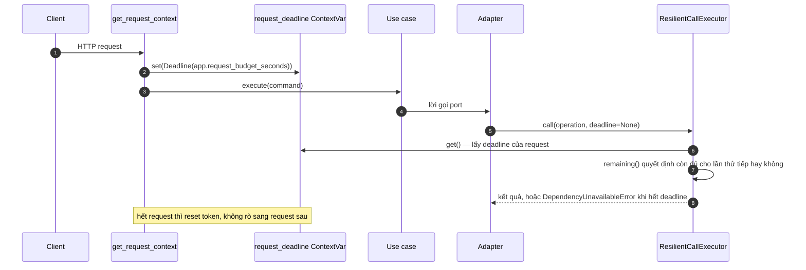

**Hiện trạng:** `AppSettings.request_budget_seconds = 10.0` được khai mà **không nơi nào đọc**, và không chỗ nào truyền `deadline` vào `_call`. Mỗi `ResilientCallExecutor.call` tự gọi `new_deadline()` theo `total_timeout_seconds` **của riêng nó**. Hệ quả: một request chạm ba phụ thuộc có thể chờ tổng bằng tổng ba budget nhân số lần retry, trong khi client đã bỏ đi từ lâu.

**Đích (B18):** một `ContextVar[Deadline | None]` trong `infrastructure/resilience/deadline.py`; `get_request_context` đặt nó, `ResilientCallExecutor.call` đọc khi tham số `deadline` là `None`. Không đổi chữ ký của 8 port — đây là lý do chọn contextvar thay vì truyền `deadline` xuống từng lời gọi.

Worker (`reconcile`, `dispatch`) không có request nên contextvar rỗng; executor rơi về `new_deadline()` như hiện nay. Đó là hành vi đúng: job nền không có client đang chờ.

### 5.5. Adapter in-memory

Bảy adapter ở `adapter/outbound/fake/in_memory.py` phục vụ profile `fake` và test: `InMemoryCatalog`, `InMemoryObjectStore`, `InMemoryIntentStore`, `InMemoryRelationshipStore`, `InMemoryEventPublisher`, `InMemoryAuditLog`, `InMemoryDocumentLock`, cộng `AllowAllPolicyDecision`.

Năm lớp đầu kế thừa `InMemoryAdapter(HealthProbeMixin)` chứ không phải `OutboundAdapter`, vì không có phụ thuộc ngoài nào để bọc. **Hai lớp không kế thừa nó**: `InMemoryAuditLog` (`in_memory.py:442`) chỉ kế thừa `AuditPort`, `AllowAllPolicyDecision` (`:410`) chỉ kế thừa `PolicyDecisionPort` — nên cả hai **không** là `HealthProbe` và không đăng ký health được. Hệ quả: khi B12 đăng ký health cho `events`, `audit`, `policies` thì profile `fake` sẽ thiếu đúng hai indicator so với profile thật, trừ khi hai lớp này được cho kế thừa `InMemoryAdapter` cùng lúc.

**Luật: fake phải chặt bằng bản thật.** Mỗi khi một hiện thực thật siết thêm một ràng buộc, fake siết theo — nếu không, bộ contract test sẽ xanh trên fake và đỏ trên bản thật, hoặc tệ hơn, xanh cả hai mà bản thật vẫn sai. Áp dụng cho `put_immutable` trả checksum thật (B6), `query` trả `RelatedEdge` (B4), `invalidate` (B11), phân trang (B14), timeout acquire của khóa (B17).

`in_memory.py` hiện 478 dòng và sẽ nhận thêm từ năm bước trên. Nếu vượt ~700 thì tách `fake/catalog.py`, `fake/storage.py`, `fake/state.py` và re-export ở `fake/__init__.py` — flake8 `per-file-ignores` đã miễn `F401` cho `__init__.py`, nên **không** re-export trong `in_memory.py`.

---

## 6. Lớp `adapter.inbound`

### 6.1. Dependency của FastAPI và context object

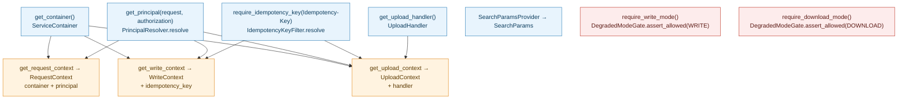

Lý do gom thành context object: endpoint vượt `max-args=5` của pylint. `WriteContext` còn có tác dụng làm rõ **endpoint nào là đường ghi** — ai khai `ReadCtx` thì không bắt `Idempotency-Key`. Đó chính là chỗ lỗi X6: `transition_status` đang khai `ReadCtx`.

### 6.2. Đường upload — đích sau B16

```python
# adapter/inbound/http/upload_handler.py
class UploadSource(Protocol):
    filename: str | None
    content_type: str | None
    async def read(self, size: int = -1) -> bytes: ...
    async def seek(self, offset: int) -> None: ...          # (B16)

@dataclass(frozen=True, slots=True)
class PreparedUpload:
    request: UploadRequest
    body: SpooledUploadBody                                  # (B16) thay cho payload: bytes
    def stream_factory(self) -> AsyncIterator[bytes]
    async def aclose(self) -> None

# utils/files.py
class SpooledUploadBody:                                     # (B16)
    """Body đọc lại được: bọc một file nhị phân seekable + kích thước đã đo."""
    size_bytes: int
    def chunks(self) -> AsyncIterator[bytes]                 # seek(0) rồi yield từng CHUNK_SIZE
    async def aclose(self) -> None
```

**Vì sao không cần tạo file tạm thứ hai.** `UploadFile` của Starlette **đã** là một `SpooledTemporaryFile` với ngưỡng 1 MiB: file lớn đã nằm trên đĩa trước khi code của service chạy dòng đầu tiên. Dòng `b"".join(chunks)` hiện tại chỉ **nhân đôi** nó vào RAM. B16 bỏ dòng đó, `seek(0)`, và bọc chính file đó.

**Hai ràng buộc không thay đổi được:**

1. **Checksum và size phải có trước khi vào use case.** `UploadRequest.checksum` là đầu vào của `DedupPolicy.duplicate_of` (I8/I9 — phải phát hiện trùng *trước khi* ghi object) và của `VersionPolicy.next_version`. Đổi sang "tính checksum sau khi ghi" là đổi thứ tự bước của [c4-05 luồng 1](c4-05-dynamic-views.md#1-upload-và-đăng-ký-phiên-bản).
2. **`stream_factory` phải đọc lại được nhiều lần.** `ResilientCallExecutor` retry **bên trong** `put_immutable`; một generator một-lần sẽ gửi body rỗng ở lần thử thứ hai.

→ Dữ liệu phải nằm ở đâu đó đọc lại được. Giá phải trả, ghi rõ: **đọc file hai lượt** (lượt 1 băm, lượt 2 upload), và đĩa tạm tỷ lệ với kích thước file. Yêu cầu dung lượng đĩa tạm phải vào [c4-06 mục 6.3](c4-06-deployment.md#63-tài-nguyên-tham-khảo), nơi đang chờ số đo của POC-28.

Hằng số `CHUNK_SIZE = 1 MiB` và `MAX_UPLOAD_BYTES = 512 MiB` chuyển sang `configs/storage.yml` thành `multipart_part_bytes` và `max_upload_bytes` **(B16)**.

### 6.3. Health

```python
class ReadinessPolicy:
    def evaluate(self, results: tuple[HealthResult, ...]) -> ServiceMode
    def _all_up(self, results, kind: DependencyKind) -> bool

class HealthCheckRegistry(metaclass=SingletonMeta):
    def register(self, indicator: HealthIndicator) -> None
    def mark_startup_done(self) -> None
    def liveness(self) -> dict[str, str]
    def startup(self) -> dict[str, object]
    async def readiness(self, timeout_seconds: float = 2.0) -> HealthReport
    async def details(self, timeout_seconds: float = 2.0) -> HealthReport
    def reset(self) -> None

class DegradedModeGate(metaclass=SingletonMeta):
    def update(self, mode: ServiceMode) -> None
    def assert_allowed(self, action: Action) -> None     # ServiceDegradedError nếu không
```

**Nhóm phụ thuộc và chế độ phục vụ:**

| `DependencyKind` | Phụ thuộc | Mất nó thì |
|---|---|---|
| `REQUIRED_FOR_READ` | `catalog`, `relationship_store`, `idp` | không đọc được metadata |
| `REQUIRED_FOR_DOWNLOAD` | `object_store` | không cấp được file |
| `REQUIRED_FOR_WRITE` | `intent_store`, `document_lock` | không nhận ghi mới |
| `OPTIONAL` | `events`, `audit`, `reconcile_backlog` | chỉ cảnh báo |

| Điều kiện | `ServiceMode` | `DegradedModeGate` cho phép |
|---|---|---|
| write + read + download đều UP | `FULL` | mọi `Action` |
| read + download UP | `READ_ONLY` | `VIEW_METADATA`, `SEARCH`, `DOWNLOAD` |
| download UP | `DOWNLOAD_ONLY` | `DOWNLOAD` |
| còn lại | `NOT_READY` | không gì |

`DEGRADED` **không** hạ mode — chỉ `DOWN` mới tính. Trạng thái `HALF_OPEN` của breaker cho `DEGRADED`, nghĩa là phụ thuộc vừa phục hồi thì service không bị đẩy ra khỏi load balancer.

**Ba sửa đổi (B9):**

| # | Hiện trạng | Đích |
|---|---|---|
| 1 | `_all_up` trả `True` cho **nhóm rỗng** (`all([])`), nên thiếu indicator nhóm ghi vẫn cho `FULL` | fail closed: nhóm `REQUIRED_*` rỗng → `False` |
| 2 | Chỉ 5 port được đăng ký health (`catalog`, `objects`, `intents`, `relationships`, `locks`); `events`, `audit`, `policies` bị bỏ dù `OutboxEventPublisher` và `StructuredAuditLogger` đều là `HealthProbe` | đăng ký đủ |
| 3 | `IdpHealthIndicator(jwks_available=True)` hard-code trong container, không có đường nối tới `OidcTokenVerifier` | nối `update_jwks_state` với `OidcTokenVerifier.jwks_available` |
| 4 | `details()` chỉ gọi lại `readiness()` nên không có đường xem chi tiết từng indicator. Trong bốn trường cấu hình của `health`, **hai** đã được đọc (`probe_timeout_seconds` và `expose_details` ở `health_routes.py:39,49,51`) và **hai** là knob chết: `cache_ttl_seconds`, `startup_deadline_seconds` | `details()` trả từng indicator; hai knob chết được nối hoặc bỏ |

### 6.4. Sync từ nguồn

```python
class SourceConnector(ABC):
    def __init__(self, settings: SourceSettings) -> None
    @abstractmethod
    def discover(self) -> Iterable[SourceFile]

class FileSystemSourceConnector(SourceConnector): ...
class SourcePermissionMapper:
    def map(self, settings: SourceSettings) -> AccessPolicy      # không ánh xạ được → restricted (I11)
class SourceSyncJob:
    def connectors(self) -> list[SourceConnector]
    async def run_once(self) -> SyncReport
class SourceSyncScheduler:
    async def run_forever(self) -> None
```

**Ba sửa đổi (B16, B18):**

| ID | Hiện trạng | Đích |
|---|---|---|
| X31 | `idempotency_key = f"sync-{checksum[:24]}"` — **không có `document_id`** | `f"sync-{document_id}-{checksum[:16]}"`. Hai tài liệu khác nhau cùng nội dung hiện bị coi là replay của nhau, phá đúng I9 ("hai `Document` khác nhau có thể cùng `checksum` nhưng giữ `document_id` riêng") |
| X32 | `SourceFile.payload: bytes`, `discover()` gọi `path.read_bytes()` — "discover" cũng là "load" | `SourceFile.path`, mở `path.open("rb")` khi cần; checksum tính bằng `StreamingHasher` theo chunk |
| X33 | `run_forever` không bắt exception ngoài `DomainError`, nên một lỗi lạ kết thúc vòng lặp **im lặng** | bắt mọi `Exception`, log, chạy tiếp; chỉ thoát khi bị hủy |

---

## 7. Lớp `infrastructure`

### 7.1. Resilience

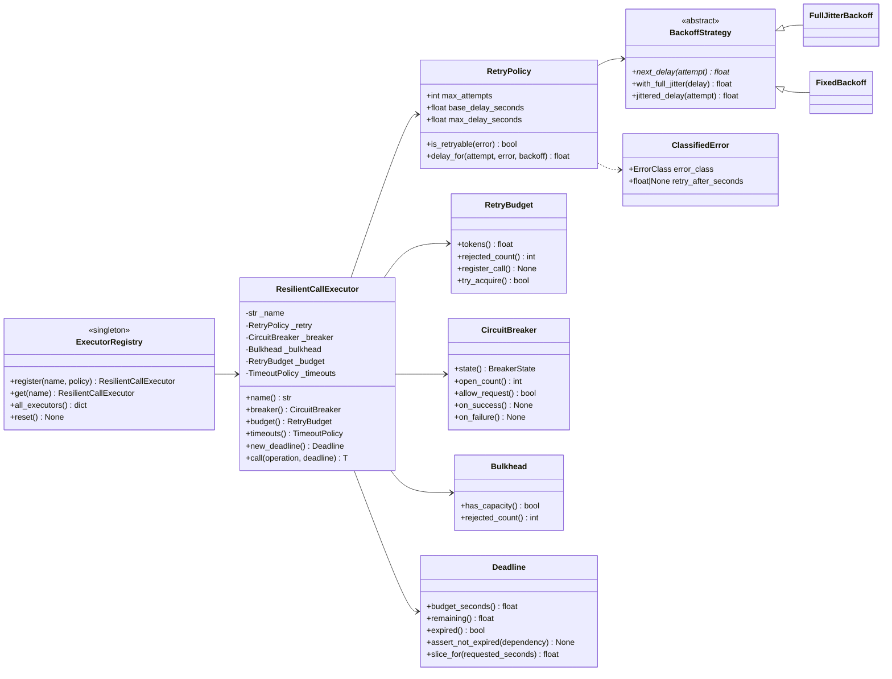

`ConnectionPool` **không phải một lớp tự viết**: pool nằm trong `httpx.AsyncClient` (OpenMetadata), `botocore.config.Config` (S3) và kết nối sqlite. `c4-04b` mục 11.1 vẽ nó như một lớp — đó là lệch tài liệu, không phải thiếu code.

**Phân loại lỗi (`ErrorClass`)** quyết định có retry hay không:

| Lớp lỗi | Retry | Nguồn |
|---|---|---|
| `RETRYABLE_TRANSIENT` | có | `5xx`, timeout, connection reset |
| `RETRYABLE_THROTTLED` | có, tôn trọng `Retry-After` | `429` |
| `AUTH_REFRESHABLE` | một lần sau khi làm mới token | `401` |
| `NON_RETRYABLE_CLIENT` | không | `4xx` khác |
| `NON_RETRYABLE_CONFLICT` | không | `409`, `412` |

### 7.2. Health

```python
class HealthProbe(ABC):
    @property
    def dependency_name(self) -> str
    @property
    def dependency_kind(self) -> DependencyKind
    async def check_health(self) -> HealthResult

class HealthProbeMixin(HealthProbe):
    def __init__(self, cache_ttl_seconds: float = 5.0) -> None
    @abstractmethod
    async def _probe_dependency(self) -> HealthResult
    async def check_health(self) -> HealthResult          # cache TTL + đo latency + bắt exception → DOWN
    def invalidate_health_cache(self) -> None
    def health_up(self, detail="") / health_degraded(detail) / health_down(detail) -> HealthResult

class HealthIndicator(ABC):
    def __init__(self, name: str, kind: DependencyKind) -> None
    @abstractmethod
    async def _probe(self) -> HealthResult
    async def check(self, timeout_seconds: float = 2.0) -> HealthResult   # bọc asyncio.wait_for
```

`OutboundAdapter.check_health()` đọc trạng thái breaker **trước** khi gọi phụ thuộc: breaker `OPEN` → `DOWN` ngay, không thêm một lời gọi vào phụ thuộc đang quá tải; `HALF_OPEN` + kết quả healthy → hạ xuống `DEGRADED`.

### 7.3. `ServiceContainer` — điểm wiring duy nhất

Thứ tự trong `__init__`, không lazy:

```text
1. settings            ← get_settings()
2. LoggingConfigurator().configure(level, json_format)
3. ExecutorRegistry()  ← _register_executors(): 6 hiện có + document_lock (B17)
                         catalog · object_store · intent_store · relationship_store
                         idp (đăng ký nhưng KHÔNG ai get) · events
4. ports               ← _build_ports() → _build_fake_ports() | _build_real_ports()
5. policies            ← _build_policies()
6. builder             ← CatalogMetadataBuilder()
7. use_cases           ← UseCaseFactory(ports, policies, presign_ttl, builder)
8. health              ← HealthCheckRegistry()
9. gate                ← DegradedModeGate()
10. metrics            ← MetricsRecorder()
11. _register_health()
```

**Chọn adapter theo cấu hình:**

| Port | profile `fake` | profile `openmetadata` | Quyết định |
|---|---|---|---|
| `catalog` | `InMemoryCatalog` | `OpenMetadataCatalogAdapter` | — |
| `relationships` | `InMemoryRelationshipStore` | `OmLineageRelationshipStore` nếu `relationship.kind=lineage`, ngược lại `SqliteRelationshipRegistry` | **Q4** |
| `objects` | `InMemoryObjectStore` | `S3ObjectStoreAdapter` | — |
| `intents` | `InMemoryIntentStore` | `S3ManifestIntentStore` nếu `intent.kind=s3_manifest`, ngược lại `SqliteRegistryIntentStore` | **Q2** |
| `policies` | `AllowAllPolicyDecision` | `CachingPolicyDecision` | — |
| `events` | `InMemoryEventPublisher` | `OutboxEventPublisher(SqliteOutbox(db))` | — |
| `audit` | `InMemoryAuditLog` | `StructuredAuditLogger(db)` | — |
| `locks` | **theo `lock.kind`**, không theo profile **(B17)** | **theo `lock.kind`** | **Q12** |

Khóa chọn theo cấu hình của chính nó, **không** theo `app.profile`: nhờ đó chạy POC-26 (hai instance, catalog fake, Redis thật) mà không phải dựng OpenMetadata.

**`SqliteDatabase` dùng chung một file** cho intent, relationship registry, audit và outbox — chúng là bốn schema của **cùng** C7. Hiện container dùng `settings.intent.sqlite_path` cho cả bốn và `settings.relationship.sqlite_path` **không ai đọc**; B18 sửa để đường dẫn của relationship được tôn trọng khi khác.

---

## 8. ERD của C7 Service State Store

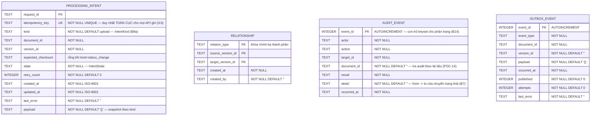

**Index:**

| Index | Bảng | Phục vụ |
|---|---|---|
| `idx_relationship_source` | `relationship(source_version_id)` | truy vấn chiều ra |
| `idx_relationship_target` | `relationship(target_version_id)` | truy vấn chiều vào |
| `idx_audit_target` | `audit_event(target_id)` | audit của một phiên bản |
| `idx_audit_document` | `audit_event(document_id)` | audit của một tài liệu (POC-14) và phân trang keyset |
| `idx_outbox_pending` | `outbox_event(published, event_id)` | lấy lô sự kiện chưa phát |
| `idx_intent_kind_state` **(B9a)** | `processing_intent(kind, state, updated_at)` | `find_unfinished(stale_after, kind)` |

**Không có migration.** `SqliteDatabase._initialize` chỉ chạy `CREATE TABLE IF NOT EXISTS`. Hệ quả vận hành: **đổi schema ⇒ phải xóa `local_data/*.sqlite`**, và câu đó phải nằm trong `deploy/README.md`. Đây là lý do B9a **đổi tên bảng** `upload_intent` → `processing_intent` thay vì `ALTER TABLE`: tên mới thì DB mới, và tên bảng nói đúng nội dung.

**Biến thể A của Q2 (manifest trên S3)** chỉ phục vụ được schema `processing_intent`, dưới hai prefix: `intents/{request_id}.json` và một index theo `idempotency_key`. Nó **không** làm được audit truy vấn theo `document_id` hay outbox có điều kiện, nên nó là phương án dự phòng hẹp, không phải một kiến trúc tương đương. Bằng chứng ở [c4-08 mục 4](c4-08-tra-soat-code-vs-thiet-ke.md): API S3 chuẩn không có ghi có điều kiện dùng được trên mọi sản phẩm tương thích, nên hai lượt ghi index đều thành công và lượt sau ghi đè lượt trước.

---

## 9. Sequence ở mức method

Tám luồng dưới đây chi tiết hoá **một phần** của [c4-05](c4-05-dynamic-views.md) xuống tới tên method, và thêm ba luồng mà c4-05 không có (9.3 truy vấn quan hệ, 9.7 phát outbox, 9.8 vòng đời khóa). Ánh xạ: 9.1↔luồng 1, 9.2↔luồng 2, 9.4 và 9.5↔luồng 3, 9.6↔luồng 7. **Chưa chi tiết hoá:** c4-05 luồng 4 (KB tiêu thụ bản Approved), luồng 5 (thu hồi và xóa), luồng 6 (đồng bộ nguồn), luồng 8 (hết retention) — luồng 5 và 8 thuộc D25 ngoài phạm vi, luồng 6 nằm ở mục 6.4.

> **Mọi luồng dưới đây mô tả trạng thái đích sau B2, B6, B9a–c và B16.** Những thứ chưa có trong `src/`: `ProcessingIntent`, `IntentKind`, `StatusChangeSaga`, `StatusChangePlan`, `TransitionResult`, `ChecksumMismatchError`, `SpooledUploadBody`, và việc `PutResult` mang checksum **đọc lại** từ storage (hiện `s3_store.py:74-78` trả lại chính checksum đầu vào).

Mermaid `sequenceDiagram` **không dùng dấu `;`** trong text.

### 9.1. Tạo phiên bản mới

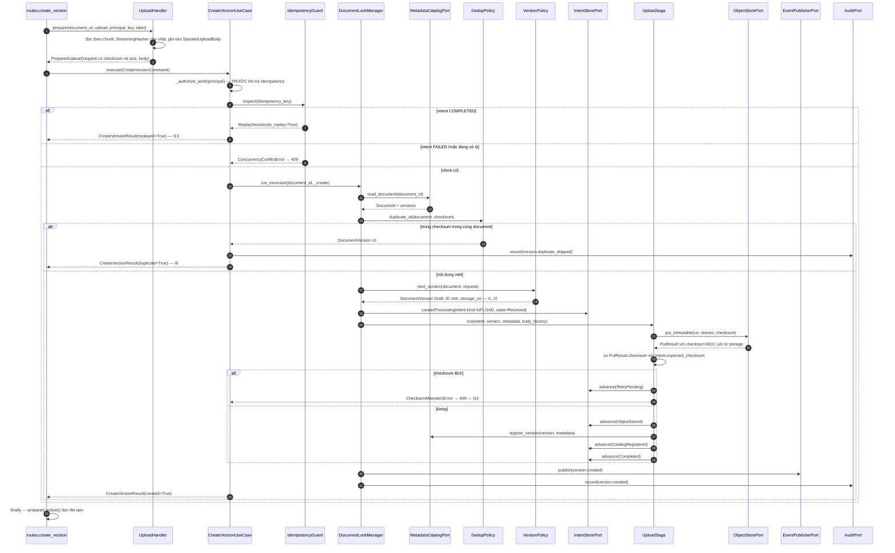

Mọi lỗi từ bước `create(ProcessingIntent)` trở đi: `intent.register_retry(error)` + `intents.save(intent)` rồi re-raise. Phục hồi ở [luồng 9.6](#96-phục-hồi-intent--hai-nhánh-theo-kind).

**Thứ tự `_authorize_write` trước `inspect` là bắt buộc (B10).** Hiện code gọi `inspect` trước, nên một chủ thể **không có quyền ghi** mà dùng lại một `Idempotency-Key` đã `Completed` sẽ nhận được snapshot phiên bản, và một khóa đã `Failed` cho `409` — cả hai đường **không qua kiểm quyền và không ghi audit denied**, trái thứ tự ở [c4-05 luồng 1](c4-05-dynamic-views.md#1-upload-và-đăng-ký-phiên-bản) bước 2 và trái I12.

### 9.2. Duyệt phiên bản

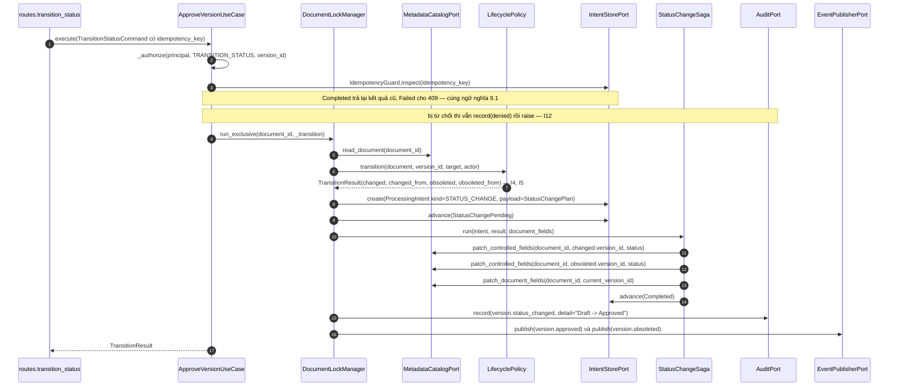

**Vì sao phải có intent ở đây.** Ba lệnh patch **không** nằm trong một giao dịch của OpenMetadata. Lỗi ở lệnh thứ hai mà không có intent sẽ để lại **hai bản `Approved`** trong catalog cho tới lượt đối soát kế tiếp — I4 vỡ trong khoảng giữa hai lượt, và không có gì ghi nhận việc đó.

**Vùng tuần tự chỉ đúng với một instance C1.** Từ hai instance trở lên, khóa trong tiến trình không tuần tự hóa được; cần `RedisDocumentLock` ([mục 12](#12-khóa-phân-tán-theo-redis)).

### 9.3. Truy vấn quan hệ hai chiều

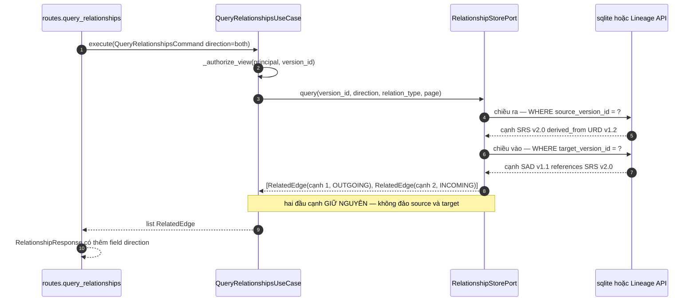

**Đây là lỗi X1, và nó là lỗi ngữ nghĩa chứ không phải trình bày.** Hiện `query` gọi `relationship.reversed_direction()` cho cạnh chiều vào: đảo `source`/`target` và giữ nguyên `relation_type`. Truy vấn từ SRS v2.0 trả về `references: source=SRS v2.0, target=SAD v1.1` — **một quan hệ chưa từng được khai báo**. KB sẽ lưu nó làm nguồn sự thật, và POC-06/09 được tính là "đạt" trong khi dữ liệu trả ra sai.

### 9.4. Cấp file theo quyền

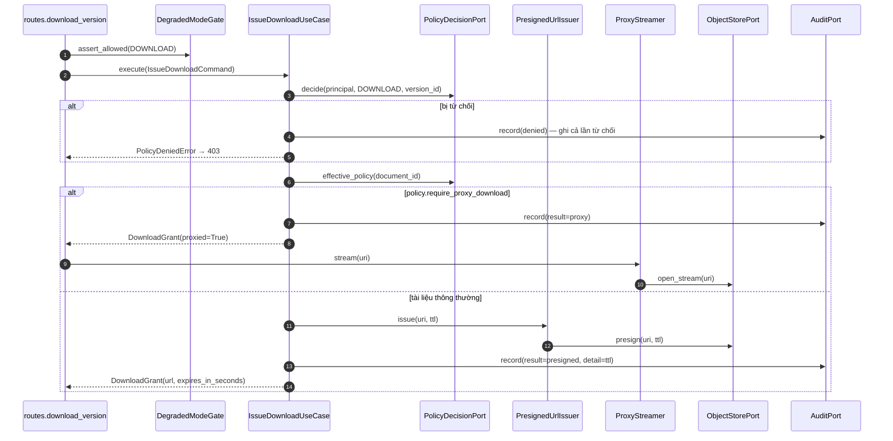

Hai điều tách biệt, đúng mục 2.6 đề bài: **ngừng cấp mới** có hiệu lực ngay khi policy đổi — nhờ `invalidate` ở B11; **link đã phát hành** chỉ hết hiệu lực khi hết TTL. Dữ liệu cần thu hồi ngay phải đặt `require_proxy_download=true`.

### 9.5. Tra cứu có lọc quyền

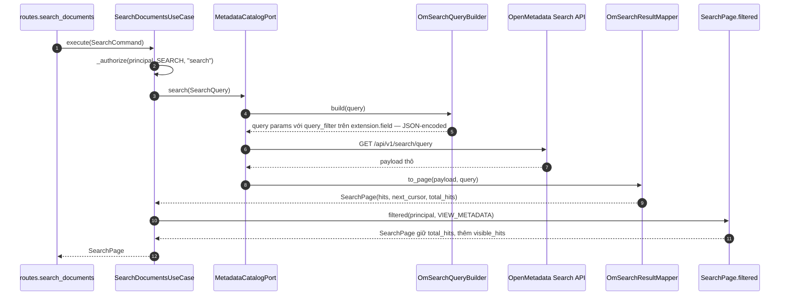

Lọc quyền nằm ở `domain`, **không** ở adapter: đổi sản phẩm catalog không được làm mất quy tắc phân quyền. Hệ quả phải nói rõ cho client: lọc xảy ra **sau** phân trang, nên một trang có thể rỗng mà `next_cursor` khác `None`.

### 9.6. Phục hồi intent — hai nhánh theo `kind`

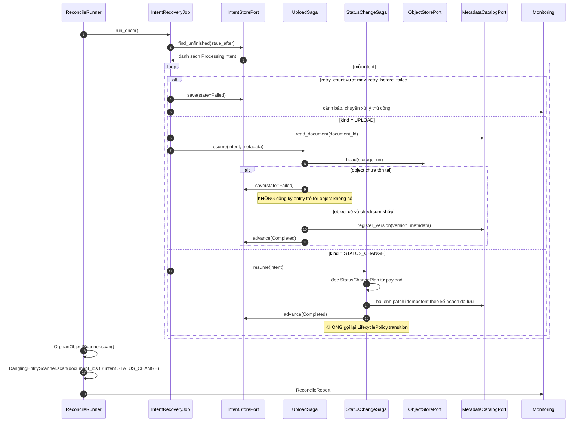

Hai điều hiện sai: `IntentRecoveryJob` coi **mọi** intent là upload và luôn gọi `UploadSaga.resume`; `DanglingEntityScanner.scan(document_ids)` luôn được gọi với `[]` nên không quét gì. B9c sửa cả hai.

### 9.7. Phát sự kiện

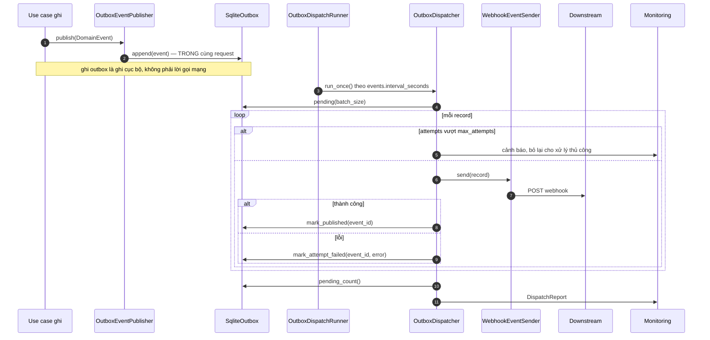

**Hiện `OutboxDispatcher.run_once()` không có tiến trình nào gọi.** Sự kiện được ghi vào `outbox_event` rồi nằm lại vô thời hạn; downstream không nhận gì, nên POC-11 không thể đạt. B15 thêm `worker/dispatch.py`.

### 9.8. Lấy, gia hạn và nhả khóa

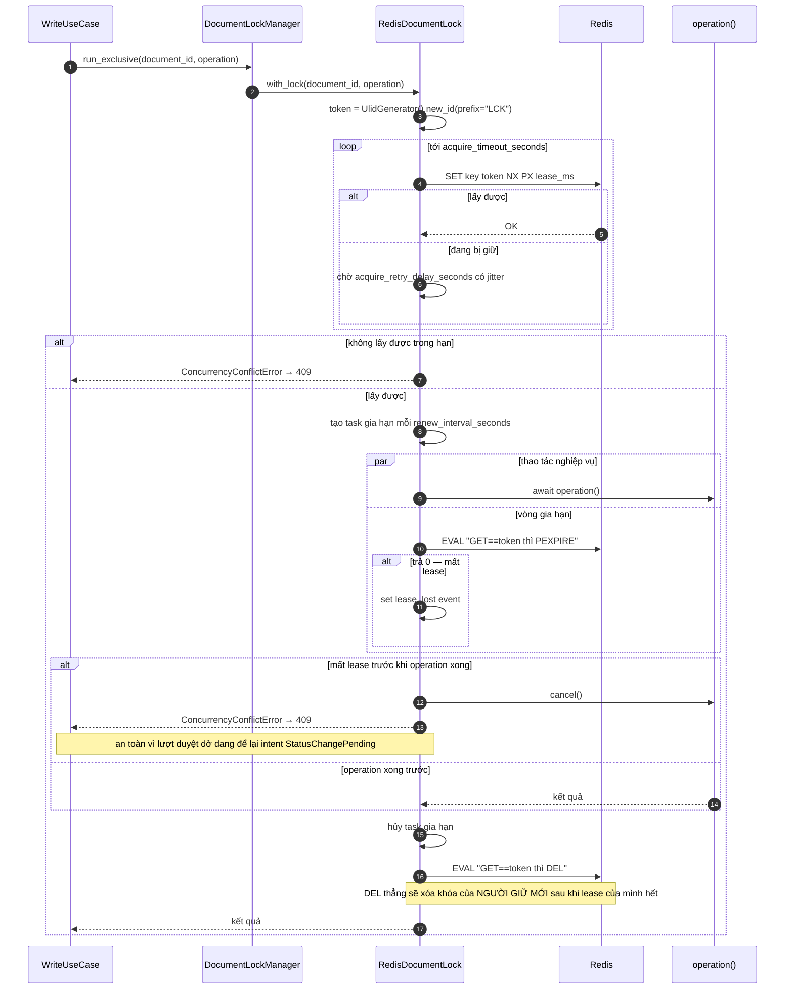

---

## 10. Hợp đồng API công khai

Prefix `app.api_prefix` = `/api/v1`. Endpoint vận hành (`/livez`, `/startupz`, `/readyz`, `/internal/healthz/deps`) nằm **ngoài** prefix và ngoài hợp đồng cho ứng dụng khai thác.

| D | Method · Path | Query | Request | Response | Mã | Idem | Bất biến |
|---|---|---|---|---|---|---|---|
| D1 | `POST /documents` | — | `CreateDocumentRequest` | `DocumentResponse` | 201 | **bắt buộc** | I11 |
| D1 | `GET /documents/{document_id}` | — | — | `DocumentResponse` | 200 / 404 | — | I11 |
| D1 | `POST /documents/{document_id}/versions` | — | multipart: `file`, `version_label` | `VersionResponse` | 201 / 409 | **bắt buộc** | I1, I2, I3, I8, I9, I10, I13 |
| D1 | `POST /versions/{version_id}/status` | `document_id` **bắt buộc** | `TransitionStatusRequest` | `VersionResponse` | 200 / 409 | **bắt buộc (B8)** | I4, I5, I12, I14 |
| D1 | `POST /relationships` | — | `DeclareRelationshipRequest` | `RelationshipResponse` | 201 / 409 | **bắt buộc** | I6 |
| D1 | `GET /versions/{version_id}/relationships` | `direction`, `relation_type`, `page_size`, `cursor` **(B14)** | — | `PageResponse[RelationshipResponse]` **(B14)** | 200 | — | I7, **I16** |
| D1 | `GET /versions/{version_id}/download` | `document_id` **bắt buộc** | — | `DownloadResponse` | 200 / 403 | — | I11 |
| D1 | `GET /search` | `text`, `document_type`, `status`, `collection_id`, `classification`; `owner`, `version_label` **(B13)**; `page_size`, `cursor` **(B14)** | — | `SearchResponse` | 200 | — | — |
| D1 | `GET /documents/{document_id}/versions` **(B14)** | `page_size`, `cursor` | — | `PageResponse[VersionResponse]` | 200 | — | I14 |
| D9 | `PATCH /documents/{document_id}/access-policy` | — | `AccessPolicyPayload` | `AccessPolicyPayload` | 200 | **bắt buộc** | I11, I12 |
| D16 | `GET /documents/{document_id}/audit` | `page_size`, `cursor` **(B14)** | — | `PageResponse[AuditEventResponse]` **(B14)** | 200 | — | I12 |
| D24 | `POST`/`GET`/`PATCH /collections` | — | — | — | — | — | **ngoài phạm vi** |
| D25 | `DELETE /documents/{id}`, `PATCH /documents/{id}/retention` | — | — | — | — | — | **ngoài phạm vi** |
| D23 | `PUT /admin/document-type-schemas/{type}` | — | — | — | — | — | **ngoài phạm vi** |
| C8 | CLI `python -m document_service.worker.reconcile` | — | — | `ReconcileReport` ra log | — | — | I13, I14 |
| C10 | CLI `python -m document_service.worker.dispatch` **(B15)** | — | — | `DispatchReport` ra log | — | — | — |

`SearchParams` hiện **có** field `page_size`/`cursor` nhưng `SearchParamsProvider.__call__` (`context.py:124-131`) không nhận chúng từ query string, nên phân trang `/search` chưa tồn tại trên API — B14 nối vào.

`GET /documents/{id}/versions` là endpoint **mới**: đề bài mục 2.4 đòi *"Phiên bản `Obsolete` vẫn truy xuất lịch sử được nếu chưa hết retention và người dùng có quyền"*, mà `DocumentResponse` chỉ trả `version_count`. `MetadataCatalogPort.list_versions` đã có và được dùng nội bộ (`catalog_adapter.py:112`, `worker/reconcile.py:137`), chỉ thiếu đường ra API.

**Bốn quy ước, mỗi cái có lý do:**

1. **`document_id` ở query của hai endpoint theo `version_id`.** Trông dư thừa nhưng là cần thiết: adapter phải có `document_id` để dựng FQN và đọc thẳng entity. Thiếu nó thì chỉ còn đường tra qua Search API, mà index có độ trễ nên vừa tạo phiên bản xong đã duyệt sẽ không tìm thấy.
2. **Response quan hệ mang `direction`**, và `source_version_id`/`target_version_id` **giữ nguyên** theo cạnh đã khai báo. Đảo hai đầu để biểu diễn chiều vào là trả về một quan hệ chưa từng tồn tại (I16).
3. **`Idempotency-Key` đã dùng cho lượt ghi kết thúc `Failed` không được dùng lại** — service trả `409`, yêu cầu khóa mới. Có `UNIQUE(idempotency_key)` ở tầng dưới thực thi điều này, nên không được có nhánh code tưởng là cho phép.
4. **API không phơi bày khái niệm OpenMetadata**: không `fqn`, `extension`, `entityType` trong payload công khai. Đổi phiên bản hoặc sản phẩm catalog không được làm vỡ hợp đồng này.

---

## 11. Máy trạng thái

### 11.1. `DocumentStatus` của một phiên bản

```mermaid
stateDiagram-v2
    [*] --> Draft: VersionPolicy.next_version
    Draft --> Approved: LifecyclePolicy.transition(APPROVED)
    Draft --> Obsolete: LifecyclePolicy.transition(OBSOLETE) — loại bỏ bản nháp
    Approved --> Obsolete: bản mới được duyệt, hoặc thu hồi phát hành
    Obsolete --> [*]
    Approved --> [*]

    note right of Approved
        Tối đa MỘT bản Approved cho mỗi document_id.
        current_version_id cập nhật trong cùng
        thao tác logic, có intent StatusChangePending.
    end note
    note right of Obsolete
        Draft to Obsolete KHÔNG ghi approved_at
        hay approved_by — chỉ obsoleted_at
        và obsoleted_by.
    end note
```

`transition(DRAFT)` không được hỗ trợ: `StatusTransitionError`. Không có đường quay về `Draft`.

### 11.2. `IntentState`

```mermaid
stateDiagram-v2
    [*] --> Received: use case ghi, create(ProcessingIntent)
    Received --> ObjectStored: UploadSaga ghi object và checksum khớp
    Received --> StatusChangePending: ApproveVersionUseCase trước ba lệnh patch
    ObjectStored --> CatalogRegistered: register_version thành công
    CatalogRegistered --> Completed: chốt intent
    StatusChangePending --> Completed: ba lệnh patch xong
    Received --> RetryPending: lỗi ghi object hoặc checksum lệch
    ObjectStored --> RetryPending: lỗi đăng ký catalog
    StatusChangePending --> RetryPending: lỗi ở một trong ba lệnh patch
    RetryPending --> ObjectStored: IntentRecoveryJob với UploadSaga
    RetryPending --> Completed: IntentRecoveryJob hoàn tất
    RetryPending --> Failed: vượt max_retry_before_failed, cảnh báo
    Received --> Failed: object không tồn tại, không phục hồi được
    Completed --> [*]
    Failed --> [*]

    note right of Failed
        is_terminal. Idempotency-Key của intent
        Failed KHÔNG dùng lại được — 409.
    end note
```

### 11.3. `BreakerState` và `ServiceMode`

```mermaid
stateDiagram-v2
    state "Circuit breaker" as CB {
        [*] --> CLOSED
        CLOSED --> OPEN: tỷ lệ lỗi vượt failure_ratio_threshold trong rolling_window_size
        OPEN --> HALF_OPEN: hết open_duration_seconds
        HALF_OPEN --> CLOSED: lời gọi thử thành công
        HALF_OPEN --> OPEN: lời gọi thử thất bại
    }
    state "Service mode" as SM {
        [*] --> NOT_READY
        NOT_READY --> FULL: mọi phụ thuộc REQUIRED đều UP và startup xong
        FULL --> READ_ONLY: intent_store hoặc document_lock DOWN
        FULL --> DOWNLOAD_ONLY: catalog DOWN nhưng object_store UP
        READ_ONLY --> FULL: phụ thuộc ghi phục hồi
        DOWNLOAD_ONLY --> FULL: catalog phục hồi
        READ_ONLY --> NOT_READY: object_store cũng DOWN
        DOWNLOAD_ONLY --> NOT_READY: object_store DOWN
    }
```

`OutboundAdapter.check_health()` đọc breaker **trước**: `OPEN` → `DOWN` ngay mà không gọi phụ thuộc; `HALF_OPEN` + healthy → `DEGRADED`. `DEGRADED` không hạ `ServiceMode`.

**Ba ràng buộc của `ReadinessPolicy` mà code hiện chưa có (B12):**

1. **Một phụ thuộc có thể thuộc nhiều nhóm.** `c4-04b` mục 10.3 gán catalog = `REQUIRED_FOR_WRITE` **và** `REQUIRED_FOR_READ`, object storage = `REQUIRED_FOR_WRITE` **và** `REQUIRED_FOR_DOWNLOAD`. `HealthResult.kind` hiện là **một** giá trị đơn nên không biểu diễn được điều đó.
2. **`READ_ONLY` không được đòi `download_ready`.** Nhánh hiện tại là `if read_ready and download_ready: return READ_ONLY`, nên Object Storage DOWN **không bao giờ** cho `READ_ONLY` mà nhảy thẳng xuống `NOT_READY` — trái `c4-04b` mục 10.4 (`FULL --> READ_ONLY: Intent Store hoặc Lock hoặc S3 ghi DOWN`). Service vẫn đọc được metadata thì phải còn phục vụ, không bị đẩy ra khỏi load balancer.
3. **`DOWNLOAD_ONLY` có điều kiện của I11.** `c4-04b` mục 10.4 chốt: chỉ bật khi `PolicyDecisionPort` còn cache policy **trong TTL** và tài liệu không thuộc nhóm `require_proxy_download`; hết TTL thì chuyển `NOT_READY` thay vì đoán quyền. Hiện `ReadinessPolicy` không biết gì về cache policy.

---

## 12. Khóa phân tán theo Redis

Quyết định Q12. Vị trí: `adapter/outbound/lock/redis_lock.py`, package mới song song `intent/`, `relationship/`, `policy/`.

```python
class RedisDocumentLock(DocumentLockPort, OutboundAdapter):
    def __init__(self, settings: LockSettings, executor: ResilientCallExecutor,
                 client: "redis.asyncio.Redis | None" = None) -> None:
        OutboundAdapter.__init__(self, executor, DependencyKind.REQUIRED_FOR_WRITE)
    async def with_lock(self, document_id: DocumentId,
                        operation: Callable[[], Awaitable[T]]) -> T
    async def _probe_dependency(self) -> HealthResult      # PING, KHÔNG bọc _call
    async def aclose(self) -> None
```

| Khía cạnh | Thiết kế | Vì sao |
|---|---|---|
| Tên phụ thuộc | **`document_lock`** | `tests/unit/test_api_flow.py::test_health_details_lists_dependencies` đã assert tên này |
| `DependencyKind` | `REQUIRED_FOR_WRITE` | Redis DOWN → `DegradedModeGate` chặn `Action.WRITE` → `READ_ONLY`. Mất khóa là mất I4/I5, nên chặn ghi là đúng |
| Key, token | `f"{key_prefix}:doc:{document_id}"`; token `UlidGenerator().new_id(prefix="LCK")` mỗi lần acquire | token là điều kiện để nhả khóa an toàn |
| Acquire | `SET key token NX PX lease_ms`; không được thì chờ có jitter tối đa `acquire_timeout_seconds`, mỗi nhịp `acquire_retry_delay_seconds` | Đây là **chờ để lấy** khóa, không phải retry **khi đang giữ** khóa, nên không vi phạm điều 2 của `c4-04b` mục 11.3. `acquire_timeout_seconds: 0.0` cho fail-fast tuyệt đối |
| Hết hạn chờ | `ConcurrencyConflictError` | `errors.py` **đã** map sang `409`; không phải thêm kiểu lỗi |
| Lease | `lease_seconds` 15.0 | Một lượt duyệt là ba lệnh PATCH; `resilience.catalog.total_timeout_seconds = 8.0` |
| Gia hạn | Task nền mỗi `renew_interval_seconds` ≈ lease/3, chạy Lua `if GET==token then PEXPIRE else return 0` | Trả `0` nghĩa là **mất lease** |
| Mất lease | `cancel_on_lease_loss: true` → `op_task.cancel()` → `ConcurrencyConflictError` | An toàn **chỉ vì** lượt duyệt dở dang để lại intent `StatusChangePending` cho `IntentRecoveryJob`. Đây là lý do B9 phải xong trước B17 |
| Nhả khóa | Lua `if GET==token then DEL`, trong `finally`, sau khi hủy task gia hạn. Lỗi nhả thì **log**, không che lỗi của operation | `DEL` thẳng sẽ xóa khóa của **người giữ mới** sau khi lease của mình đã hết |
| Health | `PING` | Rẻ, chỉ đọc, không ghi key nào. Không bọc `_call` vì `check_health()` đã đọc breaker và `HealthProbeMixin` đã bắt exception thành DOWN. URL trong payload đi qua `sanitized_url` cắt password |

**Giữ nguyên chữ ký `with_lock(document_id, operation)`.** Bốn lý do: người gọi duy nhất là `WriteUseCase._run_exclusive`, không có thông tin nghiệp vụ nào để chọn timeout; timeout và lease là tham số hạ tầng thuộc `configs/`; `c4-04b` mục 3 đã chốt chữ ký, đổi là phải sửa cả hai sequence mục 6 và 7 ở đó; và đã có đúng một knob chết ở chỗ này — `SecuritySettings.lock_timeout_seconds` không được đọc ở đâu, nên việc cần làm là **bỏ** nó, không phải thêm đường thứ hai. Nếu sau này cần override theo lời gọi thì thêm `options: LockOptions | None = None`, không phải một `float` trần.

**Container (B17):**

```python
def _build_locks(self) -> DocumentLockPort:
    if self._settings.lock.kind is LockKind.REDIS:
        return RedisDocumentLock(self._settings.lock, self._executors.get("document_lock"))
    return InMemoryDocumentLock(self._settings.lock)
```

Dùng ở **cả** `_build_fake_ports` và `_build_real_ports`. `InMemoryDocumentLock` cũng nhận `LockSettings` để có **cùng chế độ lỗi** (timeout acquire), nhờ đó một bộ contract test chạy được trên cả hai.

**Compose:** `redis:7.4-alpine`, `command: redis-server --appendonly no --save "" --maxmemory-policy noeviction`, healthcheck `redis-cli ping`, không khai `volumes`. Hai lựa chọn cố ý: **tắt persistence** — một khóa sống sót qua restart còn tệ hơn mất khóa, vì TTL của lease đã là giới hạn trên của thời gian giữ; và **`noeviction`** — với `allkeys-lru`, Redis có thể xóa một khóa **đang được giữ** khi đầy bộ nhớ.

---

## 13. Bất biến I1–I18 → lớp → test

| # | Thực thi ở | Test |
|---|---|---|
| I1 | `VersionPolicy.next_version`, `DocumentVersionId` | `test_invariants.py::test_version_id_independent_of_label`, `test_version_id_is_immutable_value` |
| I2 | `Document.assert_label_unique`, `VersionPolicy._next_label` | `test_invariants.py`, `test_api_flow.py` (409) |
| I3 | `ObjectStorePort.put_immutable`, `StorageUri.for_version` | `test_invariants.py`, `test_object_store_contract.py::test_put_is_idempotent` |
| I4 | `LifecyclePolicy.assert_at_most_one_approved`, `Document.approve` | `test_invariants.py`, `test_reconcile.py` |
| I5 | `Document.approve` + `DocumentLockManager.run_exclusive` | `test_invariants.py::test_concurrent_approval_keeps_one_approved` |
| I6 | `RelationshipPolicy.assert_target_not_rebound`, `Relationship.assert_both_ends_are_versions` | `test_invariants.py`, `test_relationship_store_contract.py` |
| I7 | `RelationshipStorePort.query` | `test_relationship_store_contract.py` (3 hiện thực sau B5) |
| I8 | `DedupPolicy.duplicate_of` | `test_invariants.py`, `test_api_flow.py` |
| I9 | `Document.version_with_checksum`, `SourceSyncJob._version_command` **(B18)** | `test_invariants.py`, test sync hai tài liệu cùng nội dung **(B18)** |
| I10 | `S3ObjectStoreAdapter.put_immutable` + `UploadSaga._store_object` **(B6)** | `test_object_store_contract.py`, test checksum lệch **(B6)** |
| I11 | `AccessPolicy.permits`, `CachingPolicyDecision`, `SourcePermissionMapper.map` | `test_invariants.py`, `test_policy_decision_contract.py`, `test_source_sync.py` |
| I12 | `UseCase._record` trong mọi use case ghi | `test_invariants.py`; luật AST ở `test_architecture_rules.py` **(B20)** |
| I13 | `IdempotencyGuard.inspect` + `UNIQUE(idempotency_key)` | `test_intent_store_contract.py`, `test_api_flow.py`, `test_catalog_contract.py` |
| I14 | `LifecyclePolicy.current_version_fields`, `DanglingEntityScanner` | `test_invariants.py`, `test_reconcile.py` |
| **I15** | — **ngoài phạm vi** (D23) | — |
| **I16** | `RelationshipStorePort.query` trả `RelatedEdge` **(B4)** | `test_relationship_store_contract.py` ca "cạnh chiều vào giữ nguyên hai đầu" **(B4)** |
| **I17** | — **ngoài phạm vi** (D25) | — |
| **I18** | — **ngoài phạm vi** (D23) | — |

**Bất biến chỉ được tính là có test khi test đó sẽ đỏ nếu bất biến bị phá.** I12 **có** test hành vi thật (`test_invariants.py:273-293` đọc `ports.audit.list_for_document` và assert `"version.status_changed" in actions`). Thứ chỉ được phủ bằng substring là **luật kiến trúc** *"mọi `WriteUseCase` gọi `_record`"* (`test_architecture_rules.py:89`), nên một use case ghi mới sẽ không bị kiểm — B20 đổi sang AST.

Gate `GT` của kế hoạch phán quyết đúng điểm này cho **15 bất biến trong phạm vi** (I1–I14 cộng I16).

---

## 14. Cấu hình

`configs/*.yml`, nạp theo thứ tự ưu tiên **init → env `DS_` (lồng nhau bằng `__`) → `.env` → YAML → mặc định trong code**. Bí mật **không** đặt trong YAML.

| File | Khối | Trường quan trọng |
|---|---|---|
| `app.yml` | `app` | `profile`, `api_prefix`, `request_budget_seconds` **(B18: hiện không ai đọc)** |
| `logging.yml` | `logging` | `level`, `json_format` |
| `catalog.yml` | `catalog` | `base_url`, `bot_token` (env), `pinned_version`, `drive_service_name`, `root_directory`, `required_properties`, `require_existing_collection` **(B13)** |
| `storage.yml` | `storage` | `endpoint`, `bucket`, `access_key`/`secret_key` (env), `presign_ttl_seconds`, `multipart_threshold_bytes`, `object_prefix` **(B18: hiện không ai đọc)**, `max_upload_bytes` **(B16)**, `multipart_part_bytes` **(B16)** |
| `intent_store.yml` | `intent` | `kind` (**Q2**), `sqlite_path`, `manifest_prefix`, `reconcile_interval_seconds`, `stale_after_seconds`, `max_retry_before_failed` |
| `relationship_store.yml` | `relationship` | `kind` (**Q4**), `sqlite_path` **(B18: hiện không ai đọc)** |
| `lock.yml` **(B17)** | `lock` | `kind` (**Q12**), `redis_url` (env cho password), `key_prefix`, `lease_seconds`, `renew_interval_seconds`, `acquire_timeout_seconds`, `acquire_retry_delay_seconds`, `cancel_on_lease_loss` |
| `security.yml` | `security` | `auth_disabled`, `oidc_*`, `admin_groups`/`writer_groups`/`approver_groups`, `require_idempotency_key`, `policy_cache_ttl_seconds`; **bỏ `lock_timeout_seconds` (B17)** |
| `resilience.yml` | `resilience` | 6 khối hiện có: `catalog`, `storage`, `intent`, `relationship`, `idp` (**không ai dùng**, xem mục 5.3), `events`; thêm **`lock` (B17)** |
| `health.yml` | `health` | `cache_ttl_seconds` **(knob chết)**, `probe_timeout_seconds` (đọc ở `health_routes.py:39,51`), `backlog_threshold` (đọc ở `container.py:270`), `startup_deadline_seconds` **(knob chết)**, `expose_details` (đọc ở `health_routes.py:49`) |
| `sync.yml` | `sync` | `enabled`, `interval_seconds`, `batch_size`, `sources[]` |
| `events.yml` | `events` | `enabled`, `webhook_urls`, `batch_size`, `interval_seconds`, `max_attempts` |

**Luật: không cấu hình nào được khai mà không ai đọc.** Hiện có **sáu trường** vi phạm cộng **một executor**:

| Knob chết | Bước sửa |
|---|---|
| `app.request_budget_seconds` | B18 |
| `app.service_name` | B18 (nối vào log/metric hoặc bỏ) |
| `storage.multipart_threshold_bytes` | B16 (đường multipart dùng nó) |
| `relationship.sqlite_path` | B18 |
| `security.lock_timeout_seconds` | B17 (chuyển sang `configs/lock.yml`) |
| `health.cache_ttl_seconds`, `health.startup_deadline_seconds` | B12 |
| executor `idp` — đăng ký mà không ai `get("idp")`, nên cả khối `resilience.idp` vô tác dụng | B18 |

`storage.object_prefix` **không** thuộc danh sách này: nó có một người đọc (`worker/reconcile.py:196`) nhưng `StorageUri.for_version` lại hard-code `objects/` — một lỗi khác và nguy hiểm hơn, xem mục 3.2.

Một knob chết tệ hơn không có knob: người vận hành đổi nó rồi tin là đã có tác dụng.

Khối `lock` của `resilience.yml`, đúng dòng "Khóa phân tán" của `c4-04b` mục 11.3:

```yaml
  lock:
    connect_timeout_seconds: 0.3
    read_timeout_seconds: 1.0
    total_timeout_seconds: 1.0
    max_attempts: 1          # thực thi "không retry khi đang giữ khóa" ở tầng executor
    open_duration_seconds: 5.0
```

---

## 15. Quy ước code

### 15.1. Nơi đặt quy tắc nghiệp vụ

| Loại quy tắc | Nơi đặt |
|---|---|
| Bất biến về dữ liệu của một thực thể | method của chính model (`Document.approve`, `DocumentVersion.mark_approved`) |
| Quy tắc cần nhiều thực thể hoặc cần tiền/hậu điều kiện | `DomainPolicy` con |
| Quy tắc về quyền | `AccessPolicy.permits` + `PolicyDecisionPort` |
| Thứ tự gọi phụ thuộc ngoài, chịu lỗi từng bước | saga ở `application/orchestration` |
| Dịch khái niệm sản phẩm | adapter, **không** ở domain hay application |

### 15.2. Hướng phụ thuộc

Năm luật ở [mục 2.3](#23-hướng-phụ-thuộc-giữa-các-lớp-kiến-trúc), có test tự động. Luật số 4 kiểm tra cả import tuyệt đối và tương đối từ `adapter.outbound` đến `application`.

### 15.3. Singleton

Được phép, mỗi cái có lý do dùng chung một instance: `SettingsProvider`, `ServiceContainer`, `ExecutorRegistry`, `HealthCheckRegistry`, `DegradedModeGate`, `MetricsRecorder`, `LoggingConfigurator`.

**Tuyệt đối không** singleton cho dữ liệu nghiệp vụ hay trạng thái một request: `Document`, `DocumentVersion`, `ProcessingIntent`, `Principal`, `Deadline`. Trạng thái bền vững thuộc `IntentStorePort`.

`SingletonMeta` dùng `threading.RLock` — khóa **phải** reentrant vì `ServiceContainer.__init__` tạo tiếp đối tượng khác khi đang giữ khóa; dùng `Lock` là deadlock lúc khởi động. Mỗi singleton có `reset()` và `tests/conftest.py` gọi `SingletonMeta.clear()` autouse giữa các test. **(B1)** `SettingsProvider` hiện thiếu `reset()`.

### 15.4. Executor

Hai luật `L-EX1` và `L-EX2` ở [mục 5.3](#53-bản-đồ-executor--ai-sở-hữu-circuit-breaker-nào).

### 15.5. Luật về đường ghi, kiểm bằng AST (B20)

| Luật | Cách kiểm |
|---|---|
| Mọi `WriteUseCase` gọi `_record` | tập đường dẫn chấm của mọi `ast.Call` trong class phải chứa `_record` |
| `ApproveVersionUseCase` đi qua `LifecyclePolicy.transition` | tập đó phải chứa `self._policies.lifecycle.transition` |
| `DeclareRelationshipUseCase` kiểm rebind | phải chứa `assert_target_not_rebound` |
| Intent được ghi **trước** khi chạm phụ thuộc ngoài | trong mỗi `WriteUseCase` có `intents.create`, `lineno` của nó nhỏ hơn `lineno` của **mọi** lời gọi chứa `objects.`, `_saga.` hoặc `patch_` |
| Tập use case ghi **tự phát hiện** | mọi `ClassDef` có base `WriteUseCase` (kể cả `ast.Subscript`); assert tập **không rỗng** |
| Bề mặt port đóng băng | `ClassDef` kế thừa `ABC` trong `domain/port.py` đúng 8 tên |

Hiện có **sáu** assert dùng substring (`test_architecture_rules.py:60,65,75,76,89,94`) và một chỗ so thứ tự bằng `source.index()` (`:99-100`); cả hai vỡ khi format lại dòng hoặc tách helper. Danh sách `write_use_cases` hard-code 5 tên file nên một use case ghi mới **không bị kiểm** và không ai biết.

### 15.6. Cổng tài liệu ↔ mã nguồn

Mọi tên trong backtick ở `c4-04b` **và tài liệu này** khớp `^[A-Z][A-Za-z0-9]+$` phải tồn tại như một `ClassDef` dưới `src/`, với allow-list tường minh cho tên của sản phẩm ngoài (`Directory`, `File`, `LineageDetails`, `SpooledTemporaryFile`, …). Đây là cổng chặn đúng loại lỗi đã xảy ra: 12 tên lớp trong tài liệu không có trong mã nguồn.

Luật kiến trúc **không được kiểm bằng việc nó xanh**: sau khi viết, cố tình xóa một `self._record(` và một `intents.create` để xác nhận test đỏ.

---

## 16. Khác biệt có chủ ý so với `c4-04b`

| Trong `c4-04b` | Trong mã nguồn và tài liệu này | Lý do |
|---|---|---|
| Use case nhận từng port làm tham số riêng | `PortBundle` + `PolicySet` | pylint `max-args=5`; từng port vẫn truy cập qua thuộc tính cùng tên |
| `UseCase#audit(actor, action, target, result)` | `_record(principal, action: str, target: AuditTarget, outcome: AuditOutcome)` | `action` của audit là không gian tên riêng, rộng hơn tập `Action` dùng phân quyền; hai thứ không được trộn |
| `#authorize(principal, action, resource)` | `_authorize` + `_authorize_view` + `_authorize_write` | hai biến thể hay dùng được đặt tên, giảm lặp ở 9 use case |
| `OmPermissionResultFilter` trong adapter — `c4-04b` mục 5 **đã tự sửa** điểm này ngày 19/11 | `SearchPage.filtered` ở `domain` | đổi sản phẩm catalog không được làm mất quy tắc phân quyền |
| `ServiceContainer` dựng cả use case | `UseCaseFactory` tách riêng | container chạm ngưỡng 20 public method của pylint; thêm use case mới không làm container phình |
| `OmLineageRelationshipStore --> OmFqnBuilder` | `_VersionIndex` | Lineage API nhận **UUID** để ghi và **FQN** để đọc, nên cần một chỉ mục `version_id → (uuid, fqn)`, không chỉ một bộ dựng FQN |
| `ConnectionPool` là một lớp | cấu hình của `httpx`/`botocore`/sqlite | không tự viết lại pool |
| `Relationship` có `relationship_id` | khóa tự nhiên ba thành phần | `remove()` và tính idempotent của `upsert` dùng khóa này; ID riêng sẽ cho hai bản ghi cùng ngữ nghĩa khác ID |
| `DomainException`, `DuplicateContentException` | `DomainError`, `DuplicateContentError` | quy ước hậu tố `Error` của Python |
| `LifecyclePolicy.transition(DocumentVersion, DocumentStatus, Actor)` | `transition(document, version_id, target, actor)` | I4 là bất biến **của tài liệu**, không của một phiên bản, nên policy phải thấy cả `Document` |
| `RelationshipPolicy.assertTargetNotRebound(Relationship)` | `assert_target_not_rebound(relationship, existing)` | kiểm rebind cần biết các quan hệ đang có; policy không được tự đọc store |
| `ApprovalResult(approved, obsoleted)` | `TransitionResult(changed, changed_from, obsoleted, obsoleted_from)` **(B2)** | field `approved` hiện chứa bản vừa bị Obsolete ở nhánh obsolete; và audit cần trạng thái trước |
| 11 use case, 6 policy, có `OmSchemaMigration` trong sơ đồ nhưng không trong bảng lớp | 9 use case, 4 policy, `OmSchemaMigration` **có tồn tại** ở `bootstrap.py` | `ManageCollectionUseCase`, `ApplyRetentionUseCase`, `MetadataSchemaPolicy`, `RetentionPolicy` thuộc D23/D24/D25 — **ngoài phạm vi lần này** |

| `MetadataCatalogPort` 8 method | thêm `find_collection` **(B13)** | `register_document` phải kiểm được collection tồn tại; D24 ngoài phạm vi nên không có endpoint, nhưng cần chỗ cắm |
| `RelationshipStorePort.query → List~Relationship~` | `list[RelatedEdge]` + tham số `page` **(B4, B14)** | chiều cạnh là thuộc tính của **kết quả truy vấn**, không của thực thể — xem mục 3.5 |
| `IntentStorePort` dùng `UploadIntent` | `ProcessingIntent` + `kind`; `find_unfinished(stale_after, kind)` **(B9a)** | lượt chuyển trạng thái cũng cần intent; giữ **một** bảng vì `UNIQUE(idempotency_key)` phải duy nhất **toàn cục cho mọi API ghi** (I13) |
| `PolicyDecisionPort` 2 method | thêm `invalidate` **(B11)** | thu hồi quyền phải có hiệu lực ngay, không chờ TTL (đề bài mục 2.6) |
| `AuditPort.list_for_document → List~AuditEvent~` | `Page[AuditEvent]` + `page` **(B14)** | một tài liệu có thể có hàng nghìn bản ghi audit |
| `IdempotencyGuard.runOnce(key, cmd)` gọi từ lớp inbound | `inspect(key)` gọi từ use case, **sau** khi kiểm quyền | để ở inbound thì không có chỗ ghi audit denied, và replay trả dữ liệu trước khi kiểm quyền |
| Tên method camelCase trong sơ đồ | snake_case trong code | quy ước Python; `c4-04b` dùng camelCase vì vẽ UML, không phải vì hợp đồng khác |
| "Bề mặt port đóng băng ở tám port" | vẫn **đúng tám port**, nhưng ba port được thêm method | đóng băng là về **số port**, không về số method. Thêm port thứ chín mới là hành động phải sửa tài liệu |

Mọi dòng trong bảng này phải được phản ánh lại vào `c4-04b` khi bước B21 chạy, để hai tài liệu không nói hai chuyện khác nhau. B21 cũng sửa bốn chỗ ở tài liệu cấp trên mà gate G0 chỉ ra: `c4-02` mục 2.4 cần ghi "C1 **và C8 khi phục hồi intent**"; `c4-04b` mục 12 vẫn còn `POST /internal/reconcile/run`; `c4-04b` mục 11.1 và 11.6 tự mâu thuẫn về `ConnectionPool`; và tên bảng `upload_intent` → `processing_intent` phải truyền lên `c4-02` và `c4-04`.
